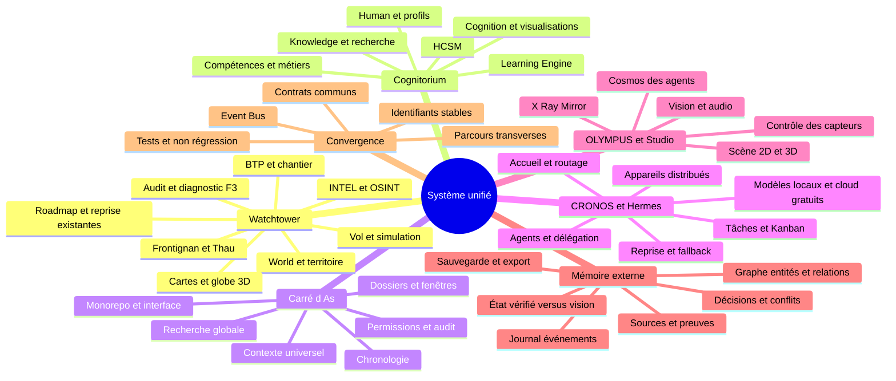
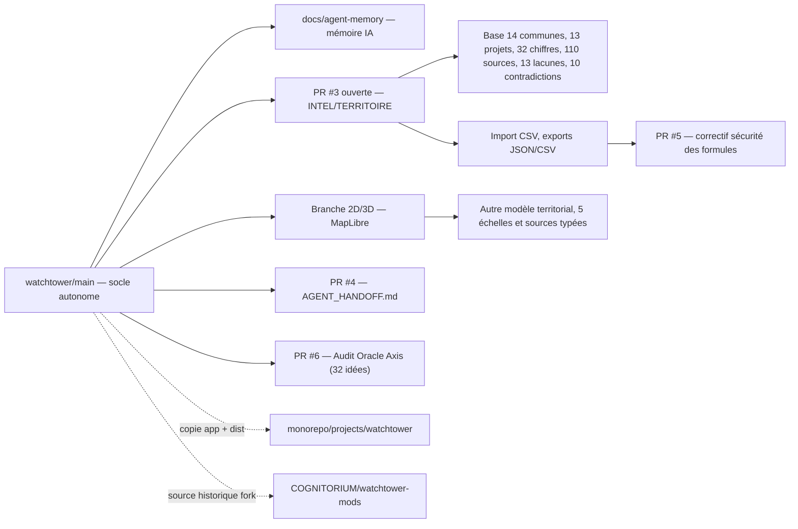
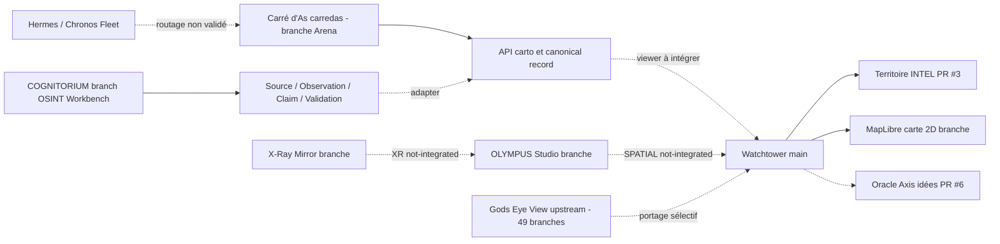
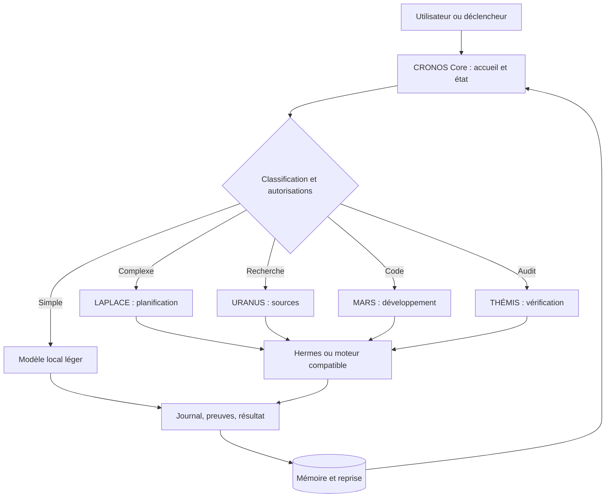
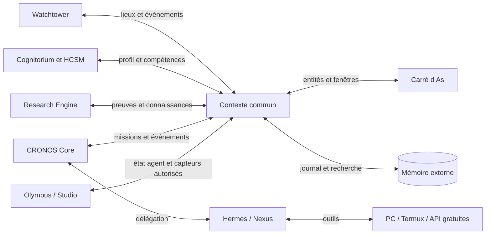

# WATCHTOWER × COGNITORIUM × CARRÉ D'AS

> [!abstract] Mission de cette note
> **Carte mentale centrale, lisible par un humain ET exploitable comme mémoire externe par un agent IA.** Elle réunit les concepts, dépôts, modules, agents, données, outils, interfaces, flux, contraintes, décisions, incertitudes et travaux restants, sans présenter les souhaits comme des fonctionnalités actives.
>
> **Date de photographie : 22/11/2026.** Les états opérationnels sont historiques sauf mention d'un contrôle daté. Ne pas utiliser cette note comme preuve qu'un service fonctionne actuellement.

## 0. Mode d'emploi — pour Obsidian et les agents

- **Dans Obsidian :** ouvrir la note en mode Lecture pour voir la carte Mermaid, et en mode Plan pour parcourir les titres ; rechercher les IDs `WT-`, `CG-`, `CA-`, `AG-`, `MEM-`.
- **Pour un agent IA :** lire en priorité les sections **1, 2, 3, 12, 15, 16, 17 et 18** ; puis uniquement les branches nécessaires à la mission. La carte n'est pas un substitut aux fichiers du dépôt, tests, logs et états courants.
- **Pour contribuer :** ne jamais réécrire une assertion sans conserver sa provenance. Ajouter la date de contrôle, la branche, le commit et la preuve ; inscrire les contradictions dans la section 17.
- **Convention des états :** `[CODE-LU]` fichier consulté ; `[DOC]` annoncé/documenté ; `[TEST-HIST]` test rapporté à une date passée ; `[ACTIF-HIST]` service actif lors d'un constat passé ; `[CIBLE]` vision ; `[À VÉRIFIER]` information incertaine ; `[BLOQUÉ]` problème identifié.
- **Attention :** état d'une **capacité**, état d'un **modèle/outil**, état d'un **processus** et état d'une **mission** sont quatre objets distincts.

## 1. Carte mentale visuelle — vue générale



> [!tip] Lecture hiérarchique
> Les sections ci-dessous constituent la **mindmap éditable en Markdown**. Les diagrammes Mermaid sont des vues synthétiques ; les titres, tables et identifiants sont la source structurée que les agents doivent pouvoir citer.

## 2. Noyau conceptuel — frontières et identité

### 2.1 Les quatre grands ensembles

- **`WT-000` WATCHTOWER** — yeux sur le monde réel : cartographie, géographie, signaux, lieux, bâtiments, acteurs, dossiers, événements, territoire, BTP, simulations spatiales. Un module métier connecté, **pas** le moteur d'agents.
- **`CG-000` COGNITORIUM / COGNITARIUM** — humain, compétences, connaissances, apprentissage, parcours, représentations cognitives. Le nom « Cognitarium » apparaît aussi dans la vision produit ; **frontière de nommage à arbitrer**, sans supprimer les projets existants.
- **`CA-000` CARRÉ D'AS / MONOREPO** — centre de contexte, interface fédératrice, navigation et vues transversales. C'est l'espace dans lequel Watchtower, Cognitorium, Olympus et les autres domaines deviennent accessibles, **pas** une fusion automatique de leurs bases et moteurs.
- **`AG-000` CRONOS / HERMES / NEXUS** — compréhension des demandes, orientation, délégation, exécution, chronologie, tâches, mémoire opérationnelle et supervision ; orchestrateurs à connecter **sans concurrence cachée**.

### 2.2 Une grammaire commune

`Objectif humain → Contexte → Entités → Données → Sources/Preuves → Agents/Outils → Hypothèses/Simulation → Décision humaine → Action autorisée → Observation → Mémoire/Révision`

- **Fondations métier constitutionnelles :** `HUMAN`, `KNOWLEDGE`, `WORLD`, `WORLD GRAPH`.
- **Couches transversales :** `AGENTS/TOOLS`, `TASKS/WORKFLOWS`, `MEMORY/EVIDENCE`, `TIME`, `PERMISSIONS`, `UI`.
- **Règle cardinal :** *les différents modules montrent le même objet via un même identifiant canonique ; aucune duplication d'identité lors d'un changement de vue*.

### 2.3 Règles non négociables

- **Local-first et gratuit par défaut** ; aucun abonnement, quota payant ni clé obligatoire pour le fonctionnement minimal.
- Cloud gratuit *optionnel*, quotas explicités ; fallback local fonctionnel en cas d'indisponibilité réseau/fournisseur.
- Réutiliser/adapter le code existant avant de reconstruire ; conserver les originaux et permettre le retour arrière.
- Différencier `fait`, `déclaration`, `observation`, `inférence`, `hypothèse`, `simulation`, `fiction`, `code trouvé`, `test exécuté`.
- La qualité scientifique prime : aucune déduction clinique ou psychométrique individuelle sans mesure valide, consentement et incertitude explicite.
- Journaliser les actions réelles, leurs preuves et leur coût ; ne pas inventer un appel outil, un résultat, des coordonnées ou un succès.
- Refuser les secrets dans Git, les logs publics, l'interface client ou cette note. Données privées : stockage local contrôlé.

## 3. Les douze domaines du système — taxonomie stable

| ID | Domaine | Rôle principal | Fournisseurs / provenance | État prudent |
|---|---|---|---|---|
| `command` | Command Center | Accueil, objectifs, alertes, calendrier, missions | Monorepo, CRONOS | `[CIBLE]` intégration |
| `world` | World / Territory | Globe, cartes, lieux, cadastre, bâti, réseaux | Watchtower, Atlas Frontignan | `[CODE-LU]` documentation |
| `intel` | Intel / OSINT | Acteurs, dossiers, veille, sources, risques | Watchtower, Research Engine | `[DOC]` + lot historique |
| `projects` | Projects / BTP | Marchés, chantiers, coûts, planning, phasage 4D | Watchtower, Monorepo | mix `[DOC]/[CIBLE]` |
| `human` | Human / Cognition | Profil, compétences, métier, parcours, preuves | Proto-Cognitorium, HCSM | `[CODE-LU]`, modèle HCSM proposé |
| `knowledge` | Knowledge / Research | Ontologies, littérature, claims, EvidenceGraph | État de l'art, Research Engine | `[DOC]` |
| `learning` | Learning Engine | Exercices, feedback, progression, transfert | COGNITORIUM/learning | `[CODE-LU]` PoC v0.1 |
| `simulation` | Simulation / Lab | Expériences, scénarios, hypothèses, comparaisons | Watchtower, HCSM, Research Engine | mix |
| `creation` | Design / CAD / Fabrication | Objet, modèle 2D/3D, slicer, impression | Adaptateurs futurs | `[CIBLE]` |
| `agents` | Nexus / Agents | Rôles, modèles, outils, délégation, workflows | Hermes, CRONOS, Nexus, Cosmos | code + historique, intégration ouverte |
| `memory` | Data / Memory / Provenance | Document brut, graphe, versions, recherche, audit | HCSM, Cosmos, Research Engine | multi-sources, contrats à réunir |
| `system` | System / Settings | Nœuds, sécurité, permissions, coûts, santé | Hermes, Termux, monorepo | mix historique/cible |

## 4. WATCHTOWER — `WT-*` : le monde et le territoire

### 4.1 `WT-100` Monde, cartes et navigation spatiale

- Globe 3D / Cesium et cartes 2D ; fonds satellite et routier ; couches activables.
- Modes d'exploration : **vue communale, quartier, immersion, orbite, heatzones, bâti 3D** ; fiches lieux et épingles, minicarte canvas.
- Alternatives sans clé documentées : satellite Esri, CARTO/OSM, recherche Photon/Nominatim ; fournisseur payant optionnel.
- Bâtiments 3D simplifiés/instanciés : hauteur OSM si disponible, sinon estimations **étiquetées**, jamais présentées comme relevés exacts ; cache et chargement par lots.
- Cadastre/parcelles, contours de communes, géométrie, couches de réseaux/infrastructures, orthophotos, OSM, Wikidata, données ouvertes.
- Référentiel géospatial par couche (`CRS`, précision, date, licence, provenance) ; aucune coordonnée inventée.
- **État :** `[CODE-LU]` README Watchtower `main` du 22/11/2026 ; plusieurs fonctions décrites, **pas de test navigateur réalisé dans cette passe**.

### 4.2 `WT-200` INTEL / OSINT / dossiers

- Sources multi-format : événements, news, bases publiques, documents, images autorisées, flux publics, informations économiques, risques naturels/industriels.
- Dossiers : **acteur, organisme, lieu, événement, entreprise, infrastructure, projet**.
- Contrats épistémiques : chronologie, provenance, versions concurrentes, contradictions, données absentes, faits vs propositions.
- Lenses **DOSSIER** et **TERRAIN**, panneau **TERRITOIRE** dans INTEL, import CSV/POI sécurisé.
- **État historique déclaré :** lot Watchtower I du 13/11 marqué terminé, **124/124 POI importés** dans le rapport Hermes ; `[TEST-HIST]` non équivalent à vérification du build actuel.
- Risques : désinformation, accusation injustifiée, collecte non autorisée. Présenter la source et l'incertitude à chaque conclusion.

### 4.3 `WT-300` Frontignan / bassin de Thau / intelligence territoriale

- T0 / T1 : état du territoire, démographie, vieillissement et parentalité, mortalité agrégée, mobilité, services, commerces, emplois, économie et entreprises.
- Immobilier : ventes, locations, vacance, DVF, prix/volumes, évolution de quartier ; ne jamais extrapoler d'une rue vers toute la ville sans données.
- Projets : PLU, permis, chantiers actifs/prévus, marchés BOAMP, investissements, risques Géorisques, réseaux, travaux publics.
- Ressenti habitants : observations de terrain et enquêtes volontaires, avis datés/échantillonnage, biais de sélection ; distinguer ressenti et statistique.
- Analyse stratégique : besoins locaux émergents, services et activités, opportunités professionnelles/entrepreneuriales, scénarios 2026–2040.
- Boucle attendue : `collecter → dater → vérifier → cartographier → confronter terrain → comparer T0/T1 → proposer hypothèses → évaluer → décider`.

### 4.4 `WT-400` BTP / Chantier / Jumeau numérique

- Marchés/BOAMP ; DICT ; plans ; sécurité ; implantations ; métrés ; terrassements ; VRD ; réseaux secs et enterrés ; ouvrage et parcelle.
- Planning Gantt, ressources, équipes, équipements, budgets, stocks, photos et journal de chantier, autorisations.
- BIM / IFC / SIG, modèle 3D et phasage **4D** (temps) ; comparaison prévu/réalisé ; suivi et timelapse avec consentement.
- Génération d'un dossier projet vérifiable : sources, délais, contraintes, documents, calculs, décisions, preuves.
- **État :** mélange `[DOC]/[CIBLE]` : ne pas considérer l'intégration BIM/4D comme disponible sans test.

### 4.5 `WT-500` Simulation, pilotage et médias

- Simulation de vol 3D : hangar multi-engins (12 modèles annoncés dans README), cockpit, instrumentation, caméras et filtres visuels.
- Signaux géospatiaux publics selon fournisseurs : avions, satellites, séismes, départs de feux, lancements, câbles, radios, caméras publiques.
- Navires AIS et trafic : flux conditionnés à l'accès réel et aux limites fournisseur ; dégradation propre si indisponibles.
- Données historiques / simulation / temps réel **étiquetés différemment** ; pas d'accès drone réel inféré d'un simulateur.
- Connexions envisagées : photos de lieux → reconstruction photogrammétrique (COLMAP/Nerfstudio) ; objets 3D ; couches volumétriques plus fines.

### 4.6 `WT-600` Suivi historique déjà présent dans GitHub (contrôlé le 22/11/2026)

> [!warning] Sources de suivi, pas healthchecks
> Le dépôt `Sathancabrol/watchtower`, branche `main`, contient déjà des documents de suivi. Leur contenu atteste un historique documentaire, **pas** l'état actuel du PC, des branches de développement ou de tous les modules. Le dernier commit consulté sur `main` précède les activités Hermes de novembre.

| Référence | Fonction officielle | Ce qu'un agent doit en faire |
|---|---|---|
| [`ROADMAP.md`](../../ROADMAP.md) | Feuille de route **vivante** des itérations 1–21, états `fait/en cours/prévu`, sources | Lire avant de proposer un nouveau lot ; ne pas effacer les itérations |
| [`docs/REPRISE.md`](../REPRISE.md) | **Sauvegarde de session** : modules, tests rapportés, tâches ouvertes, règles utilisateur, commandes de reprise | Conserver comme **instantané historique** (branche `arena/01a06ebe-watchtower`, ancien HEAD `55e553b`), puis vérifier le HEAD réel |
| [`docs/AUDIT.md`](../AUDIT.md) | Relecture des itérations 1–20 et des modules/dettes | Source historique pour éviter les doublons |
| [`docs/DIAGNOSTIC.md`](../DIAGNOSTIC.md) | Diagnostic F3, régressions UI, procédures de reproduction | Consulter avant correction d'une disparition d'interface |
| [`docs/KNOWN-ISSUES.md`](../KNOWN-ISSUES.md) | Incidents de runtime du socle historique | Ne pas confondre avec la backlog Cognitorium |
| [`docs/CURRENT-STATE.md`](../CURRENT-STATE.md) | Très longue documentation du socle God's Eye View datée août 2026 | **Source distincte, plus ancienne** que le suivi des itérations Watchtower |
| [`01-HUB-SUIVI-AGENTS.md`](01-HUB-SUIVI-AGENTS.md) | Point d'entrée des futurs agents, priorités de lecture et conditions de mise à jour | Démarrer ici et résoudre les chemins vers leurs sources canoniques |

**Synthèse strictement documentaire des itérations :**

- **Documenté comme réalisé :** 27 calques en cinq familles, lanceur et HUD récupérables, diagnostic **F3**, palais mental et dossier d'investigation à six étapes, HQ procédurale, médaillons, minicarte, vol, chronologie/cartographie ; le statut des fonctions reste **à tester au runtime**.
- **Documenté comme partiel / prévu :** INTEL dispose de six vues mais doit devenir un hub d'investigation expert ; « Bloomberg de la ville », analyse territoriale approfondie, bascule **2D ↔ 3D MapLibre**.
- **À diagnostiquer :** fenêtre WATCHTOWER / vue HQ signalées absentes mais non reproduites dans les tests historiques ; ne pas les classer « corrigées » sans reproduire.
- **Tests historiques cités par `REPRISE.md` :** 3 144, dont deux échecs déclarés préexistants. **Aucun test relancé lors de cette publication documentaire.**
- **Lot Watchtower I, notification Hermes du 13/11/2026 :** panneaux/lentilles DOSSIER–TERRAIN et import CSV POI `124/124` annoncés terminés. **État distinct** des fichiers `main` étudiés ici : vérifier les fichiers, commits, branches, tests et copie disque externe avant d'inscrire « fusionné ».
- **Ambiguïté du mot « SUIVI » :** dans `REPRISE.md`, « SUIVI → TRACKING » désigne un renommage d'interface, **pas** le fichier Markdown de suivi de développement.

**Ordre de reprise Watchtower :** `ROADMAP → REPRISE → AUDIT → DIAGNOSTIC/KNOWN-ISSUES → SHA + tests du code réel → mindmap transversale → mise à jour contrôlée des statuts`.

### 4.7 `WT-700` Les **versions de code** : cartographie vérifiée au 22/11/2026

> [!warning] Les branches sont des états de code alternatifs, pas des modules actifs en même temps.
> Ne pas additionner naïvement les fonctionnalités ni les compteurs de tests de deux branches. Voir l'[inventaire de tous les fichiers](02-INVENTAIRE-GITHUB-COMPLET.md) et les [capacités avec provenance](03-CAPACITES-ARCHITECTURE-DIVERGENCES.md).



**Points de vérité actuellement établis par GitHub :**

- `main` : **585 fichiers à l'instantané de départ** (la mémoire ajoutée ensuite est une modification documentaire) ; socle Cesium/Vite.
- `arena/01a072e1-watchtower` : **650 fichiers**, soit **86 nouveaux chemins** face au `main` initial ; code `carte2dControleur`, `data/carte2d`, `data/territoire`, ergonomie et rapports d'audit.
- `arena/dec9cd88-watchtower` : **623 fichiers**, soit **40 nouveaux chemins** face au `main` initial ; base INTEL, Frontignan, Thau, CSV, enquêtes et sources officielles.
- `fix/territory-csv-formula-2026-10-18` : PR #5 porte une réparation dans `src/data/attributsTerritoire.js` et son test, non intégrée à `main`.
- `chore/agent-handoff-2026-10-11` : [passation préexistante](https://github.com/Sathancabrol/watchtower/blob/chore/agent-handoff-2026-10-11/AGENT_HANDOFF.md), ouverte en PR #4.
- `research/oracle-axis-integration-20261113` : un document d'étude de 32 capacités, **pas** une application Oracle Axis intégrée.
- `monorepo` : copie de Watchtower avec **416 livrables `dist/` supplémentaires**, qui ne sont pas des nouveaux modules ; source code partagé très largement identique par SHA.
- `COGNITORIUM/watchtower-mods` : ancien foyer du fork ; le document de septembre intitulé « dépôt vide » est **obsolète** après publication de Watchtower.

**Validation CI à date :** [run GitHub Actions du 22/11](https://github.com/Sathancabrol/watchtower/actions/runs/45033922316) = onboarding Windows **success** ; unit tests Node 24/26 **failure**, **3 144 tests, deux erreurs `ign-ortho`**. Ne pas prétendre « tous les tests au vert ». Lire le [protocole complet](04-VALIDATION-CI-REPRISE.md).

**Références à charger avant toute intervention** : [hub de suivi](01-HUB-SUIVI-AGENTS.md) → [inventaire](02-INVENTAIRE-GITHUB-COMPLET.md) → [matrice de capacités](03-CAPACITES-ARCHITECTURE-DIVERGENCES.md) → [validation](04-VALIDATION-CI-REPRISE.md) → `ROADMAP.md` et `docs/REPRISE.md` → vrais fichiers/commits et tests.

### 4.8 `WT-800` Carte des risques de duplication et des contrats à unifier

| Risque | Indice découvert | Critère de convergence |
|---|---|---|
| Deux implémentations territoriales | `T/src/territoireScenes.js` vs `2D/src/data/territoire/dossierTerritorial.js` | Adaptateurs à IDs et preuves stables, tests de compatibilité |
| INTEL incomplet sur `main` | 6 vues historiques, DOSSIER/TERRAIN en branche T | Décider un propriétaire de données, brancher une UI réversible |
| 2D disponible seulement en branche | Contrôleur MapLibre et camera neutre en `2D` | Test réel GPU et aller-retour de caméra, pas de fusion brute |
| Copies de code | Monorepo, COGNITORIUM et Watchtower source | Copie construite et versionnée à partir du SHA canonique, sans code édité en parallèle |
| Agent Hermes vs Watchtower | `src/llm.js` local ; pas de pont CRONOS runtime prouvé dans `main` | Contrat de capacité, transport, reprise, autorisations et healthchecks |
| Vues scientifiques vs données de terrain | HCSM `PROPOSED`, informations tierces | Séparer cognition humaine, observation publique, source et inférence |
| Déploiement Windows et Android | Messages historiques et test CI Windows | Machine réelle, commande reproductible, logs, tests et statut de disponibilité |

### 4.9 `WT-900` Scan GitHub transversal — 84 branches du compte et 49 upstream

> [!important] Lire le [document maître d'audit v2](08-WATCHTOWER-AUDIT-MAITRE-2026-11-22.md) pour le détail complet et les annexes source. Les branches décrites ci-dessous sont **des variantes de code**, pas des services confirmés en exécution.



**Apports documentés et vérifiés dans GitHub ce 22/11 :**

- **9 dépôts** du compte, **84 branches** recensées, arbres et historiques de commits paginés ; **1 389 références de commits uniques** dans les annexes datées (hors upstream et ajouts documentaires récents), plus 49 pointes de branches du projet source [God's Eye View](https://github.com/bilawalsidhu/gods-eye-view).
- Le [module Carré d'As de Watchtower](https://github.com/Sathancabrol/monorepo/blob/arena/0034230e-monorepo/carredas/modules/watchtower/router.py) implémente des endpoints `/api/carto` et un registre de sources, **mais le viewer Cesium intégral reste à connecter**. Ne pas confondre `carredas/` avec `projects/carre-d-as/` (autre produit/branche).
- [OSINT Workbench](https://github.com/Sathancabrol/COGNITORIUM/tree/watchtower/osint-workbench-v0.1/watchtower-mods/src/osint) dispose d'un modèle de cas, de `FACT/INFERENCE/HYPOTHESIS/UNKNOWN`, d'un registre de sources et d'une **démo** ; les données d'observation de la démo sont **fictives et non collectées**, ne jamais les promouvoir comme preuves.
- [OLYMPUS Studio](https://github.com/Sathancabrol/monorepo/blob/feat/olympus-studio-20261112/projects/olympus-studio/src/integration-registry.js) marque `SPATIAL/Watchtower`, `XR` et `AUTOMATE/Hermes` comme **non intégrés**. Les interfaces et protocoles sont des engagements de contrat, non une preuve d'interopérabilité.
- [Chronos Fleet](https://github.com/Sathancabrol/monorepo/blob/feat/chronos-fleet-free-fallback-20261113/scripts/chronos-fleet/README.md) est un routeur local séparé sur :18888, différent de CRONOS Core :8789 ; ses nœuds supplémentaires n'étaient pas connectés dans la livraison GitHub.
- [Matrice T ↔ 2D](11-MATRICE-CONVERGENCE-TERRITOIRE-2D.md) : **9 chemins divergents** de code/docs entre les deux branches riches, dont **7 chemins code/config/tests** ; la fusion demande contrats et tests.
- [Upstream](10-UPSTREAM-GODS-EYE-VIEW-COMPARAISON.md) : 5 086 fichiers sur la branche source, 49 branches comparées, mais les milliers de changements ne doivent pas être recopiés sans priorisation.
- **CI réelle** (run 22/11) : 3 144 tests dont 2 rouges `ign-ortho`, onboarding Windows passé ; aucun test sur le disque externe ni sur les téléphones pendant ce scan.

**Annexes Obsidian :** [inventaire complet](02-INVENTAIRE-GITHUB-COMPLET.md), [capacités](03-CAPACITES-ARCHITECTURE-DIVERGENCES.md), [CI](04-VALIDATION-CI-REPRISE.md), [84 branches et historiques](08-WATCHTOWER-AUDIT-MAITRE-2026-11-22.md#10-index-de-toutes-les-annexes-produites--obsidian), [49 branches upstream](10B-UPSTREAM-BRANCHES-01-10.md), [risques de convergence](11-MATRICE-CONVERGENCE-TERRITOIRE-2D.md).

## 5. COGNITORIUM / COGNITARIUM — `CG-*` : humains, savoirs et apprentissage

### 5.1 `CG-100` Identité, profil et trajectoire

- Modes utilisateurs : **enfant, adulte, parent**, avec parcours **étudiant, scientifique, entrepreneur** ; entrée novice guidée.
- Profil : histoire et expériences, CV/pièces, projets, centres d'intérêt, connaissances, capacités, compétences, besoins, objectifs, contexte et préférences.
- Compétences : référentiel **ROME**, hard/soft skills, preuves associées, compétences transférables, lacunes, métier ↔ territoire ↔ formation ↔ projet.
- Gestion temporelle : déclarations à T0, acquisitions, oubli/réactivation, validation humaine, comparaison T0/T1 et parcours.
- Traces : `source → expérience/projet → preuve → compétence → possibilité métier/formation`.
- Interface : consultation, comparaison, graphiques, formulaires, export public **sur liste blanche** (jamais dossier privé complet).
- **État :** le dépôt `proto-cognitorium` est connu ; alpha Windows historiquement testée (18/10 puis build `0.2.0-alpha.2` relaté le 03/11), installation actuelle **non vérifiée**.

### 5.2 `CG-200` HCSM — modèle scientifique de l'état cognitif

- **HCSM (Human Cognitive State Model)** est un **modèle proposé, pas un diagnostic** ; README global `PROPOSED v0.1.1`.
- Trois graphes distincts : **Knowledge Graph** (science), **Evidence Graph** (observations/personne), **Inference Graph** (estimations conditionnelles).
- Construits : attention, mémoire, fonctions exécutives, cognition sociale, performance, variables contextuelles et temporelles ; définitions/mesures/validité.
- Référentiels à connecter : RDoC, ICF/CIF, Cognitive Atlas, HPO, psychométrie ; ne pas prétendre que tous les alignements sont déjà opérationnels.
- Modèle inférentiel : `ontologie + mesures + contexte + histoire + preuves + incertitudes → estimation T0`, **jamais** `discussion IA → score cognitif certain`.
- Mesures possibles **avec consentement** : tâches cognitives, questionnaires, mesures temporelles, capteurs locaux/EEG si dispositif et protocole adaptés.
- Considérer biais, alternatives, erreur de mesure, validité externe et droit à la rectification.

### 5.3 `CG-300` Learning Engine / CLE

- **PoC v0.1 documenté** dans `COGNITORIUM/learning/` : moteur de scénario → défi → feedback → mise à jour du graphe de concepts → boucle adaptative → transfert.
- Parcours exemple : comprendre l'argent, du troc à la monnaie, crédit, inflation et investissement.
- Réutilisation envisagée pour apprentissage actif, orientation, compétences, science, outils techniques, pédagogie et gamification optionnelle.
- Journalisation locale des événements de séance ; séparer progression observée et compétence validée.

### 5.4 `CG-400` Cognition multimodale et visualisations

- Représentations prévues : radial, constellation, heatmap, timeline/badges, comparatifs, focus, moteur expert ; zoom macro/micro.
- Intégration **X-Ray Mirror Studio / Vision Lab / Audio Lab** : corps, visage, mains, mouvements, objets, transcription, microphones, vidéo locale.
- Fusion envisagée avec datasets BCI/EEG/imagerie : correspondances cognitives **exploratoires**, provenance scientifique, contrôle des confusions et validation expérimentale ; aucune lecture des pensées affirmée.
- Dessins anatomiques 3D (main/crâne/cerveau/corps), interactions AR, objets du bureau, reconnaissance gestuelle, squelettes ; **à valider bloc par bloc**.
- État historique X-Ray : 0.3 Vision Lab (visage/corps/objets) ; 0.4.x Audio Lab / VoiceStudio local ; 34 tests automatisés rapportés OK ; **intégration Cognitorium/Watchtower non acquise**.

### 5.5 `CG-500` Knowledge / recherche / méthode

- Bibliothèque de connaissances : concepts, taxonomies, études, sources, protocoles, biais cognitifs et limites des résultats.
- **Research Engine** : question → collecte → source → claim → evidence → contradiction → évaluation suffisance → synthèse sourcée → révision.
- **État de l'art psychologie / Cosmos** : corpus scientifique, expériences, outils de visualisation, agents/ontologies.
- Scholar Inbox et recherches scientifiques : veille, classement et annotation ; export/ingestion avec traçabilité et autorisations.
- Ne pas confondre un article recensé, une hypothèse plausible et un résultat scientifique répliqué.

## 6. CARRÉ D'AS / MONOREPO — `CA-*` : l'OS de contexte

### 6.1 `CA-100` Interface fédératrice

- **Hôte documentaire et visuel** : `Sathancabrol/monorepo` agrège `projects/`, prévisualisations, navigation, inventaire Git et graphe de fusion.
- `FastAPI + Jinja`, `/monorepo`, `/repos`, `/preview/{project}/{path}`, `MANIFEST.json`, snapshot GitHub selon README `main`.
- Interface **centrale** : monde/projet/personne/mission actif ; **gauche** navigation & outils, **droite** agents & données, **haut** état/alertes/coûts, **bas** timeline & couches.
- Onglets/fenêtres : chat, brain, human, search, graph, watchtower, doc, camera, timeline, console, files, simulation, comparateur, permissions.
- Layouts adaptatifs, focus, déplacer/dock, sauvegarder, restaurer ; tutoriel facultatif, vue novice et vue experte.
- **État :** intégration `projects/` et préviews **documentée dans README** ; cockpit unifié temps réel = `[CIBLE]` ou branches historiques à auditer.

### 6.2 `CA-200` Contexte universel

- Identifiants canoniques **`entity_id`** et `run_id` partagés entre cartes, profils, missions, fichiers et visualisations.
- Sélection unique : même entité dans `Carte ↔ Graphe ↔ Dossier ↔ Chronologie ↔ Cognitorium ↔ Olympus ↔ Pipeline`.
- Dossiers d'enquête/projet ; recherche globale ; filtres temporels, géographiques, ontologiques et par source.
- Agrégateur / adaptateurs par module ; ne pas écraser modèles/ontologies des dépôts ; déduplication réversible.
- **Besoin critique non garanti :** Context Engine, bus d'événements, graphe commun, permissions harmonisées, contrats intermodules.

### 6.3 `CA-300` Olympus, incarnation et multi-fenêtres

- Interface Olympus « jeu » 2D Canvas avec lieux et agents figurés ; vue 3D riche facultative et représentation cosmique/constellation.
- Zoom sémantique : `Cosmos/Chronos → Laplace → Olympus → Terre/Watchtower → Dossier/Objet → Preuve/Action`.
- Graphe d'exécution **inspiré de n8n** ; distinguer dessin de workflow, traces réelles d'exécution et moteur n8n effectivement connecté.
- Les mouvements des avatars et dialogues narratifs sont une **projection d'événements sourcés**, non une preuve autonome qu'une action a été faite.

### 6.4 `CA-400` Programmes transversaux

- Module TERRITOIRE/Watchtower, module HUMAIN/Cognitorium, laboratoire, documentation, projets, mémoire, agents, interfaces outils.
- Export dossier Markdown/PDF/CSV/JSON, rapport sourcé, plan de projet, livrables, cartes et timeline ; statut d'export à tester par moteur.
- Multi-appareils et mobile : responsive/companion sans supposer que le moteur tourne partout.

## 7. CRONOS · HERMES · NEXUS — `AG-*` : orchestration, outils, autonomie

### 7.1 `AG-100` Chaîne d'exécution cible



- CRONOS : service minimal **sans modèle obligatoire** pour recevoir une requête, donner état/accusé, classifier, router, reprendre et exposer les erreurs.
- Hermes : moteur d'actions/outil/agents, Gateway, tâches planifiées, Kanban, délégation, mémoire selon configuration.
- Nexus OS : **code déjà repéré** sous `monorepo/nexus_os/` dans la branche `arena/01a08385-monorepo` ; rôle, runtime et tests à confronter à Hermes **avant réécriture**.
- CRONOS, Hermes et Nexus ne sont **pas** trois copies obligatoires de la même boucle : choisir un responsable pour chaque étape après audit.
- L'inférence par un modèle peut échouer ; le cœur de supervision doit continuer à répondre avec un état explicite.

### 7.2 `AG-200` Cosmogonie et rôles

| Entité | Mission logique | Ne pas confondre avec |
|---|---|---|
| `CRONOS` (ou Chronos selon projet) | temps, réception, continuité, coordination | un modèle particulier |
| `LAPLACE` | analyse profonde, planification, scénarios et perspective spatio-temporelle | fournisseur GPT permanent |
| `SOL` | incarnation / représentation locale ; rôle de gouvernance dans certains documents historiques | exécuteur physique garanti |
| `THÉMIS` | contrôle, critères, permissions, audit | preuve que tout a été validé |
| `MARS` | code, exécution technique, forge | processus de code actif |
| `URANUS` | recherche, veille, sources scientifiques | navigation internet toujours disponible |
| `SATHYR` | critique, contrepoint/interjections, relecture | décision autonome sans mandat |
| `MERCURE` | messages et communications | canal de messagerie connecté |
| `MÉTATRON` | mémoire, consignation, documentation | stockage persistant vérifié |
| `ANANKÉ / MOIRES` | contraintes, causalité/temps et narration | orchestration factuelle vérifiée |
| `EUNOMIE / ÉIRÈNE / DIKÈ / CENSEUR` | lois, harmonie, justice et modération dans le lore | implémentation homogène |
| `HADÈS / PLUTON / CHARON / STYX / CERBÈRE` | archivage, seuils, fin de vie et règles de rétention | autorisation de supprimer |
| `VÉNUS / TERRE / JUPITER / CÉRÈS / NEPTUNE / APOLLON / autres` | sous-domaines à conserver selon Cosmos source | agents nécessairement installés |
| `SEBAS` | personnage/entité du lore historique | agent dont les droits seraient prouvés |

**Gouvernance :** CRONOS a autorité de coordination sur les agents subordonnés selon la cosmogonie exprimée, mais reste soumis à l'autorité humaine et aux règles explicites ; ne pas attribuer l'autorité ultime à un agent. Le rôle fictionnel n'accorde aucune permission système.

### 7.3 `AG-300` Registre modèles et routage

- **Local Windows / Ollama :** qwen3:1.7b, qwen3:4b, variantes `*-hermes64k`, granite4:3b, lfm3:1.7b, qwen3.5:2b et dérivés locaux **selon inventaires historiques**.
- **Android / llama.cpp :** petits GGUF via Termux, endpoints à tester par appareil, charge et latence réelles.
- **Cloud gratuit opt-in :** OpenRouter free, Qwen Cloud, Gemini free tiers, autres **seulement si les conditions/quota/identifiants actuels sont validés**.
- **Règle :** taille du modèle et disponibilité n'impliquent pas aptitude aux actions. Benchmarker classification, JSON, appel outil, fidélité, latency, ressources, coût et erreurs.
- **Fallback :** `local rapide → autre local → cloud gratuit autorisé (si disponible) → local dégradé → erreur utile et mise en file`, sans boucle de retry infinie.
- **État historique local :** `127.0.0.1:8789` (CRONOS Core), `127.0.0.1:11434` (Ollama), Hermes Gateway et fallback local rapportés fonctionnels dans des échanges mi-novembre ; **aucun état live vérifié ici**.

### 7.4 `AG-400` Tâches, workflows, Kanban et reprise

- `Mission → plan → sous-tâches → outils → exécutions → vérification → résultat → mémoire`.
- Cron et tâches répétitives ; jobs de veille, recherche, audit, benchmarks, mise à jour et développement bornés.
- Exécutions : idempotency_key, traces, heartbeat, timeout, budget, retries limités, checkpoint, reprise après panne, intervention humaine.
- Ne pas recréer des tâches terminées au retour d'une notification Kanban ; consulter le board avant d'agir.
- Indicateurs : `queued`, `running`, `waiting`, `blocked`, `succeeded`, `failed`, `cancelled`, `degraded`, avec cause et preuve.

### 7.5 `AG-500` Skills / MCP / connecteurs

- Registre unifié : `capability`, version, outil, source, schéma d'entrée/sortie, droits, coût, latence, santé, preuve de test, état actif.
- Outils identifiés : Hermes tools/skills, MCP, Git, scripts, Ollama, VoiceStudio, web/recherche, n8n éventuel, Blender/ffmpeg/photogrammétrie si installés.
- **OpenAdapt MCP** : tentative passée avec timeout ; enregistré désactivé. Ne pas l'afficher comme connecté.
- **VoiceStudio** : serveur local historique et transcription via Sherpa-ONNX, à contrôler au moment de l'appel.
- Contrôle de l'agent sur l'ordinateur : permissions explicites, confirmation d'actions irréversibles et sauvegarde avant modification.

## 8. OLYMPUS STUDIO / X-RAY MIRROR — `OL-*` : perception, représentation

- `OL-100` Olympus Studio : environnement unifié visuel, vue de scène incarnée, fenêtres, caméra, rendu 2D/3D, suivi d'agents.
- `OL-200` Vision Lab : détection landmarks visage/corps/mains, objets et silhouettes, mouvement, gestes, calibration et FPS (valeurs historiques, non garanties).
- `OL-300` Audio Lab : capture locale, niveaux sonores, transcription en direct selon moteur connecté, export WAV, traitement 48→16 kHz.
- `OL-400` Caméras / téléphones : navigateur mobile via Tailscale, autorisations caméra/micro, flux WebRTC/HTTP selon implémentation, latence et sécurité à valider.
- `OL-500` 3D anatomique : crâne/cerveau/main/corps, textures et squelettes, interaction AR, objets de bureau ; `[CIBLE]` sauf composants prouvés.
- `OL-600` Expérimentation BCI : annotations EEG/BCI, correspondances cognitives, protocole, provenance et limites des inférences ; `[CIBLE]`.
- `OL-700` État historique : preview mobile Tailscale sur tour et deux téléphones rapportée ; certaines erreurs vidéo corrigées, envoi de média inter-téléphones non confirmé ; **pas de pont complet Olympus Studio ↔ Hermes prouvé**.

## 9. Données, graphes et recherche — `DATA-*`

### 9.1 Entités universelles

- `Human`: `User`, `Person`, `Profile`, `Skill`, `Experience`, `Measurement`, `CognitiveConstruct`, `LearningActivity`.
- `Knowledge`: `Concept`, `OntologyTerm`, `Source`, `Document`, `Paper`, `Claim`, `Evidence`, `Contradiction`, `Hypothesis`.
- `World`: `Place`, `Building`, `Parcel`, `Infrastructure`, `Organisation`, `Asset`, `Sensor`, `Signal`, `Territory`.
- `Action`: `Project`, `Task`, `Workflow`, `AgentRole`, `AgentInstance`, `Run`, `Step`, `Tool`, `Model`, `Device`, `Event`, `Decision`, `Action`, `Capability`.
- `Governance`: `Workspace`, `Permission`, `Consent`, `License`, `DataPolicy`, `AuditRecord`, `MemoryItem`, `Export`.

### 9.2 Relations typées (exemples)

- `Person --possède_preuve--> Evidence --soutient--> Skill --correspond_à--> Occupation`.
- `Source --documente--> Claim --contredit--> Claim` ; `Observation --soutient--> Hypothesis`.
- `Place --contient--> Building --est_exploité_par--> Organisation`.
- `Mission --produit--> Run --exécute--> Step --appelle--> Tool`.
- `Decision --autorise--> Action --affecte--> Entity --émet--> Event`.
- `Device --héberge--> Model/Service` ; `Capability --requiert--> Permission`.
- `Concept --est_prérequis_de--> Concept` ; `Exercise --évalue_avec_limites--> Skill`.

### 9.3 Dimensions temporelles obligatoires

- `occurred_at` (fait) ; `published_at` (source) ; `observed_at` (constat) ; `ingested_at` (système) ; `executed_at` (action) ; `valid_from/valid_until` (validité).
- Spatial : coordonnées + système de référence + exactitude, ou **null** si inconnu ; aucun géocodage fabriqué.
- Assertions contradictoires conservées avec lien `supersedes`/`disputes` ; aucune écriture destructive par défaut.

## 10. Mémoire externe multi-agent — `MEM-*`

### 10.1 Couches de mémoire

1. **`MEM-100` Source brute immuable** : README, code, sortie de test, conversation, fichier, URL, commit, date de consultation.
2. **`MEM-200` Assertions atomiques** : faits, idées, exigences, limitations, observations, hypothèses, contradictions, décisions, questions.
3. **`MEM-300` Graphes** : entités / relations / preuves / inférences, IDs stables, liens directionnels et datés.
4. **`MEM-400` Journal d'exécution** : missions, runs, tool calls, erreurs, artefacts, coûts, latences, permissions et checkpoints.
5. **`MEM-500` Mémoire opérationnelle** : ce qui marche *maintenant*, état des appareils/services/fournisseurs, tâches et blocages, avec TTL.
6. **`MEM-600` Mémoire sémantique** : enseignements validés, procédures, tutoriels, décisions durables ; recherche textuelle et index sémantique optionnel.
7. **`MEM-700` Mémoire privée** : profils, consentements, secrets et fichiers personnels stockés séparément, non exportés vers Git public.

### 10.2 Séquence d'un agent qui reprend le travail

`Lire la carte → identifier domaine propriétaire → retrouver source/branche → lire état actuel → contrôler disponibilité + permissions → planifier changement minimal → exécuter → tester → consigner preuve → mettre à jour état + décisions + carte`

- **Ne pas** résumer en écrasant les conversations brutes ; créer des assertions dérivées à côté avec leur citation.
- **Ne pas** traiter une extraction LLM comme un fait vérifié ; conserver niveau de confiance et possibilité de contradiction.
- Pour la recherche : d'abord lexicale/IDs/chemins, puis sémantique ; un embedding n'est pas une preuve.
- **Portée :** `public`, `projet`, `partagé`, `privé` ; sorties et permissions limitées à la portée requise.

### 10.3 Format recommandé d'une assertion

```yaml
id: "claim:watchtower:intel-territoire-20261113"
type: "implementation_claim"             # fact | observation | hypothesis | decision | etc.
subject_id: "module:watchtower:intel-territoire"
predicate: "reported_completed"
value: "Lot DOSSIER/TERRAIN et import CSV POI 124/124"
knowledge_status: "historical_report"     # distinct du statut runtime
runtime_status: "unverified_currently"
source_kind: "hermes_task_notification"
source_ref: "t_be159d74"
source_date: "2026-11-13"
observed_at: null
verified_at: null
confidence: null                          # ne pas inventer de chiffre
privacy: "project"
review_required: true
supersedes: []
notes: "Vérifier branche, build, tests et état PC avant de dire ACTIF"
```

### 10.4 Format recommandé d'un événement d'agent

```json
{
  "event_id": "uuidv7-or-equivalent",
  "trace_id": "trace-stable",
  "run_id": "run-stable",
  "parent_step_id": null,
  "actor_id": "agent:cronos",
  "device_id": "device:windows-main",
  "type": "tool.result",
  "status": "succeeded",
  "occurred_at": "2026-11-22T14:00:00Z",
  "source_ref": "logs/run-stable/step-01.jsonl",
  "evidence_refs": ["artifact:test-report"],
  "permissions": ["read:workspace"],
  "cost_eur": 0,
  "error": null,
  "result_ref": "artifact:output",
  "synthetic_example": true
}
```

> [!warning] Les valeurs de cet exemple JSON sont **fictives** et illustrent uniquement un contrat ; elles ne représentent aucune exécution réelle.

## 11. Matériel, réseau et déploiement — `SYS-*`

| Nœud / composant | Rôle envisagé | État connu |
|---|---|---|
| Tour Windows 10, i7-6700, 16 Go, GTX 1060 6 Go | hôte principal, Watchtower, Hermes, Ollama, CRONOS, builds, stockage | inventaire utilisateur historique |
| Portable Windows, i5-10300H, 8 Go, GTX 1650 4 Go | exécution auxiliaire, tests, relais | inventaire utilisateur historique |
| Redmi Note 13 5G, Android/Termux | nœud llama.cpp léger, capteur/companion | endpoint local passé, à revalider |
| Samsung Galaxy A17, Android/Termux | nœud llama.cpp léger, capteur/companion | endpoint local passé, à revalider |
| Tailscale + service proxy `8788` | accès privé réseau / studio | accès rapporté, santé actuelle inconnue |
| CRONOS Core `8789` | réception et routage | tests passés, santé actuelle inconnue |
| Ollama `11434` | modèles locaux | inventaire passé, santé actuelle inconnue |
| VoiceStudio `3900` | ASR local | service passé, santé actuelle inconnue |
| Hermes Gateway | tâches, conversation, délégation | service passé, santé actuelle inconnue |

- **Ne pas confondre** quatre appareils connectés et un seul GPU virtuel : l'exécution distribuée demande un protocole explicite et une gestion des tâches par nœud.
- États standard de capacité : `detected → configured → authenticated → reachable → tested → enabled → busy/degraded/offline`.
- La disponibilité **24/7** est un **objectif**, non un constat ; tests de redémarrage, coupure réseau, crash modèle, récupération et attente du retour utilisateur requis.
- Surveillance des ressources : RAM, VRAM, disque, réseaux, veille Windows, température, crash/restart, charge et consommation.

## 12. Contrats entre modules — avant la fusion fonctionnelle

| Contrat proposé | Champs incontournables | Consommateurs |
|---|---|---|
| `module.manifest@1` | `module_id, version, owner, source_ref, dependencies, interfaces, capabilities, license, state` | Carré d'As |
| `entity@1` | `id, type, namespace, label, source_refs, dates, privacy, status, confidence` | tous modules |
| `relation@1` | `from_id, predicate, to_id, dates, evidence_refs, confidence` | graphe commun |
| `event@1` | `event_id, trace_id, run_id, actor_id, timestamp, type, status, evidence_ref` | CRONOS, Olympus, Watchtower |
| `capability@1` | `tool_id, version, preconditions, healthcheck, permissions, test_result, cost, status` | routeur CRONOS |
| `workflow@1` | `definition_id, steps, graph, retries, human_approval, run_refs` | Hermes/Nexus/Studio |
| `memory@1` | `raw_ref, extracted_claims, validation, sources, privacy, revision` | agents et recherche |
| `window-layout@1` | `window_id, type, anchor_entity_id, geometry, permissions, layout` | Carré d'As |
| `space-time@1` | `crs, geometry, accuracy, observed_at, valid_at, uncertainty` | Watchtower/BTP |

**Contrats en vigueur à conserver jusqu'à audit :** `watchtower.intel@1.0.0` et modèles propres à Cognitorium/HCSM. Les contrats `@1` de ce tableau sont **proposés**, pas des API garanties déployées.

## 13. Chaîne d'interopérabilité — qui parle à qui ?



- **`Watchtower → Cognitorium` :** lieu / bassin d'emploi ↔ métier ↔ opportunités ↔ parcours/compétences.
- **`Watchtower → HCSM` :** contexte environnemental daté si pertinent et consenti, sans conclure une causalité psychologique automatique.
- **`Research Engine → tous` :** assertions sourcées, contradiction, incertitude et littérature.
- **`Hermes → Watchtower/Cognitorium` :** tâches reproductibles, analyses, imports/exports, tests et mises à jour via outils autorisés.
- **`Carré d'As ↔ OLYMPUS` :** représentations synchronisées d'un agent, d'une mission ou d'un lieu, sans dupliquer leur état.
- **`X-Ray Studio → Cognitorium` :** observations multimodales consenties et contextualisées, jamais diagnostic implicite.
- **`CRONOS → Mémoire` :** missions, état, décisions, accès au bon contexte et reprise fiable.

**État :** ce graphe représente l'architecture **cible** ; les doubles flèches ne garantissent **pas** l'existence de connecteurs en production.

## 14. Parcours complets à viser — critères d'utilité

### 14.1 Territoire / décision publique

`Question Frontignan → Watchtower (lieux/couches) → dossier INTEL → Research Engine (sources/contradictions) → scénarios → présentation Olympus/Carré d'As → décision → rapport daté → suivi T0/T1`.

### 14.2 Orientation / apprentissage

`Profil volontaire → compétences sourcées → ROME et besoins territoriaux → lacunes → Learning Engine → progression observée → choix humain → action/formation → suivi`.

### 14.3 Recherche scientifique

`Question → corpus → triage → méthodes → claims/evidence → contre-exemples → rapport avec limites → mise à jour mémoire`.

### 14.4 Chantier / fabrication

`Objectif → lieu/parcelle → contraintes et plans → étude de risques → modèle 3D/4D → planning/budget → simulation → validation → action autorisée → retour terrain`.

### 14.5 Développement autonome supervisé

`Demande utilisateur → CRONOS → plan Laplace → Mars/Codex/Hermes → tests Thémis → artefacts → preuve/log → checkpoint → validation → fusion réversible`.

### 14.6 Observations multimodales

`Consentement → capture locale → pipeline X-Ray/VoiceStudio → métadonnées/qualité → analyse non diagnostique → visualisation → suppression/export selon politique de rétention`.

## 15. Registre d'implémentation — preuves connues

| ID | Élément | Évidence et date | État à inscrire aujourd'hui |
|---|---|---|---|
| `IMP-01` | `watchtower` cartes/territoire/3D/vol | README `main` lu 22/11 | `[CODE-LU/DOC]`, runtime à retester |
| `IMP-02` | INTEL DOSSIER/TERRAIN et POI | notification Hermes 13/11, 124/124 | `[TEST-HIST]`, delta à vérifier |
| `IMP-03` | `monorepo` FastAPI et preview | README `main` lu 22/11 | `[CODE-LU/DOC]`, pas de recette live |
| `IMP-04` | interface finale 12 domaines | branche `feat/final-interface-skeleton-2026-10-07`, Atlas du 11/11 | `[CODE-LU-HIST]` |
| `IMP-05` | `nexus_os/` (22 agents/147 tests annoncés) | branche `arena/01a08385-monorepo`, Atlas du 11/11 | `[CODE-LU-HIST]`, tests non rejoués |
| `IMP-06` | Cognitorium Learning Engine | README `main` 22/11, PoC v0.1 | `[CODE-LU/DOC]` |
| `IMP-07` | proto-Cognitorium Windows | tests rapportés oct-nov 2026 | `[TEST-HIST]` |
| `IMP-08` | HCSM | README `main` 22/11, global `PROPOSED` | `[CODE-LU]` modèle proposé |
| `IMP-09` | Olympus/Cosmos historique | branche `arena/01a04f7b-etat-de-lart-psychologie`, Atlas | `[CODE-LU-HIST]` |
| `IMP-10` | CRONOS Core + Hermes + Ollama | tests fournis mi-novembre | `[ACTIF-HIST]`, sans live check |
| `IMP-11` | X-Ray Studio / VoiceStudio | tests historiques novembre, audio/vision | `[TEST-HIST]` |
| `IMP-12` | UI unifiée + graphe de contexte + mémoire universelle | architecture consolidée Atlas v0.2 | `[CIBLE]`, intégration non validée |
| `IMP-13` | Photogrammétrie, BIM/4D, CAD, BCI | éléments envisagés / outils recensés | `[CIBLE]` |
| `IMP-14` | Réseau multi-nœuds 24/7 et fallbacks | tests ponctuels Tailscale/Termux | `[TEST-HIST]` partiel, 24/7 non prouvé |

## 16. Feuille de route — priorités et dépendances

### `P0` — vérité, sûreté, récupération de l'existant

- [ ] **P0.1** Comparer dépôts GitHub, branches et copies locales (y compris disque externe) sans écraser les modifications ; établir SHA/manifest/provenance et état de travail.
- [ ] **P0.2** Faire l'audit différentiel de `nexus_os/` contre Hermes et de CRONOS contre les deux ; décider qui est propriétaire de chaque fonction.
- [ ] **P0.3** Retester les services réellement accessibles : Gateway, Ollama, CRONOS Core, Tailscale, Android, Studio, previews Watchtower/Monorepo.
- [ ] **P0.4** Cartographier les sources de mémoire et les droits ; ne pas importer les secrets ou les données personnelles dans un corpus partagé.
- [ ] **P0.5** Geler les IDs, états et contrats d'échange minimaux (`entity`, `event`, `memory`, `capability`) et documenter adaptations réversibles.

### `P1` — connexion fonctionnelle minimum viable

- [ ] **P1.1** Exposer un module Watchtower dans Carré d'As avec synchronisation d'une **entité sélectionnée** et d'une **preuve**.
- [ ] **P1.2** Exposer un profil/Skill Graph Cognitorium et relier **compétence ↔ métier ↔ opportunité territoriale**.
- [ ] **P1.3** Faire la trace réelle d'une mission `CRONOS → agent → outil → preuve → résultat` dans un panneau d'exécution.
- [ ] **P1.4** Implémenter mémoire Markdown/JSONL + recherche, sans remplacer les moteurs historiques ; tests de reprise après crash.
- [ ] **P1.5** Déployer une procédure de validation humaine, permissions, logs et rollback pour les modifications du code.

### `P2` — profondeur fonctionnelle

- [ ] **P2.1** Dossiers INTEL avancés, T0/T1 territorial, collecte publique et fiabilisation données.
- [ ] **P2.2** Visualisations Cognitorium multi-vues, CLE et HCSM scientifiquement prudents.
- [ ] **P2.3** Studio Vision/Audio + intégration capteurs consentis et modes 3D.
- [ ] **P2.4** BIM/4D, jumeau numérique, photogrammétrie, simulation et fabrication.
- [ ] **P2.5** Orchestration multi-appareils avec quotas, benchmarks et tests 24/7.

### Critères de sortie d'une tâche

- Une capacité n'est **terminée** que si : `source/commit + test reproductible + sortie/artifact + journal + propriétaire + statut courant + procédure de retour arrière` existent.
- Pour un module visible : démontrer `sélection entité → passage de vue → même ID → source accessible → résultat reproductible`.
- Pour un agent : démontrer `ordre utilisateur → permissions → appels réels → état de run → preuve → reprise` sans succès fictif.

## 17. Contradictions, décisions et questions ouvertes

| ID | Question / conflit | Position provisoire | Test ou décision nécessaire |
|---|---|---|---|
| `Q-01` | « Cognitorium » plateforme totale ou domaine Human/Learning ? | garder les deux usages et le nom des dépôts ; Carré d'As comme intégration | fixer frontières/alias canoniques |
| `Q-02` | « Cronos » ou « Chronos » ? | `CRONOS` pour orchestrateur local, `animation-chronos` pour dépôt ; alias historique documenté | registre d'identité agent |
| `Q-03` | Olympus : scène, OS ou moteur d'agents ? | représentation/identités + surface d'interaction ; moteur à prouver | vérifier branche et interfaces |
| `Q-04` | Hermes vs Nexus OS ? | conserver les deux sans dupliquer fonctions | audit code/runtime, matrice propriétaire |
| `Q-05` | DB globale PostgreSQL/AGE/PostGIS vs SQLite/JSONL ? | cible de graphe documentée, mais local-first léger prioritaire | mesures, migration réversible, besoin réel |
| `Q-06` | n8n « style » vs exécution n8n réelle ? | seules traces d'exécution effectives font foi | connecter/tester ou étiqueter démonstration |
| `Q-07` | 3D Watchtower actuellement inactif selon certains échanges ? | README annonce bâtis/vues 3D, mais l'état du build local peut diverger | tests version + appareil + navigateur |
| `Q-08` | Quelles données BCI/capteurs utilisables ? | expérimentation consentie/non diagnostique | protocole, matériel, qualité et validité |
| `Q-09` | Quels modèles cloud « gratuits » en pratique ? | aucun gratuit n'est garanti stable ou illimité | vérifier quotas, termes et latence au jour du test |
| `Q-10` | Autonomie 24/7 ? | objectif ; pas de preuve de résilience globale | failover/reboot/network/quotas/long-run |
| `Q-11` | Qui valide les fusions Git et actions externes ? | humain autorité finale ; approbations explicites | politique de permissions |
| `Q-12` | Branches et disques divergents ? | ne rien supprimer/merger à l'aveugle | audit de delta, sauvegarde et rollback |

## 18. Protocole de mémoire pour agent — instructions de reprise

> [!important] À injecter comme contexte de mission
> Tu interviens dans **WATCHTOWER × COGNITORIUM × CARRÉ D'AS**. Cette note est un **index de mémoire**, non une autorisation d'action ni une preuve de runtime actuel. Lis l'objectif utilisateur et sélectionne les branches et sources pertinentes. Respecte `local-first`, `0 € obligatoire`, `preuve/provenance`, `consentement`, `aucun secret dans Git`, `sauvegarde + rollback`, `réutilisation de l'existant`. Pour chaque capacité, sépare **VÉRIFIÉ SOURCE / DOCUMENTÉ / HISTORIQUEMENT TESTÉ / ACTIF MAINTENANT / PROPOSÉ**. N'affirme jamais « terminé » sans tests et preuves. Vérifie les branches et services réels avant de coder ; ne recrée pas Nexus, le Context Engine, ou les modules existants sans audit. Journalise décisions, erreurs, run IDs, fichiers et résultats. Toute modification de connaissance doit citer sa source, sa date et préserver l'historique.

### Checklist d'entrée de mission

- [ ] Objet demandé, périmètre et résultat attendu identifiés.
- [ ] Domaine propriétaire (`world`, `human`, `agents`...) et fichiers source déterminés.
- [ ] État réel du dépôt et de l'appareil vérifié si l'action en dépend.
- [ ] Liens et assertions sourcés ; hypothèses et risques indiqués.
- [ ] Autorisations, coûts et disponibilité des outils contrôlés.
- [ ] Plan minimal/réversible et tests de sortie définis.

### Checklist de sortie de mission

- [ ] Résultat et éventuels artefacts pointés par chemins ou refs exactes.
- [ ] Modifications Git consignées avec commits/branches, ou mention explicite « aucune modification ».
- [ ] Tests réellement exécutés, non exécutés et échecs séparés.
- [ ] Nouveaux faits/contraintes inscrits avec leurs sources et dates.
- [ ] Incertitudes, blocages, prochaines actions et reprises sauvegardés.
- [ ] Aucun secret ni donnée personnelle exportée dans un registre public.

### Gabarit d'un compte rendu d'agent

```yaml
mission_id: "À RENSEIGNER"
owner_agent: "À RENSEIGNER"
requested_goal: "À RENSEIGNER"
scope: ["watchtower", "cognitorium", "carre-d-as"]
started_at: null
finished_at: null
repository_refs: []             # URL + branche + SHA
actions_performed: []           # preuves réelles uniquement
tests_passed: []
tests_failed: []
tests_not_run: []
artifacts: []                   # chemins/URLs exacts
new_assertions: []              # sources requises
decisions: []
open_questions: []
status: "not_started"
next_actions: []
```

## 19. Inventaire de sources — ordre de consultation

### 19.1 Dépôts primaires

- [Watchtower](https://github.com/Sathancabrol/watchtower) — `README.md`, `ROADMAP.md`, `docs/REPRISE.md`, `docs/AUDIT.md`, `docs/DIAGNOSTIC.md`, `docs/KNOWN-ISSUES.md`, `src/`, `audit/REFERENCE.md` ; voir `WT-600` pour l’ordre de lecture.
- [Monorepo / Carré d'As](https://github.com/Sathancabrol/monorepo) — `README.md`, `MANIFEST.json`, `app/`, `projects/`, `data/`, `nexus_os/` **dans sa branche historique concernée**.
- [COGNITORIUM](https://github.com/Sathancabrol/COGNITORIUM) — `README.md`, `docs/constitution/`, `docs/architecture/`, `learning/`, `docs/agents/`.
- [Proto-Cognitorium](https://github.com/Sathancabrol/proto-cognitorium) — profils, types, graphe, consolidation et anciens conflits de branche.
- [HCSM](https://github.com/Sathancabrol/HCSM) — modèle scientifique, ontologies et specs (`PROPOSED`).
- [Research Engine](https://github.com/Sathancabrol/reaserch-engine) — recherches, claims, evidence, contradiction, graphes.
- [État de l'art / Cosmos / Olympus historique](https://github.com/Sathancabrol/ETAT-DE-LART-PSYCHOLOGIE) — `cosmos/`, UI et rapports.
- [Animation Chronos](https://github.com/Sathancabrol/animation-chronos) — interface et animation.
- [Language-decoder](https://github.com/Sathancabrol/Language-decoder) — dépôt exploratoire ; périmètre à vérifier.

### 19.2 Branches et références importantes (historiques)

- `monorepo@feat/final-interface-skeleton-2026-10-07` — audit 12 domaines + squelette UI.
- `monorepo@feat/tool-data-catalog-2026-10` — registres modules/outils/intégrations.
- `monorepo@arena/01a08385-monorepo` — `nexus_os/` et tests annoncés.
- `ETAT-DE-LART-PSYCHOLOGIE@arena/01a04f7b-etat-de-lart-psychologie` — Olympus historique / Cosmos.
- `watchtower@arena/dec9cd88-watchtower` — INTEL BASE.
- `watchtower@arena/01a072e1-watchtower` — INTEL TERRITOIRE / architecture module.
- `proto-cognitorium@arena/01a034f2-proto-cognitorium` — consolidation historique, comparer à main.
- `monorepo@feat/olympus-mobile-preview-20261113` — branche rapportée dans les conversations ; existence/état actuel à vérifier.

### 19.3 Documents mémoire historiques

- **Atlas OLYMPUS/CHRONOS v0.2** (11/11/2026) : vision et tableau de rapprochement historique ; pas un rapport de recette actuelle.
- **Constitution Cognitorium** : principes, architecture, décisions et données ; prioritaire en cas de conflit de concept.
- **Rapports Hermes/CRONOS** (13–20/11/2026) : Gateway, modèles, routage et lot Watchtower I ; ne pas substituer à un healthcheck actuel.
- **Rapports X-Ray Mirror v0.3–0.4.9** : tests vision/audio historiques ; recouper avec le code local.
- **Journaux Olympus nightshift** : anciens `STATE.json`, `EVIDENCE.md`, `DIAGNOSIS.md`, `TESTS.md`, `HANDOFF.md` sur le disque externe mentionné ; emplacement et contenu actuels à vérifier.

## 20. Journal des mises à jour de cette note

| Date | Version | Changement | Niveau de vérification |
|---|---|---|---|
| 2026-11-22 | 1.0.0 | Consolidation Watchtower / Cognitorium / Carré d’As / CRONOS / OLYMPUS et protocole mémoire agent | README GitHub consultés + Atlas/documentation + contexte historique ; **pas** d’audit runtime local |
| 2026-11-22 | 1.1.0 | Raccordement à `ROADMAP.md`, `docs/REPRISE.md`, audit/diagnostic ; état documenté des itérations et précautions de reprise | Lecture de `main` GitHub, **pas** de tests sur tour |
| 2026-11-22 | 1.2.0 | Inventaire 11 branches et copies, 1 131 chemins, CI, 4 PR, matrice de capacités et divergences 2D/INTEL ; index JSON | GitHub source + workflows ; **aucune recette locale** |
| 2026-11-22 | 1.3.0 | Scan 84 branches du compte + 49 upstream, historiques paginés, Carré d'As en code, OSINT Workbench, Olympus Studio et matrice T/2D | Arbres Git, code ciblé, CI ; **aucun test sur disque externe** |

---

**Résumé opérationnel :** **Watchtower observe le monde ; Cognitorium modélise les connaissances et parcours humains ; Carré d'As unifie l'expérience ; CRONOS orchestre ; Hermes/Nexus exécutent selon capacité réelle ; OLYMPUS représente ; les preuves et la mémoire relient le tout.** La prochaine étape n'est pas de tout recréer, mais de **vérifier les intégrations, stabiliser les identifiants et brancher les flux de données et événements**.