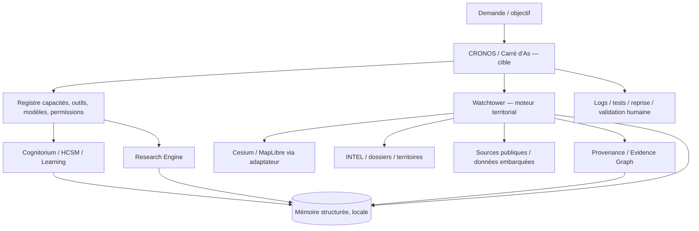

# WATCHTOWER — Capacités et divergences des versions

> [!warning] Photographie GitHub et non état du disque externe
> Sources examinées le **22/11/2026** : arbres GitHub, code ciblé, README, ROADMAP, AUDIT, REPRISE, issues/PR/CI. Les documents datés de septembre/octobre/novembre restent des **preuves historiques à date**. Le code présent n'est pas un service actif. L'inventaire machine complet est dans [`WATCHTOWER-FILE-INDEX.json`](WATCHTOWER-FILE-INDEX.json) ; la liste exhaustive dans [`02-INVENTAIRE-GITHUB-COMPLET.md`](02-INVENTAIRE-GITHUB-COMPLET.md).

## 1. Nomenclature stable et frontières

| Domaine | Propriétaire privilégié | Responsabilité | Nature du lien |
|---|---|---|---|
| WATCHTOWER | `Sathancabrol/watchtower` | Monde physique / cartographie / données territoriales / observation publique / dossiers géolocalisés | Application JavaScript + Cesium + Vite, autonome |
| COGNITORIUM | `Sathancabrol/COGNITORIUM` | Connaissances, compétences, apprentissage, graphe, constitution et conventions | Domaine distinct, contrat d'adaptation |
| Proto-Cognitorium | `Sathancabrol/proto-cognitorium` | UI profil cognitif, ROME, preuves, CV, parcours | Hôte possible historiquement, pas fusionné ici |
| HCSM | `Sathancabrol/HCSM` | Modèle temporel et épistémique de cognition | `PROPOSED`, ne doit pas inférer un diagnostic |
| Research Engine | `Sathancabrol/reaserch-engine` | Vérification, preuves, sources et contradictions | Adaptateur envisagé |
| Carré d'As / Monorepo | `Sathancabrol/monorepo` | Portfolio, explorer, hôte des projets et previews | **Copie** `projects/watchtower`, pas branche source |
| CRONOS / Hermes / OLYMPUS | runtime et Cosmos hors dépôt Watchtower | Dialogue, planification, dispatch, monde incarné, reprise | Intégration souhaitée ; **pont de production non vérifié** |
| Nexus OS | branche historique de `monorepo/nexus_os/` | Autre orchestrateur possible | Auditer les doublons, ne pas recréer un troisième routeur |
| X-Ray Mirror / Olympus Studio | projet local distinct | Vision, audio, capteurs consentis, UI studio | Interface/fusion non démontrée dans le dépôt `watchtower` |

> [!important] Conflit historique conservé
> [`COGNITORIUM/docs/etat-des-lieux/06-watchtower.md`](https://github.com/Sathancabrol/COGNITORIUM/blob/main/docs/etat-des-lieux/06-watchtower.md) décrit Watchtower comme **dépôt vide**, ce qui n'était vrai qu'à son époque ; les arbres GitHub 22/11 prouvent que ce document n'est **plus à jour**. [`docs/ARCHITECTURE-MODULE.md`](https://github.com/Sathancabrol/watchtower/blob/arena/01a072e1-watchtower/docs/ARCHITECTURE-MODULE.md) portait une décision de **différer l'intégration à Proto le 06/10**. La vision transversale de novembre n'autorise pas à supprimer ce contexte de décision.

## 2. Variantes de code réellement identifiées

| Identifiant | Branche ou espace | Rôle et faits |
|---|---|---|
| `M` | [`main`](https://github.com/Sathancabrol/watchtower/tree/main) | Socle autonome, READMEs, 21 itérations documentées, CI Node/Windows ; fichiers de mémoire publiés |
| `T` | [`arena/dec9cd88-watchtower`](https://github.com/Sathancabrol/watchtower/tree/arena/dec9cd88-watchtower) | TERRITOIRE, imports CSV, INTEL DOSSIER/TERRAIN, atlas Thau ; **PR #3 ouverte** |
| `CSV` | [`fix/territory-csv-formula-2026-10-18`](https://github.com/Sathancabrol/watchtower/tree/fix/territory-csv-formula-2026-10-18) | Correctif injection formule tableur `attributsTerritoire.js` ; **PR #5 ouverte vers T**, pas vers main |
| `2D` | [`arena/01a072e1-watchtower`](https://github.com/Sathancabrol/watchtower/tree/arena/01a072e1-watchtower) | MapLibre 2D ↔ Cesium 3D, dossier territorial différent, UI/volant/fil/contenu ; **86 nouveaux chemins par rapport à M** (à l'instantané de l'inventaire) |
| `H` | [`chore/agent-handoff-2026-10-11`](https://github.com/Sathancabrol/watchtower/tree/chore/agent-handoff-2026-10-11) | [`AGENT_HANDOFF.md`](https://github.com/Sathancabrol/watchtower/blob/chore/agent-handoff-2026-10-11/AGENT_HANDOFF.md) ; **PR #4 ouverte**, à ne pas réécrire ou supprimer |
| `O` | [`research/oracle-axis-integration-20261113`](https://github.com/Sathancabrol/watchtower/tree/research/oracle-axis-integration-20261113) | Recherche : **32 capacités** proposées, non intégrées ; **PR #6 ouverte** |
| `MONO` | [`monorepo/projects/watchtower`](https://github.com/Sathancabrol/monorepo/tree/main/projects/watchtower) | Copie : **581 fichiers de `M` identiques par SHA**, 2 fichiers documentaires divergents, 2 mémoires manquantes lors du relevé, 416 fichiers supplémentaires du **build `dist/`** |
| `COG` | [`COGNITORIUM/watchtower-mods`](https://github.com/Sathancabrol/COGNITORIUM/tree/main/watchtower-mods) | **Source historique du fork** : 62 fichiers, dont 47 identiques à M, 13 homonymes divergents, 2 fichiers propres |

Les 11 noms de branche GitHub observés ne représentent pas 11 variantes différentes : certaines références partagent un **même SHA**, notamment `fix/map2d-lifecycle-2026-10-18` avec `2D`, et plusieurs variantes `fix/territoire-*` avec `T`.

## 3. Modules par capacité — lecture de sources et limites

**Codes d'état** : `F` = chemin/implémentation présent au snapshot, sans test runtime ; `D` = documenté ; `HT` = test historique revendiqué dans un document ; `CI` = test GitHub Actions consulté le 22/11 ; `P` = proposition ; `?` = à vérifier. Plusieurs états peuvent coexister.

### 3.1 Globe, carte, navigation et scène

| Capacité | Référence à lire | Statut |
|---|---|---|
| Globe 3D Cesium, fonds satellites et sources de carte | [`src/main.js`](https://github.com/Sathancabrol/watchtower/blob/main/src/main.js), [`src/mapStackController.js`](https://github.com/Sathancabrol/watchtower/blob/main/src/mapStackController.js) | M:F, D |
| Démarrage gratuit sans clé avec dégradation explicite | [`README.md`](https://github.com/Sathancabrol/watchtower/blob/main/README.md), [`src/paywallGate.js`](https://github.com/Sathancabrol/watchtower/blob/main/src/paywallGate.js) | M:F, D |
| Carte 2D MapLibre et état caméra 2D/3D | [`carte2dControleur.js`](https://github.com/Sathancabrol/watchtower/blob/arena/01a072e1-watchtower/src/carte2dControleur.js), [`docs/CARTE-2D.md`](https://github.com/Sathancabrol/watchtower/blob/arena/01a072e1-watchtower/docs/CARTE-2D.md) | 2D:F, HT ; absent de M |
| Performance / gouverneur de rendu / reprise du contexte WebGL | [`renderGovernor.js`](https://github.com/Sathancabrol/watchtower/blob/main/src/renderGovernor.js), [`reprisRendu.js`](https://github.com/Sathancabrol/watchtower/blob/arena/01a072e1-watchtower/src/data/reprisRendu.js) | M:F, 2D:F |
| Bâti 3D simplifié et volume géographique | [`batiRapide.js`](https://github.com/Sathancabrol/watchtower/blob/main/src/batiRapide.js) | M:F |
| Calques, réglages, fonds IGN/OSM, états persistants | [`calques.js`](https://github.com/Sathancabrol/watchtower/blob/main/src/calques.js), [`displayOptions.js`](https://github.com/Sathancabrol/watchtower/blob/main/src/displayOptions.js) | M:F, D |
| Localisation T0, épingles, trajets et street view libre | [`localisation.js`](https://github.com/Sathancabrol/watchtower/blob/main/src/localisation.js), [`pins.js`](https://github.com/Sathancabrol/watchtower/blob/main/src/pins.js), [`trajets.js`](https://github.com/Sathancabrol/watchtower/blob/main/src/trajets.js), [`streetView.js`](https://github.com/Sathancabrol/watchtower/blob/main/src/streetView.js) | M:F |
| Simulation vol et caméras, cockpit, mobiGlas, drone/VTOL | [`flightMode.js`](https://github.com/Sathancabrol/watchtower/blob/main/src/flightMode.js), [`cockpit.js`](https://github.com/Sathancabrol/watchtower/blob/main/src/cockpit.js), [`mobiglas.js`](https://github.com/Sathancabrol/watchtower/blob/main/src/mobiglas.js) | M:F |
| Satellites, orbites et calendrier d'événements | [`satellites.js`](https://github.com/Sathancabrol/watchtower/blob/main/src/data/satellites.js), [`systemeSolaire.js`](https://github.com/Sathancabrol/watchtower/blob/main/src/systemeSolaire.js) | M:F |
| Historique du bâti, frise et distinction OSM daté/estimé | [`historique.js`](https://github.com/Sathancabrol/watchtower/blob/main/src/historique.js) | M:F |
| Scènes cinématiques / prise d'images de synthèse | [`cinematique.js`](https://github.com/Sathancabrol/watchtower/blob/main/src/cinematique.js) | M:F |

### 3.2 Observation et données ouvertes

| Capacité | Référence | Statut |
|---|---|---|
| Avions civils (OpenSky, adsb.lol), suivis d'objets publics | [`flights.js`](https://github.com/Sathancabrol/watchtower/blob/main/src/data/flights.js), [`adsbLolFallback.js`](https://github.com/Sathancabrol/watchtower/blob/main/src/data/adsbLolFallback.js) | M:F |
| Navires AIS (clé gratuite potentielle, pas de couverture mondiale sans clé) | [`aisLiveVessels.js`](https://github.com/Sathancabrol/watchtower/blob/main/src/data/aisLiveVessels.js), [`DATA_SOURCES.md`](https://github.com/Sathancabrol/watchtower/blob/main/DATA_SOURCES.md) | M:F ; disponibilité externe ? |
| Caméras publiques / vues CCTV et leurs droits | [`cctv.js`](https://github.com/Sathancabrol/watchtower/blob/main/src/data/cctv.js), [`cctvViewshed.js`](https://github.com/Sathancabrol/watchtower/blob/main/src/data/cctvViewshed.js) | M:F ; conditions source à contrôler |
| Séismes, incendies, météo, Vigicrues, autres risques | [`earthquakes.js`](https://github.com/Sathancabrol/watchtower/blob/main/src/data/earthquakes.js), [`firmsAdapt.js`](https://github.com/Sathancabrol/watchtower/blob/main/src/data/firmsAdapt.js), [`crues.js`](https://github.com/Sathancabrol/watchtower/blob/arena/01a072e1-watchtower/src/data/crues.js) | M:F, 2D:F |
| Infrastructures, datacenters, barrages, câbles marins | [`localLayers.js`](https://github.com/Sathancabrol/watchtower/blob/main/src/data/localLayers.js), [`telegeographySubmarineCables.js`](https://github.com/Sathancabrol/watchtower/blob/main/src/data/telegeographySubmarineCables.js) | M:F ; licence de données distincte du MIT |
| Trafic routier, transport, vélos et itinéraires | [`traffic.js`](https://github.com/Sathancabrol/watchtower/blob/main/src/data/traffic.js), [`bikeshare.js`](https://github.com/Sathancabrol/watchtower/blob/main/src/data/bikeshare.js) | M:F ; sources variables |
| Radio géolocalisée et favoris | [`radio.js`](https://github.com/Sathancabrol/watchtower/blob/main/src/radio.js) | M:F |
| Crédits par source, respect licences et réserves | [`DATA_SOURCES.md`](https://github.com/Sathancabrol/watchtower/blob/main/DATA_SOURCES.md), [`dataCredits.js`](https://github.com/Sathancabrol/watchtower/blob/main/src/data/dataCredits.js) | M:F |
| Analyse des couches **déjà en mémoire** (non ingestion externe) | [`analystEngine.js`](https://github.com/Sathancabrol/watchtower/blob/main/src/data/analystEngine.js) : `applyFilter`, `applyScope`, `createAnalystEngine` | M:code lu, pas d'ETL global |
| Brève régionale via proxy, normalisation articles/météo | [`regionalBrief.js`](https://github.com/Sathancabrol/watchtower/blob/main/src/data/regionalBrief.js) | M:code lu, pas d'historique persistant prouvé |

### 3.3 INTEL, territoire, savoir local et enquête

| Capacité | Référence | Statut |
|---|---|---|
| 6 vues INTEL historiques : JUMEAU, COMMUNAL, INDIVIDUEL, POLITIQUE, ÉCONOMIQUE, PRODUCTION | [`vuesIntel.js`](https://github.com/Sathancabrol/watchtower/blob/main/src/vuesIntel.js) : `VUES_INTEL` et `initIntelVues` inspectés | M:code lu |
| Jumeau INTEL, profil/lieu/bandeau et recherche de contexte | [`intelTwin.js`](https://github.com/Sathancabrol/watchtower/blob/main/src/intelTwin.js) : `lireProfil`, `initIntelTwin` | M:code lu, ni HCSM ni cognition personnelle validés |
| Fiche lieu, empreinte économique, risque et sources | [`ficheLieu.js`](https://github.com/Sathancabrol/watchtower/blob/main/src/ficheLieu.js), [`empreinte.js`](https://github.com/Sathancabrol/watchtower/blob/main/src/empreinte.js) | M:F |
| Dossier d'investigation (6 étapes et notes locales) | [`dossier.js`](https://github.com/Sathancabrol/watchtower/blob/main/src/dossier.js), [`palais.js`](https://github.com/Sathancabrol/watchtower/blob/main/src/palais.js) | M:F, D |
| Territoire stratégique Frontignan/Sète/Thau | [`territoireScenes.js`](https://github.com/Sathancabrol/watchtower/blob/arena/dec9cd88-watchtower/src/territoireScenes.js), [`territoire.js`](https://github.com/Sathancabrol/watchtower/blob/arena/dec9cd88-watchtower/src/territoire.js) | T:code lu et HT ; **non fusionné M** |
| CSV multi-types, stabilité des ID, rapport de refus et sources | [`importCsv.js`](https://github.com/Sathancabrol/watchtower/blob/arena/dec9cd88-watchtower/src/data/importCsv.js), [`docs/IMPORTER.md`](https://github.com/Sathancabrol/watchtower/blob/arena/dec9cd88-watchtower/docs/IMPORTER.md) | T:code lu, HT ; **correctif CSV sur branche CSV** |
| Base territoriale structurée (13 projets, 32 indicateurs, 110 sources, 13 lacunes, 10 contradictions, 79 nœuds, 167 relations, 14 communes) | [`INTEL-BASE.md`](https://github.com/Sathancabrol/watchtower/blob/arena/dec9cd88-watchtower/docs/INTEL-BASE.md) et [`dossierIntel.js`](https://github.com/Sathancabrol/watchtower/blob/arena/dec9cd88-watchtower/src/dossierIntel.js) | T:D, code lu/HT ; volumes historiques, pas fraîcheur actuelle |
| Contrat machine `watchtower.intel@1.0.0` JSON + 6 CSV | [`dossierIntel.js`](https://github.com/Sathancabrol/watchtower/blob/arena/dec9cd88-watchtower/src/dossierIntel.js), [`public/data/intel/`](https://github.com/Sathancabrol/watchtower/tree/arena/dec9cd88-watchtower/public/data/intel) | T:code lu ; exploitable par adaptateur |
| INTEL DOSSIER, onglets projets/chiffres/agglo/lacunes/2040/veille/sources | [`intelDossierVue.js`](https://github.com/Sathancabrol/watchtower/blob/arena/dec9cd88-watchtower/src/intelDossierVue.js) | T:F, D |
| INTEL TERRAIN, requêtes officielles et dégradation | [`intelTerrainVue.js`](https://github.com/Sathancabrol/watchtower/blob/arena/dec9cd88-watchtower/src/intelTerrainVue.js), [`sourcesOfficielles.js`](https://github.com/Sathancabrol/watchtower/blob/arena/dec9cd88-watchtower/src/sourcesOfficielles.js) | T:F, D |
| Structure territoriale à 5 échelles, `creerFait`, `bilanCertitude`, correction des données | [`dossierTerritorial.js`](https://github.com/Sathancabrol/watchtower/blob/arena/01a072e1-watchtower/src/data/territoire/dossierTerritorial.js), [`INTEL-TERRITOIRE.md`](https://github.com/Sathancabrol/watchtower/blob/arena/01a072e1-watchtower/docs/INTEL-TERRITOIRE.md) | 2D:code lu et HT ; **autre conception à comparer à T** |
| Frontignan 2026–2040 et corpus travaux | [`monorepo/projects/frontignan/`](https://github.com/Sathancabrol/monorepo/tree/main/projects/frontignan) ; extraction par scripts T | Sources documentaires datées ; vérifier le périmètre des jeux d'essai |

**Attention aux différences de périmètre :** la documentation historique revendique selon branche **27 calques**, **29 calques**, **38 couches**, **6 vues INTEL** ou **7 vues**. Ce ne sont ni 27+29+38 couches ni une mesure de runtime au 22/11 ; chaque valeur a sa version, sa définition (calque/dock/source/vue) et sa date.

### 3.4 IA, voix, agents et mémoire

| Capacité | Référence | Limite |
|---|---|---|
| Assistant local Ollama / réponse de secours / providers | [`src/llm.js`](https://github.com/Sathancabrol/watchtower/blob/main/src/llm.js) : `demander`, `modelesOllama`, `creerAssistant`, `reponseLocale` | Code inspecté ; aucune preuve de liaison à CRONOS Core :8789 |
| Commandes voix libres et actions GEV | [`voice/freeVoice.js`](https://github.com/Sathancabrol/watchtower/blob/arena/dec9cd88-watchtower/src/voice/freeVoice.js), [`voice/gevActions.js`](https://github.com/Sathancabrol/watchtower/blob/main/src/voice/gevActions.js) | Vérifier micro navigateur et permissions |
| Voix cloud optionnelle et coût | [`voice/gevRealtime.js`](https://github.com/Sathancabrol/watchtower/blob/main/src/voice/gevRealtime.js), [`voice/voiceCost.js`](https://github.com/Sathancabrol/watchtower/blob/main/src/voice/voiceCost.js) | Ne dépendre d'aucun fournisseur payant par défaut |
| Traces et journal de consultations | [`tracabilite.js`](https://github.com/Sathancabrol/watchtower/blob/main/src/tracabilite.js), [`dossier.js`](https://github.com/Sathancabrol/watchtower/blob/main/src/dossier.js) | Journal consultatif ≠ moteur d'événements versionné |
| Orchestration multi-appareils Carré d'As | [Hub agent](01-HUB-SUIVI-AGENTS.md), [OLYMPUS Atlas](00-WATCHTOWER-COGNITORIUM-CARRE-DAS-MINDMAP.md) | **Vision / environnement local déclaré**, pas code Watchtower main vérifié |
| Oracle Axis, incidents et scores | [`docs/ORACLE-AXIS...`](https://github.com/Sathancabrol/watchtower/blob/research/oracle-axis-integration-20261113/docs/ORACLE-AXIS-INTEGRATION-2026-11-13.md) | Recherche **32 idées**, aucune nouvelle capacité intégrée |

## 4. Les deux branches riches NE sont PAS interchangeables

| Axe | `T` : TERRITOIRE + INTEL | `2D` : 2D + territoire |
|---|---|---|
| Territoire | `src/territoire.js`, `src/territoireScenes.js`, `src/data/thauTerritoire.js` | `src/data/territoire/dossierTerritorial.js`, `frontignan.js`, `grapheThau.js` |
| Représentation | Carte stratégique, lentilles, maillage, modules exportables | Socle d'état à cinq échelles, niveaux, fidélité des sources |
| Carte GPU | Rendu principal Cesium, optimisation ciblée | Bascule **MapLibre/Cesium** importée à la demande |
| Import CSV | `importCsv.js` + six exports `public/data/intel` | Autres mécanismes de territoires ; comparer les contrats |
| GUI INTEL | DOSSIER + TERRAIN ajoutés aux vues | UI/refonte, grammaire de vues, fil/volant |
| Tests | 3 255 annoncés dans audit 07/10 | 3 277 annoncés dans parité source (date à confirmer) |
| Intégration actuelle au main | **Non**, PR #3 ouverte | **Non**, branche distincte non fusionnée |

**Stratégie prudente proposée :** construire la matrice de contrats (`Place`, `Project`, `Claim`, `Evidence`, `Time`, `Geometry`, `Source`), puis comparer fonctions exportées/testées et demander aux agents de préparer des adaptateurs. Ne pas faire un `git merge` direct des deux gros `src/main.js`.

## 5. Les sources, licences et limites des feeds

- **Fonds** : Esri/CARTO/OSM/IGN en repli suivant configuration, Google photoréaliste avec clé et conditions propres ; Cesium ion a ses quotas et licences propres.
- **Aérien** : OpenSky/adsb.lol ont des limites de quotas et d'usage. Les positions publiques et les retards de signal restent des observations, pas une vérification exhaustive.
- **Maritime** : AISStream.io requiert une clé gratuite ; les sources ouvertes régionales (ex. Finlande/Norvège) ne remplacent pas la Méditerranée.
- **Risques et territoires** : INSEE, API Géo, IGN, Géorisques, BOAMP, DVF, SIRENE, Open-Meteo, GDELT, Hub'Eau, OSM/Overpass ; accessibilité et qualité à confirmer par API indépendamment.
- **Données incluses** : certains jeux ont une licence propre **non commerciale** (TeleGeography) ; le code MIT ne rend pas les datasets redistribuables sous MIT.
- **Recherche/veille** : le dossier Oracle Axis et l'audit 06/10 évoquent Europe PMC, CORDIS, data.europa.eu, Crossref, OSIRIS ; ces sources sont **candidates documentées**, pas toutes installées.

Règle de traçabilité : une mesure doit garder `source`, `date`, `périmètre`, `licence`, `exactitude`, `statut`, `preuves` ; afficher `non publié` à la place de `0` quand la donnée est absente.

## 6. Architecture modulaire cible — sans effacer l'application

À ce stade le diagramme est une **cible de convergence**, pas un flux prouvé de production.

## 7. Contrats d'échange à conserver

| Contrat | Provenance | Usage / exigence |
|---|---|---|
| `watchtower.intel@1.0.0` | `T/src/dossierIntel.js` | Export d'entités, territoires, chiffres sourcés, lacunes/contradictions ; conserver les champs/version |
| `Watchtower code provenance` | Git tree index `path + sha + ref` | Situer précisément une fonction dans une branche |
| `Event / Incident canonical` | Audit Oracle Axis (proposé) | Événement, source, heures distinctes, géométrie, dédup, indépendance des preuves |
| `Cognitorium data model` | Constitution/architecture Cognitorium | IDs stables et relations typées ; adaptateur, non renommage brutal |
| `HCSM Knowledge/Evidence/Inference` | HCSM | Ne pas transformer une donnée territoriale ou un signal vidéo en propriété psychologique d'un individu |
| `agent run / skill` | Hermes/Carré d'As (hors dépôt) | Rôle ≠ instance ≠ exécution ≠ résultat prouvé |

## 8. Arbitrages non résolus

- Quel dossier/répertoire/branche correspond **réellement** à la version du disque externe ?
- La version 2D doit-elle être la base des futurs changements, ou intégrer le moteur 2D comme plugin dans T ?
- Les modèles de territoire à cinq échelles, les exports INTEL et les données T0 sont-ils sémantiquement compatibles ?
- Où réside la **mémoire durable** : fichiers Markdown/JSONL, SQLite locale, PostgreSQL cible documentée ? Le prototype visuel n'implique pas le backend cible.
- Quelle interface dessert l'utilisateur : Watchtower autonome, Olympus Studio, Monorepo preview, ou adaptateur ouvrant une fenêtre Watchtower ?
- Le déploiement et les licences permettent-ils les usages souhaités sans abonnement, et qui renouvelle les quotas ?
- Quels artefacts du lot Hermes du 13/11 (124 POI) existent en Git ou seulement sur le disque externe ?

Les prochaines validations concrètes, la CI et les règles de fusion figurent dans [`04-VALIDATION-CI-REPRISE.md`](04-VALIDATION-CI-REPRISE.md).
