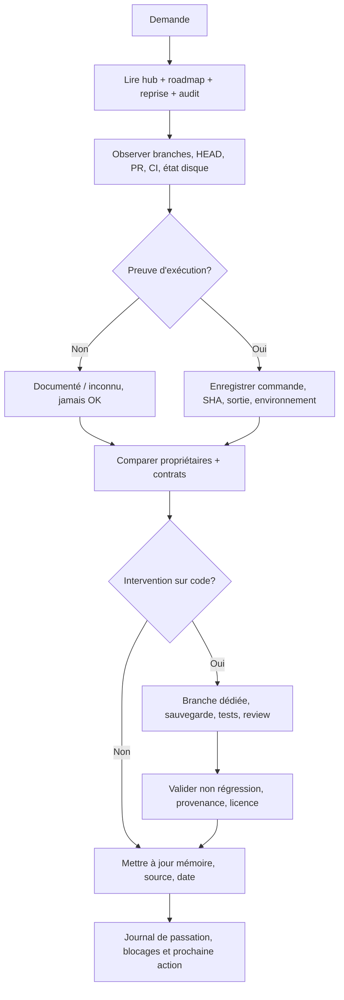

# WATCHTOWER — Validation, risques, CI et procédure de reprise

## 1. Mesure CI du 22 novembre 2026 (preuve machine GitHub)

**Source :** [GitHub Actions CI du 22/11/2026](https://github.com/Sathancabrol/watchtower/actions/runs/45033922316) sur `main` (run consulté le 22/11/2026, **pas** lancé par cet audit).

| Job / étape | Résultat GitHub | Portée |
|---|---|---|
| `Windows onboarding` / Pinokio + tests ciblés + build | **success** | Installation/build Windows du code GitHub dans le runner, **pas le PC utilisateur** |
| `Node 24.14.0` / install + policy | **success** | Installation dépendances et politiques initiales |
| `Node 24.14.0` / `Run unit tests` | **failure** | 3 144 tests, **2 échecs** |
| `Node 26.x` / `Run unit tests` | **failure** | Même phase ; build suivant **skipped** |
| CI globale | **failure** | **Ne pas inscrire « toutes les vérifications OK »** |

Deux échecs exacts visibles dans les logs de `Node 24.14.0` :

1. `AssertionError [ERR_ASSERTION]: MAP_STACKS id 'ign-ortho' has no cable classification mapping`.
2. `AssertionError [ERR_ASSERTION]: set_map_stack 'ign-ortho' has no self-mapping alias — voice selection would throw`.

Les **mêmes deux cas** étaient déjà cités comme échecs préexistants dans [`docs/REPRISE.md`](../REPRISE.md) ; l'audit ne prouve pas que tous les autres problèmes connus sont clos. Après ces commits documentaires, vérifier **une nouvelle CI** avant de marquer un état plus récent. Le run ci-dessus constitue une photographie datée.

## 2. PR ouvertes et ordre de dépendance

| PR | Source → cible | Ce qu'elle porte | État constaté le 22/11 | Décision suggérée |
|---|---|---|---|---|
| [#3 — TERRITOIRE & INTEL](https://github.com/Sathancabrol/watchtower/pull/3) | `arena/dec9cd88-watchtower` → `main` | **53 fichiers** modifiés, code+exports (dossiers, carte, CSV, sources, outils) | **ouverte**, pas fusionnée | Audit des contrats, suivi des licences et tests ; conflit possible avec branche 2D |
| [#5 — sécurité CSV](https://github.com/Sathancabrol/watchtower/pull/5) | `fix/territory-csv-formula-2026-10-18` → `arena/dec9cd88-watchtower` | **2 fichiers**, neutralisation de formules dans `attributsTerritoire.js` et test | **ouverte** ; CI du 17/10 **success** ; `mergeable_state=clean` à la consultation | Intégrer/adapter le fix au projet territorial **avant** export utilisateurs, sans annoncer la fusion |
| [#4 — passation agent](https://github.com/Sathancabrol/watchtower/pull/4) | `chore/agent-handoff-2026-10-11` → `main` | `AGENT_HANDOFF.md` + lien README | **ouverte**, n'existe pas sur M | Garder ce journal comme source ; relier au hub au lieu de le réécrire |
| [#6 — Oracle Axis](https://github.com/Sathancabrol/watchtower/pull/6) | `research/oracle-axis-integration-20261113` → `main` | **1 Markdown** : inventaire de 32 capacités et architecture cible | **ouverte** ; CI de la branche **failure** (unit tests existants) | Classer `PROPOSÉ`, aucun module Oracle installé |
| [#1 et #2](https://github.com/Sathancabrol/watchtower/pulls?q=is%3Apr+is%3Aclosed) | branches Arena historiques → M | Itérations/roadmap, documentation outils | **fusionnées** le 06 et 07/09 | Historique, pas travail en attente |

**Attention** : le correctif CSV (#5) a pour base #3, non `main`. L'ordre `#5` puis `#3` est la logique dépendante, mais fusionner reste une action sur le code nécessitant revue et recette ; **cet audit n'a fusionné aucune PR**.

## 3. 11 noms de branche identifiés et SHA au point de contrôle

| Branche | SHA observé le 22/11 | Usage |
|---|---|---|
| `main` | référence mouvante, modifiée par le dépôt documentaire | Socle canonique, HEAD doit être relu avant travail |
| `arena/01a06ebe-watchtower` | `715bfa793923fb8e0fddc3c0f9561e252178723a` | Sauvegarde itération 21 |
| `arena/01a072e1-watchtower` | `be0cceff24d6f1d63df882d74623c4fdf49994de` | Développement 2D/3D, territoire, ergonomie |
| `fix/map2d-lifecycle-2026-10-18` | `be0cceff24d6f1d63df882d74623c4fdf49994de` | Même commit que `arena/01a072e1` |
| `arena/dec9cd88-watchtower` | `4151e2e25b27efcdb500f4a47601cca96bb03388` | PR #3 TERRITOIRE + INTEL |
| `fix/territoire-import-csv-limits-2026-10-18` | `4151e2e25b27efcdb500f4a47601cca96bb03388` | Même commit que PR #3 |
| `fix/territoire-provenance-2026-10-18` | `4151e2e25b27efcdb500f4a47601cca96bb03388` | Même commit que PR #3 |
| `fix/territory-csv-formula-2026-10-18` | `d15ac5dabee3e4d2c46f6dd73a31ab399ee1533b` | PR #5, 2 fichiers différents de sa base |
| `arena/01a0730a-watchtower` | `500b91254682549d9a59b00284a48c292dcdfb06` | Ancienne PR #2, fusionnée |
| `chore/agent-handoff-2026-10-11` | `dedf937ceb0611ca522f2d2a2d8832aa7732e70b` | PR #4, fichier de passation |
| `research/oracle-axis-integration-20261113` | `2c190fd5a48cbfbb9fbc5fa42e6e5e72b5f447a4` | PR #6, recherche |

> Pour `main`, consulter [l'historique des commits](https://github.com/Sathancabrol/watchtower/commits/main) plutôt que réutiliser son SHA antérieur à l'ajout des fichiers de mémoire : sa référence évolue à chaque publication.

## 4. Invariants d'architecture et garde-fous

- **Pas de réécriture totale.** Le principe historique est de réutiliser les modules et de préserver toutes les commandes du HUD, toutes les calques et toutes les sources.
- **Source d'outil unique :** [`audit/reference/generate-reference.py`](../../audit/reference/generate-reference.py). **Ne jamais éditer manuellement** `AGENTS.md`, `audit/REFERENCE.md`, `REGISTRE-OUTILS.json` ou `REGISTRE.tsv` : ce sont des sorties générées.
- **Licences / prix :** 86 outils catalogués dans la référence historique ; les modalités « gratuit » et quotas nécessitent revalidation datée. La licence du code MIT ne couvre pas automatiquement les jeux de données inclus.
- **Moteurs 2D/3D :** le document 2D spécifie qu'un **seul rendu GPU** reste actif, avec une conversion des états de caméra et import dynamique MapLibre. Ne pas lancer deux render loops simultanément.
- **Vie privée :** aucun secret, adresse exacte, donnée biométrique de tiers, client/patient, microphone ou image privée dans la mémoire publique. Les entrées de capteurs doivent être consenties et bornées.
- **Traçabilité :** une déclaration, une observation, une simulation et une donnée de source officielle sont quatre classes distinctes.
- **Anomalie de documentation :** `docs/REPRISE.md` contient une recette de preview avec `HOST=0.0.0.0`, tandis que `AGENTS.md` déconseille un binding public ; respecter le mode réseau réellement autorisé et **ne pas exposer le service hors machine/tailnet**.
- **Dernier lot Hermes du 13/11 :** notification `124/124` POI + DOSSIER/TERRAIN. C'est une **déclaration de tâche historique**, pas un commit ni une mesure de la copie du disque externe ; vérifier l'artefact.

## 5. Procédure de reprise d'agent IA



**Avant une nouvelle tâche**, lire : [`AGENT_HANDOFF.md` sur PR #4](https://github.com/Sathancabrol/watchtower/blob/chore/agent-handoff-2026-10-11/AGENT_HANDOFF.md), le [hub](01-HUB-SUIVI-AGENTS.md), la [roadmap](../../ROADMAP.md), [REPRISE](../REPRISE.md), [DIAGNOSTIC](../DIAGNOSTIC.md), [AGENTS](../../AGENTS.md) et les sources concernées.

**Pour une tâche de code sur la tour Windows**, procéder selon les permissions et chemins locaux **effectivement constatés** :

```powershell
# Exemples de lecture seule, une fois dans le bon répertoire :
git status --short --branch
git remote -v
git branch -avv
git log -1 --format="%H %ci %s"
git diff --stat
node --version
npm --version
# Après examen des ressources et sans modification non autorisée :
# npm test
# npm run build
```

**Si un fichier est généré, ne pas modifier le produit de génération.** Si un script change du code, vérifier le bloc modifié et le diff ; une édition précédente avait tronqué des morceaux de JS tout en laissant le fichier syntaxiquement valide.

## 6. Priorités en fonction des preuves

| Priorité | Travail | Critère de sortie observable |
|---|---|---|
| **P0** | Identifier le vrai dépôt du disque externe : chemin, SHA, branche, état Git, modifications non committées | Rapport de divergence `LOCAL vs M vs T vs 2D`, sans divulguer secrets |
| **P0** | Confirmer les deux échecs `ign-ortho` / mappings dans la CI actuelle | Tests nommés et sortie machine ; fix spécifique et non-régression si changement autorisé |
| **P0** | Reprendre PR #5 sans perdre la protection contre les formules CSV | Tests de CSV incluant `= + - @`, dates et valeurs numériques légitimes |
| **P0** | Établir les contrats de fusion INTEL/TERRITOIRE (T) vs TERRITOIRE/2D | Tableau fichier/fonction/export/contrat/test, choix KEEP/ADAPT/MERGE |
| **P1** | Aligner les snapshots du monorepo sur la source canonique | Référence SHA et build `dist` issus du même code ; éviter double édition |
| **P1** | Reproduire les régressions GUI WATCHTOWER/HQ et charge GPU | Rapport F3, comparaison avant/après et test de bascule 2D |
| **P1** | Valider le lot TERRITOIRE Hermes du 13/11 | Artefact, code source, tests et nombre de POI importés, sans compter seulement la notification |
| **P2** | Préparer un `contract/event@1` + provenance + mémoire locale pour Carré d'As | Échantillon d'événement avec preuve, version et contrôle d'accès |
| **P2** | Évaluer Oracle Axis / 32 modules | Distinguer propositions documentées, implémentations et coûts licences |

## 7. Matrice minimale d'acceptation par capacité

Chaque fiche de capacité doit comporter :

```yaml
capability_id: "wt.xxx"
owner_repo: "Sathancabrol/watchtower"
path: "src/..."
commit_sha: null
branch: null
documented_at: null
implementation_status: "source-found | proposed | absent | unknown"
runtime_status: "not-tested | tested-ok | tested-failed | enabled | degraded"
test:
  command: null
  environment: null
  completed_at: null
  output_ref: null
data:
  provenance: []
  licenses: []
  confidentiality: "public | private | shared"
dependencies: []
fallback: null
decisions: []
open_issues: []
next_action: null
```

Ne jamais remplacer `not-tested` par `tested-ok` sur la seule lecture d'un README. Les résultats des tests doivent être associés au **SHA exact testé**.

## 8. État de complétude de CET audit

**Couvert en lecture GitHub :** 11 branches nommées ; arbres de huit références indépendantes + copies de monorepo et COGNITORIUM ; inventaire de **1 131 chemins distincts** dans le corpus sélectionné (dont **416 livrables dist** propres au monorepo) ; 4 PR ouvertes, CI récente consultée, documents d'architecture et plusieurs modules principaux lus.

**Non couvert / impossible à attester sans la tour et ses supports :** disque externe, fichiers non committés, vrais services en cours, qualité visuelle et FPS en production, réseau Android/Tailscale, quota cloud gratuit réel, intégrité de tous les jeux de données externes, vérité actualisée des données territoriales et toutes les fonctions de chaque module examinées ligne à ligne.

Le but de ce document n'est pas d'annoncer une exhaustivité fictive ; c'est de fournir une **surface de reprise explicitement bornée et reproductible**.

Sources : [Inventaire intégral](02-INVENTAIRE-GITHUB-COMPLET.md) · [Architecture](03-CAPACITES-ARCHITECTURE-DIVERGENCES.md) · [Hub](01-HUB-SUIVI-AGENTS.md).
