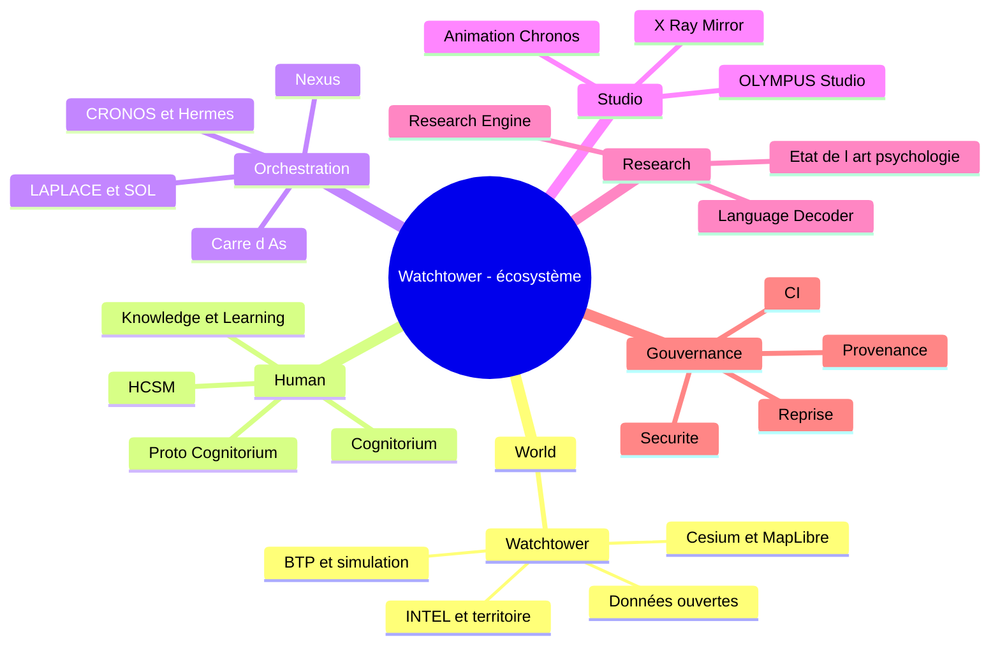

# WATCHTOWER — Arborescence profonde, multi-repo et multi-branches

Ce fichier est un **index hiérarchique supplémentaire**, non un remplacement des sources. Son objectif est d'exposer autant de sous-niveaux que le corpus documentaire permet, et de rendre les concepts retrouvables par les agents. Il dérive de deux notes déjà auditées et des recherches de branches du 22 novembre 2026. Chaque nœud renvoie au document source. **Code documenté ≠ fonctionnalité testée ≠ service actif.**

## 0. Ordre de lecture agent et frontière de confiance

- Lire [[01-HUB-SUIVI-AGENTS]] pour retrouver la règle de reprise et les documents canoniques.
  - Lire [[08-WATCHTOWER-AUDIT-MAITRE-2026-11-22]] pour l'inventaire Git, PR, tests, variantes et divergences.
    - Lire [[02-INVENTAIRE-GITHUB-COMPLET]] et `WATCHTOWER-FILE-INDEX.json` pour les chemins et SHA.
      - Vérifier le même `path` dans la **bonne branche**, pas seulement dans `main`.
        - Examiner le code, les tests associés, les diffs et les contrats avant de conclure.
          - Contrôler séparément les endpoints/équipements locaux : aucun runtime de la tour ou des téléphones n'a été validé ici.
- Lire [[00-WATCHTOWER-COGNITORIUM-CARRE-DAS-MINDMAP]] pour le panorama produit et les invariants.
  - Lire [[03-CAPACITES-ARCHITECTURE-DIVERGENCES]] pour les capacités vérifiées dans les sources.
  - Lire [[04-VALIDATION-CI-REPRISE]] pour CI, PR et étapes de convergence.
  - Lire `../../ROADMAP.md`, `../REPRISE.md`, `../AUDIT.md` dans cet ordre pour le suivi historique.
- Statuts : `CODE-LU`, `DOC`, `TEST-HIST`, `CI`, `ACTIF-HIST`, `CIBLE`, `NON-FUSIONNÉ`, `INCONNU`, `BLOQUÉ`.
  - Ne jamais convertir `INCONNU` en `OK` sans exécution instrumentée.
  - Distinguer identifiant du produit, dépôt de référence, copie vendue/preview, branche, commit, build et runtime.

## 1. Arbre de tous les dépôts et branches accessibles

Les listes suivantes sont des **références de branches Git**, pas autant de produits activés. Les branches peuvent partager une pointe de commit.

### 1.1 `watchtower` — 11 branches
- [Dépôt](https://github.com/Sathancabrol/watchtower)
  - [`arena/dec9cd88-watchtower`](https://github.com/Sathancabrol/watchtower/tree/arena/dec9cd88-watchtower)
  - [`arena/01a06ebe-watchtower`](https://github.com/Sathancabrol/watchtower/tree/arena/01a06ebe-watchtower)
  - [`arena/01a072e1-watchtower`](https://github.com/Sathancabrol/watchtower/tree/arena/01a072e1-watchtower)
  - [`arena/01a0730a-watchtower`](https://github.com/Sathancabrol/watchtower/tree/arena/01a0730a-watchtower)
  - [`chore/agent-handoff-2026-10-11`](https://github.com/Sathancabrol/watchtower/tree/chore/agent-handoff-2026-10-11)
  - [`fix/map2d-lifecycle-2026-10-18`](https://github.com/Sathancabrol/watchtower/tree/fix/map2d-lifecycle-2026-10-18)
  - [`fix/territoire-import-csv-limits-2026-10-18`](https://github.com/Sathancabrol/watchtower/tree/fix/territoire-import-csv-limits-2026-10-18)
  - [`fix/territoire-provenance-2026-10-18`](https://github.com/Sathancabrol/watchtower/tree/fix/territoire-provenance-2026-10-18)
  - [`fix/territory-csv-formula-2026-10-18`](https://github.com/Sathancabrol/watchtower/tree/fix/territory-csv-formula-2026-10-18)
  - [`main`](https://github.com/Sathancabrol/watchtower/tree/main)
  - [`research/oracle-axis-integration-20261113`](https://github.com/Sathancabrol/watchtower/tree/research/oracle-axis-integration-20261113)

### 1.2 `monorepo` — 35 branches
- [Dépôt](https://github.com/Sathancabrol/monorepo)
  - [`arena/d036959d-monorepo`](https://github.com/Sathancabrol/monorepo/tree/arena/d036959d-monorepo)
  - [`arena/d6495894-monorepo`](https://github.com/Sathancabrol/monorepo/tree/arena/d6495894-monorepo)
  - [`arena/f3c2cd12-monorepo`](https://github.com/Sathancabrol/monorepo/tree/arena/f3c2cd12-monorepo)
  - [`arena/0d411b29-monorepo`](https://github.com/Sathancabrol/monorepo/tree/arena/0d411b29-monorepo)
  - [`arena/00f44a26-monorepo`](https://github.com/Sathancabrol/monorepo/tree/arena/00f44a26-monorepo)
  - [`arena/01a07e3c-monorepo`](https://github.com/Sathancabrol/monorepo/tree/arena/01a07e3c-monorepo)
  - [`arena/01a08168-monorepo`](https://github.com/Sathancabrol/monorepo/tree/arena/01a08168-monorepo)
  - [`arena/01a08203-monorepo`](https://github.com/Sathancabrol/monorepo/tree/arena/01a08203-monorepo)
  - [`arena/01a08277-monorepo`](https://github.com/Sathancabrol/monorepo/tree/arena/01a08277-monorepo)
  - [`arena/01a08385-monorepo`](https://github.com/Sathancabrol/monorepo/tree/arena/01a08385-monorepo)
  - [`arena/01a08449-monorepo`](https://github.com/Sathancabrol/monorepo/tree/arena/01a08449-monorepo)
  - [`arena/1bad5f9b-monorepo`](https://github.com/Sathancabrol/monorepo/tree/arena/1bad5f9b-monorepo)
  - [`arena/15c77b59-monorepo`](https://github.com/Sathancabrol/monorepo/tree/arena/15c77b59-monorepo)
  - [`arena/93b54a79-monorepo`](https://github.com/Sathancabrol/monorepo/tree/arena/93b54a79-monorepo)
  - [`arena/171a1f38-monorepo`](https://github.com/Sathancabrol/monorepo/tree/arena/171a1f38-monorepo)
  - [`arena/876c41eb-monorepo`](https://github.com/Sathancabrol/monorepo/tree/arena/876c41eb-monorepo)
  - [`arena/0034230e-monorepo`](https://github.com/Sathancabrol/monorepo/tree/arena/0034230e-monorepo)
  - [`arena/5498366c-monorepo`](https://github.com/Sathancabrol/monorepo/tree/arena/5498366c-monorepo)
  - [`audit/convergence-2026-10-10`](https://github.com/Sathancabrol/monorepo/tree/audit/convergence-2026-10-10)
  - [`codex/audit-hardening-2026-10-12`](https://github.com/Sathancabrol/monorepo/tree/codex/audit-hardening-2026-10-12)
  - [`docs/mobile-ar-hud-archive-2026-10-11`](https://github.com/Sathancabrol/monorepo/tree/docs/mobile-ar-hud-archive-2026-10-11)
  - [`feat/automated-project-audit-2026-10-11`](https://github.com/Sathancabrol/monorepo/tree/feat/automated-project-audit-2026-10-11)
  - [`feat/chronos-fleet-free-fallback-20261113`](https://github.com/Sathancabrol/monorepo/tree/feat/chronos-fleet-free-fallback-20261113)
  - [`feat/creative-toolchain-registry`](https://github.com/Sathancabrol/monorepo/tree/feat/creative-toolchain-registry)
  - [`feat/final-interface-skeleton-2026-10-07`](https://github.com/Sathancabrol/monorepo/tree/feat/final-interface-skeleton-2026-10-07)
  - [`feat/gap-driven-audit-2026-10-11`](https://github.com/Sathancabrol/monorepo/tree/feat/gap-driven-audit-2026-10-11)
  - [`feat/mobile-ar-fastpath-2026-10-11`](https://github.com/Sathancabrol/monorepo/tree/feat/mobile-ar-fastpath-2026-10-11)
  - [`feat/olympus-fleet-247-20261113`](https://github.com/Sathancabrol/monorepo/tree/feat/olympus-fleet-247-20261113)
  - [`feat/olympus-mobile-preview-20261113`](https://github.com/Sathancabrol/monorepo/tree/feat/olympus-mobile-preview-20261113)
  - [`feat/olympus-studio-20261112`](https://github.com/Sathancabrol/monorepo/tree/feat/olympus-studio-20261112)
  - [`feat/tool-data-catalog-2026-10`](https://github.com/Sathancabrol/monorepo/tree/feat/tool-data-catalog-2026-10)
  - [`feature/atlas-frontignan-climat-thau`](https://github.com/Sathancabrol/monorepo/tree/feature/atlas-frontignan-climat-thau)
  - [`fix/hermes-autonomy-rescue-20261114`](https://github.com/Sathancabrol/monorepo/tree/fix/hermes-autonomy-rescue-20261114)
  - [`main`](https://github.com/Sathancabrol/monorepo/tree/main)
  - [`outsider/documentation-v0.1`](https://github.com/Sathancabrol/monorepo/tree/outsider/documentation-v0.1)

### 1.3 `COGNITORIUM` — 5 branches
- [Dépôt](https://github.com/Sathancabrol/COGNITORIUM)
  - [`arena/01a05ef8-cognitorium`](https://github.com/Sathancabrol/COGNITORIUM/tree/arena/01a05ef8-cognitorium)
  - [`arena/01a06876-cognitorium`](https://github.com/Sathancabrol/COGNITORIUM/tree/arena/01a06876-cognitorium)
  - [`chore/agent-handoff-2026-10-11`](https://github.com/Sathancabrol/COGNITORIUM/tree/chore/agent-handoff-2026-10-11)
  - [`main`](https://github.com/Sathancabrol/COGNITORIUM/tree/main)
  - [`watchtower/osint-workbench-v0.1`](https://github.com/Sathancabrol/COGNITORIUM/tree/watchtower/osint-workbench-v0.1)

### 1.4 `proto-cognitorium` — 10 branches
- [Dépôt](https://github.com/Sathancabrol/proto-cognitorium)
  - [`arena/01a033e8-proto-cognitorium`](https://github.com/Sathancabrol/proto-cognitorium/tree/arena/01a033e8-proto-cognitorium)
  - [`arena/01a034f2-proto-cognitorium`](https://github.com/Sathancabrol/proto-cognitorium/tree/arena/01a034f2-proto-cognitorium)
  - [`arena/01a035a5-proto-cognitorium`](https://github.com/Sathancabrol/proto-cognitorium/tree/arena/01a035a5-proto-cognitorium)
  - [`arena/01a0369e-proto-cognitorium`](https://github.com/Sathancabrol/proto-cognitorium/tree/arena/01a0369e-proto-cognitorium)
  - [`arena/01a03436-proto-cognitorium`](https://github.com/Sathancabrol/proto-cognitorium/tree/arena/01a03436-proto-cognitorium)
  - [`arena/01a03899-proto-cognitorium`](https://github.com/Sathancabrol/proto-cognitorium/tree/arena/01a03899-proto-cognitorium)
  - [`arena/01a08342-proto-cognitorium`](https://github.com/Sathancabrol/proto-cognitorium/tree/arena/01a08342-proto-cognitorium)
  - [`chore/agent-handoff-2026-10-11`](https://github.com/Sathancabrol/proto-cognitorium/tree/chore/agent-handoff-2026-10-11)
  - [`fix/evidence-source-links-2026-10-18`](https://github.com/Sathancabrol/proto-cognitorium/tree/fix/evidence-source-links-2026-10-18)
  - [`main`](https://github.com/Sathancabrol/proto-cognitorium/tree/main)

### 1.5 `ETAT-DE-LART-PSYCHOLOGIE` — 11 branches
- [Dépôt](https://github.com/Sathancabrol/ETAT-DE-LART-PSYCHOLOGIE)
  - [`arena/01a03aac-etat-de-lart-psychologie`](https://github.com/Sathancabrol/ETAT-DE-LART-PSYCHOLOGIE/tree/arena/01a03aac-etat-de-lart-psychologie)
  - [`arena/01a03adf-etat-de-lart-psychologie`](https://github.com/Sathancabrol/ETAT-DE-LART-PSYCHOLOGIE/tree/arena/01a03adf-etat-de-lart-psychologie)
  - [`arena/01a04f7b-etat-de-lart-psychologie`](https://github.com/Sathancabrol/ETAT-DE-LART-PSYCHOLOGIE/tree/arena/01a04f7b-etat-de-lart-psychologie)
  - [`arena/01a07d32-etat-de-lart-psychologie`](https://github.com/Sathancabrol/ETAT-DE-LART-PSYCHOLOGIE/tree/arena/01a07d32-etat-de-lart-psychologie)
  - [`arena/01a035f7-etat-de-lart-psychologie`](https://github.com/Sathancabrol/ETAT-DE-LART-PSYCHOLOGIE/tree/arena/01a035f7-etat-de-lart-psychologie)
  - [`arena/01a045a1-etat-de-lart-psychologie`](https://github.com/Sathancabrol/ETAT-DE-LART-PSYCHOLOGIE/tree/arena/01a045a1-etat-de-lart-psychologie)
  - [`arena/01a0369b-etat-de-lart-psychologie`](https://github.com/Sathancabrol/ETAT-DE-LART-PSYCHOLOGIE/tree/arena/01a0369b-etat-de-lart-psychologie)
  - [`arena/01a0389d-etat-de-lart-psychologie`](https://github.com/Sathancabrol/ETAT-DE-LART-PSYCHOLOGIE/tree/arena/01a0389d-etat-de-lart-psychologie)
  - [`chore/agent-handoff-2026-10-11`](https://github.com/Sathancabrol/ETAT-DE-LART-PSYCHOLOGIE/tree/chore/agent-handoff-2026-10-11)
  - [`feat/sathyr-optional-interjections-2026-11-12`](https://github.com/Sathancabrol/ETAT-DE-LART-PSYCHOLOGIE/tree/feat/sathyr-optional-interjections-2026-11-12)
  - [`main`](https://github.com/Sathancabrol/ETAT-DE-LART-PSYCHOLOGIE/tree/main)

### 1.6 `HCSM` — 4 branches
- [Dépôt](https://github.com/Sathancabrol/HCSM)
  - [`arena/01a03a6b-hcsm`](https://github.com/Sathancabrol/HCSM/tree/arena/01a03a6b-hcsm)
  - [`arena/01a03a93-hcsm`](https://github.com/Sathancabrol/HCSM/tree/arena/01a03a93-hcsm)
  - [`chore/agent-handoff-2026-10-11`](https://github.com/Sathancabrol/HCSM/tree/chore/agent-handoff-2026-10-11)
  - [`main`](https://github.com/Sathancabrol/HCSM/tree/main)

### 1.7 `reaserch-engine` — 2 branches
- [Dépôt](https://github.com/Sathancabrol/reaserch-engine)
  - [`chore/agent-handoff-2026-10-11`](https://github.com/Sathancabrol/reaserch-engine/tree/chore/agent-handoff-2026-10-11)
  - [`main`](https://github.com/Sathancabrol/reaserch-engine/tree/main)

### 1.8 `Language-decoder` — 4 branches
- [Dépôt](https://github.com/Sathancabrol/Language-decoder)
  - [`arena/01a05429-language-decoder`](https://github.com/Sathancabrol/Language-decoder/tree/arena/01a05429-language-decoder)
  - [`arena/01a05471-language-decoder`](https://github.com/Sathancabrol/Language-decoder/tree/arena/01a05471-language-decoder)
  - [`chore/agent-handoff-2026-10-11`](https://github.com/Sathancabrol/Language-decoder/tree/chore/agent-handoff-2026-10-11)
  - [`main`](https://github.com/Sathancabrol/Language-decoder/tree/main)

### 1.9 `animation-chronos` — 2 branches
- [Dépôt](https://github.com/Sathancabrol/animation-chronos)
  - [`chore/agent-handoff-2026-10-11`](https://github.com/Sathancabrol/animation-chronos/tree/chore/agent-handoff-2026-10-11)
  - [`main`](https://github.com/Sathancabrol/animation-chronos/tree/main)

## 2. Index conceptuel automatique des documents sourcés

> Les titres et sous-points sont extraits des deux sources conservées telles quelles. Les entrées complexes restent reliées à la section originale : ne pas considérer cette extraction comme une nouvelle vérification. Pour éviter de casser la hiérarchie, les puces d'origine sont conservées sous les titres et les lignes de tableau sont indexées séparément.

### Source — [Mindmap système v1.3](00-WATCHTOWER-COGNITORIUM-CARRE-DAS-MINDMAP.md)
  - "Watchtower — carte mentale"
  - "Cognitorium — mémoire externe"
  - "Carré d'As — architecture unifiée"
  - "Olympus — carte du système"
  - watchtower
  - cognitorium
  - carre-d-as
  - olympus
  - cronos
  - agents-ia
  - mindmap
  - knowledge-graph
  - obsidian
- **0. Mode d'emploi — pour Obsidian et les agents** · [source](00-WATCHTOWER-COGNITORIUM-CARRE-DAS-MINDMAP.md#0-mode-demploi-pour-obsidian-et-les-agents)
  - **Dans Obsidian :** ouvrir la note en mode Lecture pour voir la carte Mermaid, et en mode Plan pour parcourir les titres ; rechercher les IDs `WT-`, `CG-`, `CA-`, `AG-`, `MEM-`.
  - **Pour un agent IA :** lire en priorité les sections **1, 2, 3, 12, 15, 16, 17 et 18** ; puis uniquement les branches nécessaires à la mission. La carte n'est pas un substitut aux fichiers du dépôt, tests, logs et états courants.
  - **Pour contribuer :** ne jamais réécrire une assertion sans conserver sa provenance. Ajouter la date de contrôle, la branche, le commit et la preuve ; inscrire les contradictions dans la section 17.
  - **Convention des états :** `[CODE-LU]` fichier consulté ; `[DOC]` annoncé/documenté ; `[TEST-HIST]` test rapporté à une date passée ; `[ACTIF-HIST]` service actif lors d'un constat passé ; `[CIBLE]` vision ; `[À VÉRIFIER]` information incertaine ; `[BLOQUÉ]` problème identifié.
  - **Attention :** état d'une **capacité**, état d'un **modèle/outil**, état d'un **processus** et état d'une **mission** sont quatre objets distincts.
- **1. Carte mentale visuelle — vue générale** · [source](00-WATCHTOWER-COGNITORIUM-CARRE-DAS-MINDMAP.md#1-carte-mentale-visuelle-vue-generale)
- **2. Noyau conceptuel — frontières et identité** · [source](00-WATCHTOWER-COGNITORIUM-CARRE-DAS-MINDMAP.md#2-noyau-conceptuel-frontieres-et-identite)
  - **2.1 Les quatre grands ensembles** · [source](00-WATCHTOWER-COGNITORIUM-CARRE-DAS-MINDMAP.md#21-les-quatre-grands-ensembles)
    - **`WT-000` WATCHTOWER** — yeux sur le monde réel : cartographie, géographie, signaux, lieux, bâtiments, acteurs, dossiers, événements, territoire, BTP, simulations spatiales. Un module métier connecté, **pas** le moteur d'agents.
    - **`CG-000` COGNITORIUM / COGNITARIUM** — humain, compétences, connaissances, apprentissage, parcours, représentations cognitives. Le nom « Cognitarium » apparaît aussi dans la vision produit ; **frontière de nommage à arbitrer**, sans supprimer les projets existants.
    - **`CA-000` CARRÉ D'AS / MONOREPO** — centre de contexte, interface fédératrice, navigation et vues transversales. C'est l'espace dans lequel Watchtower, Cognitorium, Olympus et les autres domaines deviennent accessibles, **pas** une fusion automatique de leurs bases et moteurs.
    - **`AG-000` CRONOS / HERMES / NEXUS** — compréhension des demandes, orientation, délégation, exécution, chronologie, tâches, mémoire opérationnelle et supervision ; orchestrateurs à connecter **sans concurrence cachée**.
  - **2.2 Une grammaire commune** · [source](00-WATCHTOWER-COGNITORIUM-CARRE-DAS-MINDMAP.md#22-une-grammaire-commune)
    - **Fondations métier constitutionnelles :** `HUMAN`, `KNOWLEDGE`, `WORLD`, `WORLD GRAPH`.
    - **Couches transversales :** `AGENTS/TOOLS`, `TASKS/WORKFLOWS`, `MEMORY/EVIDENCE`, `TIME`, `PERMISSIONS`, `UI`.
    - **Règle cardinal :** *les différents modules montrent le même objet via un même identifiant canonique ; aucune duplication d'identité lors d'un changement de vue*.
  - **2.3 Règles non négociables** · [source](00-WATCHTOWER-COGNITORIUM-CARRE-DAS-MINDMAP.md#23-regles-non-negociables)
    - **Local-first et gratuit par défaut** ; aucun abonnement, quota payant ni clé obligatoire pour le fonctionnement minimal.
    - Cloud gratuit *optionnel*, quotas explicités ; fallback local fonctionnel en cas d'indisponibilité réseau/fournisseur.
    - Réutiliser/adapter le code existant avant de reconstruire ; conserver les originaux et permettre le retour arrière.
    - Différencier `fait`, `déclaration`, `observation`, `inférence`, `hypothèse`, `simulation`, `fiction`, `code trouvé`, `test exécuté`.
    - La qualité scientifique prime : aucune déduction clinique ou psychométrique individuelle sans mesure valide, consentement et incertitude explicite.
    - Journaliser les actions réelles, leurs preuves et leur coût ; ne pas inventer un appel outil, un résultat, des coordonnées ou un succès.
    - Refuser les secrets dans Git, les logs publics, l'interface client ou cette note. Données privées : stockage local contrôlé.
- **3. Les douze domaines du système — taxonomie stable** · [source](00-WATCHTOWER-COGNITORIUM-CARRE-DAS-MINDMAP.md#3-les-douze-domaines-du-systeme-taxonomie-stable)
  - **command** — Command Center ; Accueil, objectifs, alertes, calendrier, missions ; Monorepo, CRONOS ; `[CIBLE]` intégration
  - **world** — World / Territory ; Globe, cartes, lieux, cadastre, bâti, réseaux ; Watchtower, Atlas Frontignan ; `[CODE-LU]` documentation
  - **intel** — Intel / OSINT ; Acteurs, dossiers, veille, sources, risques ; Watchtower, Research Engine ; `[DOC]` + lot historique
  - **human** — Human / Cognition ; Profil, compétences, métier, parcours, preuves ; Proto-Cognitorium, HCSM ; `[CODE-LU]`, modèle HCSM proposé
  - **knowledge** — Knowledge / Research ; Ontologies, littérature, claims, EvidenceGraph ; État de l'art, Research Engine ; `[DOC]`
  - **learning** — Learning Engine ; Exercices, feedback, progression, transfert ; COGNITORIUM/learning ; `[CODE-LU]` PoC v0.1
  - **simulation** — Simulation / Lab ; Expériences, scénarios, hypothèses, comparaisons ; Watchtower, HCSM, Research Engine ; mix
  - **creation** — Design / CAD / Fabrication ; Objet, modèle 2D/3D, slicer, impression ; Adaptateurs futurs ; `[CIBLE]`
  - **agents** — Nexus / Agents ; Rôles, modèles, outils, délégation, workflows ; Hermes, CRONOS, Nexus, Cosmos ; code + historique, intégration ouverte
  - **memory** — Data / Memory / Provenance ; Document brut, graphe, versions, recherche, audit ; HCSM, Cosmos, Research Engine ; multi-sources, contrats à réunir
  - **system** — System / Settings ; Nœuds, sécurité, permissions, coûts, santé ; Hermes, Termux, monorepo ; mix historique/cible
- **4. WATCHTOWER — WT- : le monde et le territoire** · [source](00-WATCHTOWER-COGNITORIUM-CARRE-DAS-MINDMAP.md#4-watchtower-wt--le-monde-et-le-territoire)
  - **4.1 WT-100 Monde, cartes et navigation spatiale** · [source](00-WATCHTOWER-COGNITORIUM-CARRE-DAS-MINDMAP.md#41-wt-100-monde-cartes-et-navigation-spatiale)
    - Globe 3D / Cesium et cartes 2D ; fonds satellite et routier ; couches activables.
    - Modes d'exploration : **vue communale, quartier, immersion, orbite, heatzones, bâti 3D** ; fiches lieux et épingles, minicarte canvas.
    - Alternatives sans clé documentées : satellite Esri, CARTO/OSM, recherche Photon/Nominatim ; fournisseur payant optionnel.
    - Bâtiments 3D simplifiés/instanciés : hauteur OSM si disponible, sinon estimations **étiquetées**, jamais présentées comme relevés exacts ; cache et chargement par lots.
    - Cadastre/parcelles, contours de communes, géométrie, couches de réseaux/infrastructures, orthophotos, OSM, Wikidata, données ouvertes.
    - Référentiel géospatial par couche (`CRS`, précision, date, licence, provenance) ; aucune coordonnée inventée.
    - **État :** `[CODE-LU]` README Watchtower `main` du 22/11/2026 ; plusieurs fonctions décrites, **pas de test navigateur réalisé dans cette passe**.
  - **4.2 WT-200 INTEL / OSINT / dossiers** · [source](00-WATCHTOWER-COGNITORIUM-CARRE-DAS-MINDMAP.md#42-wt-200-intel-osint-dossiers)
    - Sources multi-format : événements, news, bases publiques, documents, images autorisées, flux publics, informations économiques, risques naturels/industriels.
    - Dossiers : **acteur, organisme, lieu, événement, entreprise, infrastructure, projet**.
    - Contrats épistémiques : chronologie, provenance, versions concurrentes, contradictions, données absentes, faits vs propositions.
    - Lenses **DOSSIER** et **TERRAIN**, panneau **TERRITOIRE** dans INTEL, import CSV/POI sécurisé.
    - **État historique déclaré :** lot Watchtower I du 13/11 marqué terminé, **124/124 POI importés** dans le rapport Hermes ; `[TEST-HIST]` non équivalent à vérification du build actuel.
    - Risques : désinformation, accusation injustifiée, collecte non autorisée. Présenter la source et l'incertitude à chaque conclusion.
  - **4.3 WT-300 Frontignan / bassin de Thau / intelligence territoriale** · [source](00-WATCHTOWER-COGNITORIUM-CARRE-DAS-MINDMAP.md#43-wt-300-frontignan-bassin-de-thau-intelligence-territoriale)
    - T0 / T1 : état du territoire, démographie, vieillissement et parentalité, mortalité agrégée, mobilité, services, commerces, emplois, économie et entreprises.
    - Immobilier : ventes, locations, vacance, DVF, prix/volumes, évolution de quartier ; ne jamais extrapoler d'une rue vers toute la ville sans données.
    - Projets : PLU, permis, chantiers actifs/prévus, marchés BOAMP, investissements, risques Géorisques, réseaux, travaux publics.
    - Ressenti habitants : observations de terrain et enquêtes volontaires, avis datés/échantillonnage, biais de sélection ; distinguer ressenti et statistique.
    - Analyse stratégique : besoins locaux émergents, services et activités, opportunités professionnelles/entrepreneuriales, scénarios 2026–2040.
    - Boucle attendue : `collecter → dater → vérifier → cartographier → confronter terrain → comparer T0/T1 → proposer hypothèses → évaluer → décider`.
  - **4.4 WT-400 BTP / Chantier / Jumeau numérique** · [source](00-WATCHTOWER-COGNITORIUM-CARRE-DAS-MINDMAP.md#44-wt-400-btp-chantier-jumeau-numerique)
    - Marchés/BOAMP ; DICT ; plans ; sécurité ; implantations ; métrés ; terrassements ; VRD ; réseaux secs et enterrés ; ouvrage et parcelle.
    - Planning Gantt, ressources, équipes, équipements, budgets, stocks, photos et journal de chantier, autorisations.
    - BIM / IFC / SIG, modèle 3D et phasage **4D** (temps) ; comparaison prévu/réalisé ; suivi et timelapse avec consentement.
    - Génération d'un dossier projet vérifiable : sources, délais, contraintes, documents, calculs, décisions, preuves.
    - **État :** mélange `[DOC]/[CIBLE]` : ne pas considérer l'intégration BIM/4D comme disponible sans test.
  - **4.5 WT-500 Simulation, pilotage et médias** · [source](00-WATCHTOWER-COGNITORIUM-CARRE-DAS-MINDMAP.md#45-wt-500-simulation-pilotage-et-medias)
    - Simulation de vol 3D : hangar multi-engins (12 modèles annoncés dans README), cockpit, instrumentation, caméras et filtres visuels.
    - Signaux géospatiaux publics selon fournisseurs : avions, satellites, séismes, départs de feux, lancements, câbles, radios, caméras publiques.
    - Navires AIS et trafic : flux conditionnés à l'accès réel et aux limites fournisseur ; dégradation propre si indisponibles.
    - Données historiques / simulation / temps réel **étiquetés différemment** ; pas d'accès drone réel inféré d'un simulateur.
    - Connexions envisagées : photos de lieux → reconstruction photogrammétrique (COLMAP/Nerfstudio) ; objets 3D ; couches volumétriques plus fines.
  - **4.6 WT-600 Suivi historique déjà présent dans GitHub (contrôlé le 22/11/2026)** · [source](00-WATCHTOWER-COGNITORIUM-CARRE-DAS-MINDMAP.md#46-wt-600-suivi-historique-deja-present-dans-github-controle-le-22112026)
    - **(ROADMAP.md)(../../ROADMAP.md)** — Feuille de route **vivante** des itérations 1–21, états `fait/en cours/prévu`, sources ; Lire avant de proposer un nouveau lot ; ne pas effacer les itérations
    - **(docs/REPRISE.md)(../REPRISE.md)** — **Sauvegarde de session** : modules, tests rapportés, tâches ouvertes, règles utilisateur, commandes de reprise ; Conserver comme **instantané historique** (branche `arena/01a06ebe-watchtower`, ancien HEAD `55e553b`), puis vérifier le HEAD réel
    - **(docs/AUDIT.md)(../AUDIT.md)** — Relecture des itérations 1–20 et des modules/dettes ; Source historique pour éviter les doublons
    - **(docs/DIAGNOSTIC.md)(../DIAGNOSTIC.md)** — Diagnostic F3, régressions UI, procédures de reproduction ; Consulter avant correction d'une disparition d'interface
    - **(docs/KNOWN-ISSUES.md)(../KNOWN-ISSUES.md)** — Incidents de runtime du socle historique ; Ne pas confondre avec la backlog Cognitorium
    - **(docs/CURRENT-STATE.md)(../CURRENT-STATE.md)** — Très longue documentation du socle God's Eye View datée août 2026 ; **Source distincte, plus ancienne** que le suivi des itérations Watchtower
    - **(01-HUB-SUIVI-AGENTS.md)(01-HUB-SUIVI-AGENTS.md)** — Point d'entrée des futurs agents, priorités de lecture et conditions de mise à jour ; Démarrer ici et résoudre les chemins vers leurs sources canoniques
    - **Documenté comme réalisé :** 27 calques en cinq familles, lanceur et HUD récupérables, diagnostic **F3**, palais mental et dossier d'investigation à six étapes, HQ procédurale, médaillons, minicarte, vol, chronologie/cartographie ; le statut des fonctions reste **à tester au runtime**.
    - **Documenté comme partiel / prévu :** INTEL dispose de six vues mais doit devenir un hub d'investigation expert ; « Bloomberg de la ville », analyse territoriale approfondie, bascule **2D ↔ 3D MapLibre**.
    - **À diagnostiquer :** fenêtre WATCHTOWER / vue HQ signalées absentes mais non reproduites dans les tests historiques ; ne pas les classer « corrigées » sans reproduire.
    - **Tests historiques cités par `REPRISE.md` :** 3 144, dont deux échecs déclarés préexistants. **Aucun test relancé lors de cette publication documentaire.**
    - **Lot Watchtower I, notification Hermes du 13/11/2026 :** panneaux/lentilles DOSSIER–TERRAIN et import CSV POI `124/124` annoncés terminés. **État distinct** des fichiers `main` étudiés ici : vérifier les fichiers, commits, branches, tests et copie disque externe avant d'inscrire « fusionné ».
    - **Ambiguïté du mot « SUIVI » :** dans `REPRISE.md`, « SUIVI → TRACKING » désigne un renommage d'interface, **pas** le fichier Markdown de suivi de développement.
  - **4.7 WT-700 Les versions de code : cartographie vérifiée au 22/11/2026** · [source](00-WATCHTOWER-COGNITORIUM-CARRE-DAS-MINDMAP.md#47-wt-700-les-versions-de-code-cartographie-verifiee-au-22112026)
    - `main` : **585 fichiers à l'instantané de départ** (la mémoire ajoutée ensuite est une modification documentaire) ; socle Cesium/Vite.
    - `arena/01a072e1-watchtower` : **650 fichiers**, soit **86 nouveaux chemins** face au `main` initial ; code `carte2dControleur`, `data/carte2d`, `data/territoire`, ergonomie et rapports d'audit.
    - `arena/dec9cd88-watchtower` : **623 fichiers**, soit **40 nouveaux chemins** face au `main` initial ; base INTEL, Frontignan, Thau, CSV, enquêtes et sources officielles.
    - `fix/territory-csv-formula-2026-10-18` : PR #5 porte une réparation dans `src/data/attributsTerritoire.js` et son test, non intégrée à `main`.
    - `chore/agent-handoff-2026-10-11` : [passation préexistante](https://github.com/Sathancabrol/watchtower/blob/chore/agent-handoff-2026-10-11/AGENT_HANDOFF.md), ouverte en PR #4.
    - `research/oracle-axis-integration-20261113` : un document d'étude de 32 capacités, **pas** une application Oracle Axis intégrée.
    - `monorepo` : copie de Watchtower avec **416 livrables `dist/` supplémentaires**, qui ne sont pas des nouveaux modules ; source code partagé très largement identique par SHA.
    - `COGNITORIUM/watchtower-mods` : ancien foyer du fork ; le document de septembre intitulé « dépôt vide » est **obsolète** après publication de Watchtower.
  - **4.8 WT-800 Carte des risques de duplication et des contrats à unifier** · [source](00-WATCHTOWER-COGNITORIUM-CARRE-DAS-MINDMAP.md#48-wt-800-carte-des-risques-de-duplication-et-des-contrats-a-unifier)
    - **Risque** — Indice découvert ; Critère de convergence
    - **Deux implémentations territoriales** — `T/src/territoireScenes.js` vs `2D/src/data/territoire/dossierTerritorial.js` ; Adaptateurs à IDs et preuves stables, tests de compatibilité
    - **INTEL incomplet sur main** — 6 vues historiques, DOSSIER/TERRAIN en branche T ; Décider un propriétaire de données, brancher une UI réversible
    - **2D disponible seulement en branche** — Contrôleur MapLibre et camera neutre en `2D` ; Test réel GPU et aller-retour de caméra, pas de fusion brute
    - **Copies de code** — Monorepo, COGNITORIUM et Watchtower source ; Copie construite et versionnée à partir du SHA canonique, sans code édité en parallèle
    - **Agent Hermes vs Watchtower** — `src/llm.js` local ; pas de pont CRONOS runtime prouvé dans `main` ; Contrat de capacité, transport, reprise, autorisations et healthchecks
    - **Vues scientifiques vs données de terrain** — HCSM `PROPOSED`, informations tierces ; Séparer cognition humaine, observation publique, source et inférence
    - **Déploiement Windows et Android** — Messages historiques et test CI Windows ; Machine réelle, commande reproductible, logs, tests et statut de disponibilité
  - **4.9 WT-900 Scan GitHub transversal — 84 branches du compte et 49 upstream** · [source](00-WATCHTOWER-COGNITORIUM-CARRE-DAS-MINDMAP.md#49-wt-900-scan-github-transversal-84-branches-du-compte-et-49-upstream)
    - **9 dépôts** du compte, **84 branches** recensées, arbres et historiques de commits paginés ; **1 389 références de commits uniques** dans les annexes datées (hors upstream et ajouts documentaires récents), plus 49 pointes de branches du projet source [God's Eye View](https://github.com/bilawalsidhu/gods-eye-view).
    - Le [module Carré d'As de Watchtower](https://github.com/Sathancabrol/monorepo/blob/arena/0034230e-monorepo/carredas/modules/watchtower/router.py) implémente des endpoints `/api/carto` et un registre de sources, **mais le viewer Cesium intégral reste à connecter**. Ne pas confondre `carredas/` avec `projects/carre-d-as/` (autre produit/branche).
    - [OSINT Workbench](https://github.com/Sathancabrol/COGNITORIUM/tree/watchtower/osint-workbench-v0.1/watchtower-mods/src/osint) dispose d'un modèle de cas, de `FACT/INFERENCE/HYPOTHESIS/UNKNOWN`, d'un registre de sources et d'une **démo** ; les données d'observation de la démo sont **fictives et non collectées**, ne jamais les promouvoir comme preuves.
    - [OLYMPUS Studio](https://github.com/Sathancabrol/monorepo/blob/feat/olympus-studio-20261112/projects/olympus-studio/src/integration-registry.js) marque `SPATIAL/Watchtower`, `XR` et `AUTOMATE/Hermes` comme **non intégrés**. Les interfaces et protocoles sont des engagements de contrat, non une preuve d'interopérabilité.
    - [Chronos Fleet](https://github.com/Sathancabrol/monorepo/blob/feat/chronos-fleet-free-fallback-20261113/scripts/chronos-fleet/README.md) est un routeur local séparé sur :18888, différent de CRONOS Core :8789 ; ses nœuds supplémentaires n'étaient pas connectés dans la livraison GitHub.
    - [Matrice T ↔ 2D](11-MATRICE-CONVERGENCE-TERRITOIRE-2D.md) : **9 chemins divergents** de code/docs entre les deux branches riches, dont **7 chemins code/config/tests** ; la fusion demande contrats et tests.
    - [Upstream](10-UPSTREAM-GODS-EYE-VIEW-COMPARAISON.md) : 5 086 fichiers sur la branche source, 49 branches comparées, mais les milliers de changements ne doivent pas être recopiés sans priorisation.
    - **CI réelle** (run 22/11) : 3 144 tests dont 2 rouges `ign-ortho`, onboarding Windows passé ; aucun test sur le disque externe ni sur les téléphones pendant ce scan.
- **5. COGNITORIUM / COGNITARIUM — CG- : humains, savoirs et apprentissage** · [source](00-WATCHTOWER-COGNITORIUM-CARRE-DAS-MINDMAP.md#5-cognitorium-cognitarium-cg--humains-savoirs-et-apprentissage)
  - **5.1 CG-100 Identité, profil et trajectoire** · [source](00-WATCHTOWER-COGNITORIUM-CARRE-DAS-MINDMAP.md#51-cg-100-identite-profil-et-trajectoire)
    - Modes utilisateurs : **enfant, adulte, parent**, avec parcours **étudiant, scientifique, entrepreneur** ; entrée novice guidée.
    - Profil : histoire et expériences, CV/pièces, projets, centres d'intérêt, connaissances, capacités, compétences, besoins, objectifs, contexte et préférences.
    - Compétences : référentiel **ROME**, hard/soft skills, preuves associées, compétences transférables, lacunes, métier ↔ territoire ↔ formation ↔ projet.
    - Gestion temporelle : déclarations à T0, acquisitions, oubli/réactivation, validation humaine, comparaison T0/T1 et parcours.
    - Traces : `source → expérience/projet → preuve → compétence → possibilité métier/formation`.
    - Interface : consultation, comparaison, graphiques, formulaires, export public **sur liste blanche** (jamais dossier privé complet).
    - **État :** le dépôt `proto-cognitorium` est connu ; alpha Windows historiquement testée (18/10 puis build `0.2.0-alpha.2` relaté le 03/11), installation actuelle **non vérifiée**.
  - **5.2 CG-200 HCSM — modèle scientifique de l'état cognitif** · [source](00-WATCHTOWER-COGNITORIUM-CARRE-DAS-MINDMAP.md#52-cg-200-hcsm-modele-scientifique-de-letat-cognitif)
    - **HCSM (Human Cognitive State Model)** est un **modèle proposé, pas un diagnostic** ; README global `PROPOSED v0.1.1`.
    - Trois graphes distincts : **Knowledge Graph** (science), **Evidence Graph** (observations/personne), **Inference Graph** (estimations conditionnelles).
    - Construits : attention, mémoire, fonctions exécutives, cognition sociale, performance, variables contextuelles et temporelles ; définitions/mesures/validité.
    - Référentiels à connecter : RDoC, ICF/CIF, Cognitive Atlas, HPO, psychométrie ; ne pas prétendre que tous les alignements sont déjà opérationnels.
    - Modèle inférentiel : `ontologie + mesures + contexte + histoire + preuves + incertitudes → estimation T0`, **jamais** `discussion IA → score cognitif certain`.
    - Mesures possibles **avec consentement** : tâches cognitives, questionnaires, mesures temporelles, capteurs locaux/EEG si dispositif et protocole adaptés.
    - Considérer biais, alternatives, erreur de mesure, validité externe et droit à la rectification.
  - **5.3 CG-300 Learning Engine / CLE** · [source](00-WATCHTOWER-COGNITORIUM-CARRE-DAS-MINDMAP.md#53-cg-300-learning-engine-cle)
    - **PoC v0.1 documenté** dans `COGNITORIUM/learning/` : moteur de scénario → défi → feedback → mise à jour du graphe de concepts → boucle adaptative → transfert.
    - Parcours exemple : comprendre l'argent, du troc à la monnaie, crédit, inflation et investissement.
    - Réutilisation envisagée pour apprentissage actif, orientation, compétences, science, outils techniques, pédagogie et gamification optionnelle.
    - Journalisation locale des événements de séance ; séparer progression observée et compétence validée.
  - **5.4 CG-400 Cognition multimodale et visualisations** · [source](00-WATCHTOWER-COGNITORIUM-CARRE-DAS-MINDMAP.md#54-cg-400-cognition-multimodale-et-visualisations)
    - Représentations prévues : radial, constellation, heatmap, timeline/badges, comparatifs, focus, moteur expert ; zoom macro/micro.
    - Intégration **X-Ray Mirror Studio / Vision Lab / Audio Lab** : corps, visage, mains, mouvements, objets, transcription, microphones, vidéo locale.
    - Fusion envisagée avec datasets BCI/EEG/imagerie : correspondances cognitives **exploratoires**, provenance scientifique, contrôle des confusions et validation expérimentale ; aucune lecture des pensées affirmée.
    - Dessins anatomiques 3D (main/crâne/cerveau/corps), interactions AR, objets du bureau, reconnaissance gestuelle, squelettes ; **à valider bloc par bloc**.
    - État historique X-Ray : 0.3 Vision Lab (visage/corps/objets) ; 0.4.x Audio Lab / VoiceStudio local ; 34 tests automatisés rapportés OK ; **intégration Cognitorium/Watchtower non acquise**.
  - **5.5 CG-500 Knowledge / recherche / méthode** · [source](00-WATCHTOWER-COGNITORIUM-CARRE-DAS-MINDMAP.md#55-cg-500-knowledge-recherche-methode)
    - Bibliothèque de connaissances : concepts, taxonomies, études, sources, protocoles, biais cognitifs et limites des résultats.
    - **Research Engine** : question → collecte → source → claim → evidence → contradiction → évaluation suffisance → synthèse sourcée → révision.
    - **État de l'art psychologie / Cosmos** : corpus scientifique, expériences, outils de visualisation, agents/ontologies.
    - Scholar Inbox et recherches scientifiques : veille, classement et annotation ; export/ingestion avec traçabilité et autorisations.
    - Ne pas confondre un article recensé, une hypothèse plausible et un résultat scientifique répliqué.
- **6. CARRÉ D'AS / MONOREPO — CA- : l'OS de contexte** · [source](00-WATCHTOWER-COGNITORIUM-CARRE-DAS-MINDMAP.md#6-carre-das-monorepo-ca--los-de-contexte)
  - **6.1 CA-100 Interface fédératrice** · [source](00-WATCHTOWER-COGNITORIUM-CARRE-DAS-MINDMAP.md#61-ca-100-interface-federatrice)
    - **Hôte documentaire et visuel** : `Sathancabrol/monorepo` agrège `projects/`, prévisualisations, navigation, inventaire Git et graphe de fusion.
    - `FastAPI + Jinja`, `/monorepo`, `/repos`, `/preview/{project}/{path}`, `MANIFEST.json`, snapshot GitHub selon README `main`.
    - Interface **centrale** : monde/projet/personne/mission actif ; **gauche** navigation & outils, **droite** agents & données, **haut** état/alertes/coûts, **bas** timeline & couches.
    - Onglets/fenêtres : chat, brain, human, search, graph, watchtower, doc, camera, timeline, console, files, simulation, comparateur, permissions.
    - Layouts adaptatifs, focus, déplacer/dock, sauvegarder, restaurer ; tutoriel facultatif, vue novice et vue experte.
    - **État :** intégration `projects/` et préviews **documentée dans README** ; cockpit unifié temps réel = `[CIBLE]` ou branches historiques à auditer.
  - **6.2 CA-200 Contexte universel** · [source](00-WATCHTOWER-COGNITORIUM-CARRE-DAS-MINDMAP.md#62-ca-200-contexte-universel)
    - Identifiants canoniques **`entity_id`** et `run_id` partagés entre cartes, profils, missions, fichiers et visualisations.
    - Sélection unique : même entité dans `Carte ↔ Graphe ↔ Dossier ↔ Chronologie ↔ Cognitorium ↔ Olympus ↔ Pipeline`.
    - Dossiers d'enquête/projet ; recherche globale ; filtres temporels, géographiques, ontologiques et par source.
    - Agrégateur / adaptateurs par module ; ne pas écraser modèles/ontologies des dépôts ; déduplication réversible.
    - **Besoin critique non garanti :** Context Engine, bus d'événements, graphe commun, permissions harmonisées, contrats intermodules.
  - **6.3 CA-300 Olympus, incarnation et multi-fenêtres** · [source](00-WATCHTOWER-COGNITORIUM-CARRE-DAS-MINDMAP.md#63-ca-300-olympus-incarnation-et-multi-fenetres)
    - Interface Olympus « jeu » 2D Canvas avec lieux et agents figurés ; vue 3D riche facultative et représentation cosmique/constellation.
    - Zoom sémantique : `Cosmos/Chronos → Laplace → Olympus → Terre/Watchtower → Dossier/Objet → Preuve/Action`.
    - Graphe d'exécution **inspiré de n8n** ; distinguer dessin de workflow, traces réelles d'exécution et moteur n8n effectivement connecté.
    - Les mouvements des avatars et dialogues narratifs sont une **projection d'événements sourcés**, non une preuve autonome qu'une action a été faite.
  - **6.4 CA-400 Programmes transversaux** · [source](00-WATCHTOWER-COGNITORIUM-CARRE-DAS-MINDMAP.md#64-ca-400-programmes-transversaux)
    - Module TERRITOIRE/Watchtower, module HUMAIN/Cognitorium, laboratoire, documentation, projets, mémoire, agents, interfaces outils.
    - Export dossier Markdown/PDF/CSV/JSON, rapport sourcé, plan de projet, livrables, cartes et timeline ; statut d'export à tester par moteur.
    - Multi-appareils et mobile : responsive/companion sans supposer que le moteur tourne partout.
- **7. CRONOS · HERMES · NEXUS — AG- : orchestration, outils, autonomie** · [source](00-WATCHTOWER-COGNITORIUM-CARRE-DAS-MINDMAP.md#7-cronos-hermes-nexus-ag--orchestration-outils-autonomie)
  - **7.1 AG-100 Chaîne d'exécution cible** · [source](00-WATCHTOWER-COGNITORIUM-CARRE-DAS-MINDMAP.md#71-ag-100-chaine-dexecution-cible)
    - CRONOS : service minimal **sans modèle obligatoire** pour recevoir une requête, donner état/accusé, classifier, router, reprendre et exposer les erreurs.
    - Hermes : moteur d'actions/outil/agents, Gateway, tâches planifiées, Kanban, délégation, mémoire selon configuration.
    - Nexus OS : **code déjà repéré** sous `monorepo/nexus_os/` dans la branche `arena/01a08385-monorepo` ; rôle, runtime et tests à confronter à Hermes **avant réécriture**.
    - CRONOS, Hermes et Nexus ne sont **pas** trois copies obligatoires de la même boucle : choisir un responsable pour chaque étape après audit.
    - L'inférence par un modèle peut échouer ; le cœur de supervision doit continuer à répondre avec un état explicite.
  - **7.2 AG-200 Cosmogonie et rôles** · [source](00-WATCHTOWER-COGNITORIUM-CARRE-DAS-MINDMAP.md#72-ag-200-cosmogonie-et-roles)
    - **Entité** — Mission logique ; Ne pas confondre avec
    - **CRONOS (ou Chronos selon projet)** — temps, réception, continuité, coordination ; un modèle particulier
    - **LAPLACE** — analyse profonde, planification, scénarios et perspective spatio-temporelle ; fournisseur GPT permanent
    - **SOL** — incarnation / représentation locale ; rôle de gouvernance dans certains documents historiques ; exécuteur physique garanti
    - **THÉMIS** — contrôle, critères, permissions, audit ; preuve que tout a été validé
    - **MARS** — code, exécution technique, forge ; processus de code actif
    - **URANUS** — recherche, veille, sources scientifiques ; navigation internet toujours disponible
    - **SATHYR** — critique, contrepoint/interjections, relecture ; décision autonome sans mandat
    - **MERCURE** — messages et communications ; canal de messagerie connecté
    - **MÉTATRON** — mémoire, consignation, documentation ; stockage persistant vérifié
    - **ANANKÉ / MOIRES** — contraintes, causalité/temps et narration ; orchestration factuelle vérifiée
    - **EUNOMIE / ÉIRÈNE / DIKÈ / CENSEUR** — lois, harmonie, justice et modération dans le lore ; implémentation homogène
    - **HADÈS / PLUTON / CHARON / STYX / CERBÈRE** — archivage, seuils, fin de vie et règles de rétention ; autorisation de supprimer
    - **VÉNUS / TERRE / JUPITER / CÉRÈS / NEPTUNE / APOLLON / autres** — sous-domaines à conserver selon Cosmos source ; agents nécessairement installés
    - **SEBAS** — personnage/entité du lore historique ; agent dont les droits seraient prouvés
  - **7.3 AG-300 Registre modèles et routage** · [source](00-WATCHTOWER-COGNITORIUM-CARRE-DAS-MINDMAP.md#73-ag-300-registre-modeles-et-routage)
    - **Local Windows / Ollama :** qwen3:1.7b, qwen3:4b, variantes `*-hermes64k`, granite4:3b, lfm3:1.7b, qwen3.5:2b et dérivés locaux **selon inventaires historiques**.
    - **Android / llama.cpp :** petits GGUF via Termux, endpoints à tester par appareil, charge et latence réelles.
    - **Cloud gratuit opt-in :** OpenRouter free, Qwen Cloud, Gemini free tiers, autres **seulement si les conditions/quota/identifiants actuels sont validés**.
    - **Règle :** taille du modèle et disponibilité n'impliquent pas aptitude aux actions. Benchmarker classification, JSON, appel outil, fidélité, latency, ressources, coût et erreurs.
    - **Fallback :** `local rapide → autre local → cloud gratuit autorisé (si disponible) → local dégradé → erreur utile et mise en file`, sans boucle de retry infinie.
    - **État historique local :** `127.0.0.1:8789` (CRONOS Core), `127.0.0.1:11434` (Ollama), Hermes Gateway et fallback local rapportés fonctionnels dans des échanges mi-novembre ; **aucun état live vérifié ici**.
  - **7.4 AG-400 Tâches, workflows, Kanban et reprise** · [source](00-WATCHTOWER-COGNITORIUM-CARRE-DAS-MINDMAP.md#74-ag-400-taches-workflows-kanban-et-reprise)
    - `Mission → plan → sous-tâches → outils → exécutions → vérification → résultat → mémoire`.
    - Cron et tâches répétitives ; jobs de veille, recherche, audit, benchmarks, mise à jour et développement bornés.
    - Exécutions : idempotency_key, traces, heartbeat, timeout, budget, retries limités, checkpoint, reprise après panne, intervention humaine.
    - Ne pas recréer des tâches terminées au retour d'une notification Kanban ; consulter le board avant d'agir.
    - Indicateurs : `queued`, `running`, `waiting`, `blocked`, `succeeded`, `failed`, `cancelled`, `degraded`, avec cause et preuve.
  - **7.5 AG-500 Skills / MCP / connecteurs** · [source](00-WATCHTOWER-COGNITORIUM-CARRE-DAS-MINDMAP.md#75-ag-500-skills-mcp-connecteurs)
    - Registre unifié : `capability`, version, outil, source, schéma d'entrée/sortie, droits, coût, latence, santé, preuve de test, état actif.
    - Outils identifiés : Hermes tools/skills, MCP, Git, scripts, Ollama, VoiceStudio, web/recherche, n8n éventuel, Blender/ffmpeg/photogrammétrie si installés.
    - **OpenAdapt MCP** : tentative passée avec timeout ; enregistré désactivé. Ne pas l'afficher comme connecté.
    - **VoiceStudio** : serveur local historique et transcription via Sherpa-ONNX, à contrôler au moment de l'appel.
    - Contrôle de l'agent sur l'ordinateur : permissions explicites, confirmation d'actions irréversibles et sauvegarde avant modification.
- **8. OLYMPUS STUDIO / X-RAY MIRROR — OL- : perception, représentation** · [source](00-WATCHTOWER-COGNITORIUM-CARRE-DAS-MINDMAP.md#8-olympus-studio-x-ray-mirror-ol--perception-representation)
  - `OL-100` Olympus Studio : environnement unifié visuel, vue de scène incarnée, fenêtres, caméra, rendu 2D/3D, suivi d'agents.
  - `OL-200` Vision Lab : détection landmarks visage/corps/mains, objets et silhouettes, mouvement, gestes, calibration et FPS (valeurs historiques, non garanties).
  - `OL-300` Audio Lab : capture locale, niveaux sonores, transcription en direct selon moteur connecté, export WAV, traitement 48→16 kHz.
  - `OL-400` Caméras / téléphones : navigateur mobile via Tailscale, autorisations caméra/micro, flux WebRTC/HTTP selon implémentation, latence et sécurité à valider.
  - `OL-500` 3D anatomique : crâne/cerveau/main/corps, textures et squelettes, interaction AR, objets de bureau ; `[CIBLE]` sauf composants prouvés.
  - `OL-600` Expérimentation BCI : annotations EEG/BCI, correspondances cognitives, protocole, provenance et limites des inférences ; `[CIBLE]`.
  - `OL-700` État historique : preview mobile Tailscale sur tour et deux téléphones rapportée ; certaines erreurs vidéo corrigées, envoi de média inter-téléphones non confirmé ; **pas de pont complet Olympus Studio ↔ Hermes prouvé**.
- **9. Données, graphes et recherche — DATA-** · [source](00-WATCHTOWER-COGNITORIUM-CARRE-DAS-MINDMAP.md#9-donnees-graphes-et-recherche-data-)
  - **9.1 Entités universelles** · [source](00-WATCHTOWER-COGNITORIUM-CARRE-DAS-MINDMAP.md#91-entites-universelles)
    - `Human`: `User`, `Person`, `Profile`, `Skill`, `Experience`, `Measurement`, `CognitiveConstruct`, `LearningActivity`.
    - `Knowledge`: `Concept`, `OntologyTerm`, `Source`, `Document`, `Paper`, `Claim`, `Evidence`, `Contradiction`, `Hypothesis`.
    - `World`: `Place`, `Building`, `Parcel`, `Infrastructure`, `Organisation`, `Asset`, `Sensor`, `Signal`, `Territory`.
    - `Action`: `Project`, `Task`, `Workflow`, `AgentRole`, `AgentInstance`, `Run`, `Step`, `Tool`, `Model`, `Device`, `Event`, `Decision`, `Action`, `Capability`.
    - `Governance`: `Workspace`, `Permission`, `Consent`, `License`, `DataPolicy`, `AuditRecord`, `MemoryItem`, `Export`.
  - **9.2 Relations typées (exemples)** · [source](00-WATCHTOWER-COGNITORIUM-CARRE-DAS-MINDMAP.md#92-relations-typees-exemples)
    - `Person --possède_preuve--> Evidence --soutient--> Skill --correspond_à--> Occupation`.
    - `Source --documente--> Claim --contredit--> Claim` ; `Observation --soutient--> Hypothesis`.
    - `Place --contient--> Building --est_exploité_par--> Organisation`.
    - `Mission --produit--> Run --exécute--> Step --appelle--> Tool`.
    - `Decision --autorise--> Action --affecte--> Entity --émet--> Event`.
    - `Device --héberge--> Model/Service` ; `Capability --requiert--> Permission`.
    - `Concept --est_prérequis_de--> Concept` ; `Exercise --évalue_avec_limites--> Skill`.
  - **9.3 Dimensions temporelles obligatoires** · [source](00-WATCHTOWER-COGNITORIUM-CARRE-DAS-MINDMAP.md#93-dimensions-temporelles-obligatoires)
    - `occurred_at` (fait) ; `published_at` (source) ; `observed_at` (constat) ; `ingested_at` (système) ; `executed_at` (action) ; `valid_from/valid_until` (validité).
    - Spatial : coordonnées + système de référence + exactitude, ou **null** si inconnu ; aucun géocodage fabriqué.
    - Assertions contradictoires conservées avec lien `supersedes`/`disputes` ; aucune écriture destructive par défaut.
- **10. Mémoire externe multi-agent — MEM-** · [source](00-WATCHTOWER-COGNITORIUM-CARRE-DAS-MINDMAP.md#10-memoire-externe-multi-agent-mem-)
  - **10.1 Couches de mémoire** · [source](00-WATCHTOWER-COGNITORIUM-CARRE-DAS-MINDMAP.md#101-couches-de-memoire)
  - **10.2 Séquence d'un agent qui reprend le travail** · [source](00-WATCHTOWER-COGNITORIUM-CARRE-DAS-MINDMAP.md#102-sequence-dun-agent-qui-reprend-le-travail)
    - **Ne pas** résumer en écrasant les conversations brutes ; créer des assertions dérivées à côté avec leur citation.
    - **Ne pas** traiter une extraction LLM comme un fait vérifié ; conserver niveau de confiance et possibilité de contradiction.
    - Pour la recherche : d'abord lexicale/IDs/chemins, puis sémantique ; un embedding n'est pas une preuve.
    - **Portée :** `public`, `projet`, `partagé`, `privé` ; sorties et permissions limitées à la portée requise.
  - **10.3 Format recommandé d'une assertion** · [source](00-WATCHTOWER-COGNITORIUM-CARRE-DAS-MINDMAP.md#103-format-recommande-dune-assertion)
  - **10.4 Format recommandé d'un événement d'agent** · [source](00-WATCHTOWER-COGNITORIUM-CARRE-DAS-MINDMAP.md#104-format-recommande-dun-evenement-dagent)
- **11. Matériel, réseau et déploiement — SYS-** · [source](00-WATCHTOWER-COGNITORIUM-CARRE-DAS-MINDMAP.md#11-materiel-reseau-et-deploiement-sys-)
  - **Nœud / composant** — Rôle envisagé ; État connu
  - **Tour Windows 10, i7-6700, 16 Go, GTX 1060 6 Go** — hôte principal, Watchtower, Hermes, Ollama, CRONOS, builds, stockage ; inventaire utilisateur historique
  - **Portable Windows, i5-10300H, 8 Go, GTX 1650 4 Go** — exécution auxiliaire, tests, relais ; inventaire utilisateur historique
  - **Redmi Note 13 5G, Android/Termux** — nœud llama.cpp léger, capteur/companion ; endpoint local passé, à revalider
  - **Samsung Galaxy A17, Android/Termux** — nœud llama.cpp léger, capteur/companion ; endpoint local passé, à revalider
  - **Tailscale + service proxy 8788** — accès privé réseau / studio ; accès rapporté, santé actuelle inconnue
  - **CRONOS Core 8789** — réception et routage ; tests passés, santé actuelle inconnue
  - **Ollama 11434** — modèles locaux ; inventaire passé, santé actuelle inconnue
  - **VoiceStudio 3900** — ASR local ; service passé, santé actuelle inconnue
  - **Hermes Gateway** — tâches, conversation, délégation ; service passé, santé actuelle inconnue
  - **Ne pas confondre** quatre appareils connectés et un seul GPU virtuel : l'exécution distribuée demande un protocole explicite et une gestion des tâches par nœud.
  - États standard de capacité : `detected → configured → authenticated → reachable → tested → enabled → busy/degraded/offline`.
  - La disponibilité **24/7** est un **objectif**, non un constat ; tests de redémarrage, coupure réseau, crash modèle, récupération et attente du retour utilisateur requis.
  - Surveillance des ressources : RAM, VRAM, disque, réseaux, veille Windows, température, crash/restart, charge et consommation.
- **12. Contrats entre modules — avant la fusion fonctionnelle** · [source](00-WATCHTOWER-COGNITORIUM-CARRE-DAS-MINDMAP.md#12-contrats-entre-modules-avant-la-fusion-fonctionnelle)
  - **Contrat proposé** — Champs incontournables ; Consommateurs
  - **entity@1** — `id, type, namespace, label, source_refs, dates, privacy, status, confidence` ; tous modules
  - **relation@1** — `from_id, predicate, to_id, dates, evidence_refs, confidence` ; graphe commun
  - **event@1** — `event_id, trace_id, run_id, actor_id, timestamp, type, status, evidence_ref` ; CRONOS, Olympus, Watchtower
  - **capability@1** — `tool_id, version, preconditions, healthcheck, permissions, test_result, cost, status` ; routeur CRONOS
  - **workflow@1** — `definition_id, steps, graph, retries, human_approval, run_refs` ; Hermes/Nexus/Studio
  - **memory@1** — `raw_ref, extracted_claims, validation, sources, privacy, revision` ; agents et recherche
  - **window-layout@1** — `window_id, type, anchor_entity_id, geometry, permissions, layout` ; Carré d'As
  - **space-time@1** — `crs, geometry, accuracy, observed_at, valid_at, uncertainty` ; Watchtower/BTP
- **13. Chaîne d'interopérabilité — qui parle à qui ?** · [source](00-WATCHTOWER-COGNITORIUM-CARRE-DAS-MINDMAP.md#13-chaine-dinteroperabilite-qui-parle-a-qui)
  - **`Watchtower → Cognitorium` :** lieu / bassin d'emploi ↔ métier ↔ opportunités ↔ parcours/compétences.
  - **`Watchtower → HCSM` :** contexte environnemental daté si pertinent et consenti, sans conclure une causalité psychologique automatique.
  - **`Research Engine → tous` :** assertions sourcées, contradiction, incertitude et littérature.
  - **`Hermes → Watchtower/Cognitorium` :** tâches reproductibles, analyses, imports/exports, tests et mises à jour via outils autorisés.
  - **`Carré d'As ↔ OLYMPUS` :** représentations synchronisées d'un agent, d'une mission ou d'un lieu, sans dupliquer leur état.
  - **`X-Ray Studio → Cognitorium` :** observations multimodales consenties et contextualisées, jamais diagnostic implicite.
  - **`CRONOS → Mémoire` :** missions, état, décisions, accès au bon contexte et reprise fiable.
- **14. Parcours complets à viser — critères d'utilité** · [source](00-WATCHTOWER-COGNITORIUM-CARRE-DAS-MINDMAP.md#14-parcours-complets-a-viser-criteres-dutilite)
  - **14.1 Territoire / décision publique** · [source](00-WATCHTOWER-COGNITORIUM-CARRE-DAS-MINDMAP.md#141-territoire-decision-publique)
  - **14.2 Orientation / apprentissage** · [source](00-WATCHTOWER-COGNITORIUM-CARRE-DAS-MINDMAP.md#142-orientation-apprentissage)
  - **14.3 Recherche scientifique** · [source](00-WATCHTOWER-COGNITORIUM-CARRE-DAS-MINDMAP.md#143-recherche-scientifique)
  - **14.4 Chantier / fabrication** · [source](00-WATCHTOWER-COGNITORIUM-CARRE-DAS-MINDMAP.md#144-chantier-fabrication)
  - **14.5 Développement autonome supervisé** · [source](00-WATCHTOWER-COGNITORIUM-CARRE-DAS-MINDMAP.md#145-developpement-autonome-supervise)
  - **14.6 Observations multimodales** · [source](00-WATCHTOWER-COGNITORIUM-CARRE-DAS-MINDMAP.md#146-observations-multimodales)
- **15. Registre d'implémentation — preuves connues** · [source](00-WATCHTOWER-COGNITORIUM-CARRE-DAS-MINDMAP.md#15-registre-dimplementation-preuves-connues)
  - **IMP-01** — `watchtower` cartes/territoire/3D/vol ; README `main` lu 22/11 ; `[CODE-LU/DOC]`, runtime à retester
  - **IMP-02** — INTEL DOSSIER/TERRAIN et POI ; notification Hermes 13/11, 124/124 ; `[TEST-HIST]`, delta à vérifier
  - **IMP-03** — `monorepo` FastAPI et preview ; README `main` lu 22/11 ; `[CODE-LU/DOC]`, pas de recette live
  - **IMP-04** — interface finale 12 domaines ; branche `feat/final-interface-skeleton-2026-10-07`, Atlas du 11/11 ; `[CODE-LU-HIST]`
  - **IMP-05** — `nexus_os/` (22 agents/147 tests annoncés) ; branche `arena/01a08385-monorepo`, Atlas du 11/11 ; `[CODE-LU-HIST]`, tests non rejoués
  - **IMP-06** — Cognitorium Learning Engine ; README `main` 22/11, PoC v0.1 ; `[CODE-LU/DOC]`
  - **IMP-07** — proto-Cognitorium Windows ; tests rapportés oct-nov 2026 ; `[TEST-HIST]`
  - **IMP-08** — HCSM ; README `main` 22/11, global `PROPOSED` ; `[CODE-LU]` modèle proposé
  - **IMP-09** — Olympus/Cosmos historique ; branche `arena/01a04f7b-etat-de-lart-psychologie`, Atlas ; `[CODE-LU-HIST]`
  - **IMP-10** — CRONOS Core + Hermes + Ollama ; tests fournis mi-novembre ; `[ACTIF-HIST]`, sans live check
  - **IMP-11** — X-Ray Studio / VoiceStudio ; tests historiques novembre, audio/vision ; `[TEST-HIST]`
  - **IMP-12** — UI unifiée + graphe de contexte + mémoire universelle ; architecture consolidée Atlas v0.2 ; `[CIBLE]`, intégration non validée
  - **IMP-13** — Photogrammétrie, BIM/4D, CAD, BCI ; éléments envisagés / outils recensés ; `[CIBLE]`
  - **IMP-14** — Réseau multi-nœuds 24/7 et fallbacks ; tests ponctuels Tailscale/Termux ; `[TEST-HIST]` partiel, 24/7 non prouvé
- **16. Feuille de route — priorités et dépendances** · [source](00-WATCHTOWER-COGNITORIUM-CARRE-DAS-MINDMAP.md#16-feuille-de-route-priorites-et-dependances)
  - **P0 — vérité, sûreté, récupération de l'existant** · [source](00-WATCHTOWER-COGNITORIUM-CARRE-DAS-MINDMAP.md#p0-verite-surete-recuperation-de-lexistant)
    - [ ] **P0.1** Comparer dépôts GitHub, branches et copies locales (y compris disque externe) sans écraser les modifications ; établir SHA/manifest/provenance et état de travail.
    - [ ] **P0.2** Faire l'audit différentiel de `nexus_os/` contre Hermes et de CRONOS contre les deux ; décider qui est propriétaire de chaque fonction.
    - [ ] **P0.3** Retester les services réellement accessibles : Gateway, Ollama, CRONOS Core, Tailscale, Android, Studio, previews Watchtower/Monorepo.
    - [ ] **P0.4** Cartographier les sources de mémoire et les droits ; ne pas importer les secrets ou les données personnelles dans un corpus partagé.
    - [ ] **P0.5** Geler les IDs, états et contrats d'échange minimaux (`entity`, `event`, `memory`, `capability`) et documenter adaptations réversibles.
  - **P1 — connexion fonctionnelle minimum viable** · [source](00-WATCHTOWER-COGNITORIUM-CARRE-DAS-MINDMAP.md#p1-connexion-fonctionnelle-minimum-viable)
    - [ ] **P1.1** Exposer un module Watchtower dans Carré d'As avec synchronisation d'une **entité sélectionnée** et d'une **preuve**.
    - [ ] **P1.2** Exposer un profil/Skill Graph Cognitorium et relier **compétence ↔ métier ↔ opportunité territoriale**.
    - [ ] **P1.3** Faire la trace réelle d'une mission `CRONOS → agent → outil → preuve → résultat` dans un panneau d'exécution.
    - [ ] **P1.4** Implémenter mémoire Markdown/JSONL + recherche, sans remplacer les moteurs historiques ; tests de reprise après crash.
    - [ ] **P1.5** Déployer une procédure de validation humaine, permissions, logs et rollback pour les modifications du code.
  - **P2 — profondeur fonctionnelle** · [source](00-WATCHTOWER-COGNITORIUM-CARRE-DAS-MINDMAP.md#p2-profondeur-fonctionnelle)
    - [ ] **P2.1** Dossiers INTEL avancés, T0/T1 territorial, collecte publique et fiabilisation données.
    - [ ] **P2.2** Visualisations Cognitorium multi-vues, CLE et HCSM scientifiquement prudents.
    - [ ] **P2.3** Studio Vision/Audio + intégration capteurs consentis et modes 3D.
    - [ ] **P2.4** BIM/4D, jumeau numérique, photogrammétrie, simulation et fabrication.
    - [ ] **P2.5** Orchestration multi-appareils avec quotas, benchmarks et tests 24/7.
  - **Critères de sortie d'une tâche** · [source](00-WATCHTOWER-COGNITORIUM-CARRE-DAS-MINDMAP.md#criteres-de-sortie-dune-tache)
    - Une capacité n'est **terminée** que si : `source/commit + test reproductible + sortie/artifact + journal + propriétaire + statut courant + procédure de retour arrière` existent.
    - Pour un module visible : démontrer `sélection entité → passage de vue → même ID → source accessible → résultat reproductible`.
    - Pour un agent : démontrer `ordre utilisateur → permissions → appels réels → état de run → preuve → reprise` sans succès fictif.
- **17. Contradictions, décisions et questions ouvertes** · [source](00-WATCHTOWER-COGNITORIUM-CARRE-DAS-MINDMAP.md#17-contradictions-decisions-et-questions-ouvertes)
  - **Q-01** — « Cognitorium » plateforme totale ou domaine Human/Learning ? ; garder les deux usages et le nom des dépôts ; Carré d'As comme intégration ; fixer frontières/alias canoniques
  - **Q-02** — « Cronos » ou « Chronos » ? ; `CRONOS` pour orchestrateur local, `animation-chronos` pour dépôt ; alias historique documenté ; registre d'identité agent
  - **Q-03** — Olympus : scène, OS ou moteur d'agents ? ; représentation/identités + surface d'interaction ; moteur à prouver ; vérifier branche et interfaces
  - **Q-04** — Hermes vs Nexus OS ? ; conserver les deux sans dupliquer fonctions ; audit code/runtime, matrice propriétaire
  - **Q-05** — DB globale PostgreSQL/AGE/PostGIS vs SQLite/JSONL ? ; cible de graphe documentée, mais local-first léger prioritaire ; mesures, migration réversible, besoin réel
  - **Q-06** — n8n « style » vs exécution n8n réelle ? ; seules traces d'exécution effectives font foi ; connecter/tester ou étiqueter démonstration
  - **Q-07** — 3D Watchtower actuellement inactif selon certains échanges ? ; README annonce bâtis/vues 3D, mais l'état du build local peut diverger ; tests version + appareil + navigateur
  - **Q-08** — Quelles données BCI/capteurs utilisables ? ; expérimentation consentie/non diagnostique ; protocole, matériel, qualité et validité
  - **Q-09** — Quels modèles cloud « gratuits » en pratique ? ; aucun gratuit n'est garanti stable ou illimité ; vérifier quotas, termes et latence au jour du test
  - **Q-10** — Autonomie 24/7 ? ; objectif ; pas de preuve de résilience globale ; failover/reboot/network/quotas/long-run
  - **Q-11** — Qui valide les fusions Git et actions externes ? ; humain autorité finale ; approbations explicites ; politique de permissions
  - **Q-12** — Branches et disques divergents ? ; ne rien supprimer/merger à l'aveugle ; audit de delta, sauvegarde et rollback
- **18. Protocole de mémoire pour agent — instructions de reprise** · [source](00-WATCHTOWER-COGNITORIUM-CARRE-DAS-MINDMAP.md#18-protocole-de-memoire-pour-agent-instructions-de-reprise)
  - **Checklist d'entrée de mission** · [source](00-WATCHTOWER-COGNITORIUM-CARRE-DAS-MINDMAP.md#checklist-dentree-de-mission)
    - [ ] Objet demandé, périmètre et résultat attendu identifiés.
    - [ ] Domaine propriétaire (`world`, `human`, `agents`...) et fichiers source déterminés.
    - [ ] État réel du dépôt et de l'appareil vérifié si l'action en dépend.
    - [ ] Liens et assertions sourcés ; hypothèses et risques indiqués.
    - [ ] Autorisations, coûts et disponibilité des outils contrôlés.
    - [ ] Plan minimal/réversible et tests de sortie définis.
  - **Checklist de sortie de mission** · [source](00-WATCHTOWER-COGNITORIUM-CARRE-DAS-MINDMAP.md#checklist-de-sortie-de-mission)
    - [ ] Résultat et éventuels artefacts pointés par chemins ou refs exactes.
    - [ ] Modifications Git consignées avec commits/branches, ou mention explicite « aucune modification ».
    - [ ] Tests réellement exécutés, non exécutés et échecs séparés.
    - [ ] Nouveaux faits/contraintes inscrits avec leurs sources et dates.
    - [ ] Incertitudes, blocages, prochaines actions et reprises sauvegardés.
    - [ ] Aucun secret ni donnée personnelle exportée dans un registre public.
  - **Gabarit d'un compte rendu d'agent** · [source](00-WATCHTOWER-COGNITORIUM-CARRE-DAS-MINDMAP.md#gabarit-dun-compte-rendu-dagent)
- **19. Inventaire de sources — ordre de consultation** · [source](00-WATCHTOWER-COGNITORIUM-CARRE-DAS-MINDMAP.md#19-inventaire-de-sources-ordre-de-consultation)
  - **19.1 Dépôts primaires** · [source](00-WATCHTOWER-COGNITORIUM-CARRE-DAS-MINDMAP.md#191-depots-primaires)
    - [Watchtower](https://github.com/Sathancabrol/watchtower) — `README.md`, `ROADMAP.md`, `docs/REPRISE.md`, `docs/AUDIT.md`, `docs/DIAGNOSTIC.md`, `docs/KNOWN-ISSUES.md`, `src/`, `audit/REFERENCE.md` ; voir `WT-600` pour l’ordre de lecture.
    - [Monorepo / Carré d'As](https://github.com/Sathancabrol/monorepo) — `README.md`, `MANIFEST.json`, `app/`, `projects/`, `data/`, `nexus_os/` **dans sa branche historique concernée**.
    - [COGNITORIUM](https://github.com/Sathancabrol/COGNITORIUM) — `README.md`, `docs/constitution/`, `docs/architecture/`, `learning/`, `docs/agents/`.
    - [Proto-Cognitorium](https://github.com/Sathancabrol/proto-cognitorium) — profils, types, graphe, consolidation et anciens conflits de branche.
    - [HCSM](https://github.com/Sathancabrol/HCSM) — modèle scientifique, ontologies et specs (`PROPOSED`).
    - [Research Engine](https://github.com/Sathancabrol/reaserch-engine) — recherches, claims, evidence, contradiction, graphes.
    - [État de l'art / Cosmos / Olympus historique](https://github.com/Sathancabrol/ETAT-DE-LART-PSYCHOLOGIE) — `cosmos/`, UI et rapports.
    - [Animation Chronos](https://github.com/Sathancabrol/animation-chronos) — interface et animation.
    - [Language-decoder](https://github.com/Sathancabrol/Language-decoder) — dépôt exploratoire ; périmètre à vérifier.
  - **19.2 Branches et références importantes (historiques)** · [source](00-WATCHTOWER-COGNITORIUM-CARRE-DAS-MINDMAP.md#192-branches-et-references-importantes-historiques)
    - `monorepo@feat/final-interface-skeleton-2026-10-07` — audit 12 domaines + squelette UI.
    - `monorepo@feat/tool-data-catalog-2026-10` — registres modules/outils/intégrations.
    - `monorepo@arena/01a08385-monorepo` — `nexus_os/` et tests annoncés.
    - `ETAT-DE-LART-PSYCHOLOGIE@arena/01a04f7b-etat-de-lart-psychologie` — Olympus historique / Cosmos.
    - `watchtower@arena/dec9cd88-watchtower` — INTEL BASE.
    - `watchtower@arena/01a072e1-watchtower` — INTEL TERRITOIRE / architecture module.
    - `proto-cognitorium@arena/01a034f2-proto-cognitorium` — consolidation historique, comparer à main.
    - `monorepo@feat/olympus-mobile-preview-20261113` — branche rapportée dans les conversations ; existence/état actuel à vérifier.
  - **19.3 Documents mémoire historiques** · [source](00-WATCHTOWER-COGNITORIUM-CARRE-DAS-MINDMAP.md#193-documents-memoire-historiques)
    - **Atlas OLYMPUS/CHRONOS v0.2** (11/11/2026) : vision et tableau de rapprochement historique ; pas un rapport de recette actuelle.
    - **Constitution Cognitorium** : principes, architecture, décisions et données ; prioritaire en cas de conflit de concept.
    - **Rapports Hermes/CRONOS** (13–20/11/2026) : Gateway, modèles, routage et lot Watchtower I ; ne pas substituer à un healthcheck actuel.
    - **Rapports X-Ray Mirror v0.3–0.4.9** : tests vision/audio historiques ; recouper avec le code local.
    - **Journaux Olympus nightshift** : anciens `STATE.json`, `EVIDENCE.md`, `DIAGNOSIS.md`, `TESTS.md`, `HANDOFF.md` sur le disque externe mentionné ; emplacement et contenu actuels à vérifier.
- **20. Journal des mises à jour de cette note** · [source](00-WATCHTOWER-COGNITORIUM-CARRE-DAS-MINDMAP.md#20-journal-des-mises-a-jour-de-cette-note)
  - **Date** — Version ; Changement ; Niveau de vérification
  - **2026-11-22** — 1.0.0 ; Consolidation Watchtower / Cognitorium / Carré d’As / CRONOS / OLYMPUS et protocole mémoire agent ; README GitHub consultés + Atlas/documentation + contexte historique ; **pas** d’audit runtime local
  - **2026-11-22** — 1.1.0 ; Raccordement à `ROADMAP.md`, `docs/REPRISE.md`, audit/diagnostic ; état documenté des itérations et précautions de reprise ; Lecture de `main` GitHub, **pas** de tests sur tour
  - **2026-11-22** — 1.2.0 ; Inventaire 11 branches et copies, 1 131 chemins, CI, 4 PR, matrice de capacités et divergences 2D/INTEL ; index JSON ; GitHub source + workflows ; **aucune recette locale**
  - **2026-11-22** — 1.3.0 ; Scan 84 branches du compte + 49 upstream, historiques paginés, Carré d'As en code, OSINT Workbench, Olympus Studio et matrice T/2D ; Arbres Git, code ciblé, CI ; **aucun test sur disque externe**

**Entrées structurées indexées depuis cette source : 400.**

### Source — [Audit Git maître v2](08-WATCHTOWER-AUDIT-MAITRE-2026-11-22.md)
  - "Watchtower — audit exhaustif GitHub"
  - "Carré d'As — inventaire global"
  - "Cognitorium — panorama des intégrations"
  - watchtower
  - obsidian
  - agent-memory
  - cognitorium
  - carre-d-as
  - cronos
  - hermes
  - olympus
  - github
  - audit
  - provenance
- **0. Résultat global et critère d'arrêt de la passe** · [source](08-WATCHTOWER-AUDIT-MAITRE-2026-11-22.md#0-resultat-global-et-critere-darret-de-la-passe)
  - **Branches Git de ces dépôts** — **84** ; [05A–D](05A-MONOREPO-BRANCHES-PRIORITAIRES.md), [06A–D](06A-COGNITORIUM-TOUTES-BRANCHES.md), [inventaire Watchtower](02-INVENTAIRE-GITHUB-COMPLET.md)
  - **Branches publiques du fork d'origine bilawalsidhu/gods-eye-view** — **49** ; [10B](10B-UPSTREAM-BRANCHES-01-10.md) · [10C](10C-UPSTREAM-BRANCHES-11-20.md) · [10D](10D-UPSTREAM-BRANCHES-21-30.md) · [10E](10E-UPSTREAM-BRANCHES-31-40.md) · [10F](10F-UPSTREAM-BRANCHES-41-49.md)
  - **Branches au total avec upstream** — **133** ; Les 84 internes + 49 de l'amont
  - **Watchtower : commits uniques atteignables des 11 branches dans le relevé initial** — **114** ; [07A](07A-WATCHTOWER-TOUS-COMMITS.md), avant les ajouts ultérieurs de cette documentation
  - **Chemins distincts dans l'index transversal de base Watchtower et copies sélectionnées** — **1 131** ; [02](02-INVENTAIRE-GITHUB-COMPLET.md) · [JSON SHA](WATCHTOWER-FILE-INDEX.json)
  - **Tests unitaires watchtower/main observés sur GitHub Actions le 22/11** — **3 144**, **2 échecs**, Windows onboarding OK ; [Run 45033922316](https://github.com/Sathancabrol/watchtower/actions/runs/45033922316)
  - **Test complet de la tour Windows / disque externe / modèles locaux** — **NON EFFECTUÉ** ; Accès direct indisponible dans cette session
- **1. Les neuf dépôts, leurs frontières et leurs branches** · [source](08-WATCHTOWER-AUDIT-MAITRE-2026-11-22.md#1-les-neuf-depots-leurs-frontieres-et-leurs-branches)
  - **(watchtower)(https://github.com/Sathancabrol/watchtower)** — 11 ; Application Cesium/Vite, globe, INTEL, territoire, données spatiales, enquêtes, HUD ; `main` ≠ branches T/2D ≠ disque externe
  - **(monorepo)(https://github.com/Sathancabrol/monorepo)** — 35 ; Copies intégrées, Carré d'As, Olympus Studio, CRONOS Fleet, Laplace, X-Ray Mirror, Frontignan, outils et données ; `projects/watchtower` copie ≠ source canonique du code
  - **(COGNITORIUM)(https://github.com/Sathancabrol/COGNITORIUM)** — 5 ; Origine du fork, constitution, Learning Engine, **OSINT Workbench** ; `watchtower-mods` ≠ `watchtower/main` ; doc « dépôt vide » obsolète
  - **(proto-cognitorium)(https://github.com/Sathancabrol/proto-cognitorium)** — 10 ; Prototype React/TS, profils, parcours, graphe cognitif, preuves ; Hôte potentiel non intégré à Cesium
  - **(ETAT-DE-LART-PSYCHOLOGIE)(https://github.com/Sathancabrol/ETAT-DE-LART-PSYCHOLOGIE)** — 11 ; Références scientifiques, FastAPI/D3, agent recherche, **Cosmos / Olympus** en branches ; Des rôles dans le code ≠ workers actifs dans Watchtower
  - **(HCSM)(https://github.com/Sathancabrol/HCSM)** — 4 ; Modèle scientifique / validateur cognitif ; Hypothèse ou modèle ≠ diagnostic d'individu
  - **(reaserch-engine)(https://github.com/Sathancabrol/reaserch-engine)** — 2 ; Recherche, preuves, graphe de provenance, checkpoints ; Moteur de recherche distinct de la couche `analystEngine.js` Watchtower
  - **(Language-decoder)(https://github.com/Sathancabrol/Language-decoder)** — 4 ; Interface et moteurs multimodaux en branches non fusionnées ; `main` très minimal ≠ absence de code dans les branches
  - **(animation-chronos)(https://github.com/Sathancabrol/animation-chronos)** — 2 ; Narration/animation ; N'est **pas** le service CRONOS/Hermes
- **2. Carte mentale et architecture transversale** · [source](08-WATCHTOWER-AUDIT-MAITRE-2026-11-22.md#2-carte-mentale-et-architecture-transversale)
- **3. Versions concurrentes de Watchtower** · [source](08-WATCHTOWER-AUDIT-MAITRE-2026-11-22.md#3-versions-concurrentes-de-watchtower)
  - **3.1 Le socle main** · [source](08-WATCHTOWER-AUDIT-MAITRE-2026-11-22.md#31-le-socle-main)
    - **Vite, JavaScript, Cesium** ; toujours une application autonome.
    - **Écran d'entrée gratuit, géocodage, fonds satellite, navigation, vols et caméra, données et stations publiques, radio, historique temporel, terrain/BTP, diagnostic F3, palais mental** : structures présentes dans les sources et décrites par les documents.
    - **INTEL** : six vues historiques dans `src/vuesIntel.js` ; interfaces étendues sur les branches T et 2D.
    - **Assistant local** : `src/llm.js` possède Ollama et des réponses de secours ; aucun raccordement direct au **Core CRONOS :8789** n'est établi dans ce code.
    - **Source de vérité historique** : [ROADMAP](../../ROADMAP.md) → [REPRISE](../REPRISE.md) → [AUDIT](../AUDIT.md), sans déduire le fonctionnement de la seule documentation.
  - **3.2 Variante T : TERRITOIRE + INTEL** · [source](08-WATCHTOWER-AUDIT-MAITRE-2026-11-22.md#32-variante-t-territoire-intel)
  - **3.3 Variante 2D : MapLibre + autre INTEL** · [source](08-WATCHTOWER-AUDIT-MAITRE-2026-11-22.md#33-variante-2d-maplibre-autre-intel)
  - **3.4 Quatre PR ouvertes du dépôt** · [source](08-WATCHTOWER-AUDIT-MAITRE-2026-11-22.md#34-quatre-pr-ouvertes-du-depot)
    - **(#3 TERRITOIRE / INTEL)(https://github.com/Sathancabrol/watchtower/pull/3)** — Intégration non fusionnée ; Tests et contrats de données
    - **(#5 CSV hardening)(https://github.com/Sathancabrol/watchtower/pull/5)** — Correction sécurité vers #3 ; Préserver avant export
    - **(#4 Agent Handoff)(https://github.com/Sathancabrol/watchtower/pull/4)** — Mémoire agent historique ; À référencer, pas doubler
    - **(#6 Oracle Axis)(https://github.com/Sathancabrol/watchtower/pull/6)** — **32 capacités proposées en document** ; Pas d'application Oracle intégrée
- **4. Carré d'As : deux dépôts apparents, deux implémentations** · [source](08-WATCHTOWER-AUDIT-MAITRE-2026-11-22.md#4-carre-das-deux-depots-apparents-deux-implementations)
  - **Code réel** — Rôle ; Degré d'intégration
  - **(carredas/modules/watchtower/module.json)(https://github.com/Sathancabrol/monorepo/blob/arena/0034230e-monorepo/carredas/modules/watchtower/module.json)** — Module `watchtower`, version `0.1.0`, cartographie activée dans la configuration de cette branche, endpoints `/api/carto` ; Déclaré/codé dans branche
  - **(carredas/modules/watchtower/router.py)(https://github.com/Sathancabrol/monorepo/blob/arena/0034230e-monorepo/carredas/modules/watchtower/router.py)** — Catalogue de couches, points, annotations, sources et vues ; Routes implémentées, **moteur 3D complet encore à raccorder** selon commentaire du module
  - **(carredas/core/canonical-record.schema.json)(https://github.com/Sathancabrol/monorepo/blob/arena/0034230e-monorepo/carredas/core/canonical-record.schema.json)** — `id`, `type`, `source`, `status`, `geometry`, provenance, dates, relations, licence ; Contrat intermodulaire codé
  - **(carredas/core/canonical.py)(https://github.com/Sathancabrol/monorepo/blob/arena/0034230e-monorepo/carredas/core/canonical.py)** — Adaptateurs points/preuves/outils/profils et statuts `fact/inference/hypothesis/unknown` ; Implémentation consultée, validation runtime non exécutée
  - **(carredas/modules/osint/router.py)(https://github.com/Sathancabrol/monorepo/blob/arena/0034230e-monorepo/carredas/modules/osint/router.py)** — Cas, registres et preuves ; `charger_watchtower` plutôt que recopier ; Intégration de registre codée
  - **(carredas/modules/agents/orchestrateur.py)(https://github.com/Sathancabrol/monorepo/blob/arena/0034230e-monorepo/carredas/modules/agents/orchestrateur.py)** — SOL orchestrateur déterministe, agents et sous-agents ; **Pas une preuve de connexion Hermes/CRONOS**
  - **(carredas/modules/laplace/router.py)(https://github.com/Sathancabrol/monorepo/blob/arena/0034230e-monorepo/carredas/modules/laplace/router.py)** — Façade chat et mémoire contextuelle vers SOL ; Autre implémentation que le bot Discord Laplace
- **5. Le Workbench OSINT oublié dans COGNITORIUM** · [source](08-WATCHTOWER-AUDIT-MAITRE-2026-11-22.md#5-le-workbench-osint-oublie-dans-cognitorium)
  - [`OSINT-MASTER-SPEC.md`](https://github.com/Sathancabrol/COGNITORIUM/blob/watchtower/osint-workbench-v0.1/watchtower-mods/docs/OSINT-MASTER-SPEC.md), draft v0.2 : primitives `ENTITY`, `OBSERVATION`, `SOURCE`, `RELATION`, `EVENT`, `QUESTION`, `VALIDATION`; reconstruction du monde, preuves, sources, temps, questions et cas.
  - [`OSINT-ROADMAP.md`](https://github.com/Sathancabrol/COGNITORIUM/blob/watchtower/osint-workbench-v0.1/watchtower-mods/docs/OSINT-ROADMAP.md) : version V0.1 de registre, vocabulaire de preuve, JSON et démo ; schéma canonique de cas `.wtcase.json`, graphe temporel et connecteurs **prévus**, non réalisés.
  - [`osintCase.js`](https://github.com/Sathancabrol/COGNITORIUM/blob/watchtower/osint-workbench-v0.1/watchtower-mods/src/osint/osintCase.js), [`osintEvidence.js`](https://github.com/Sathancabrol/COGNITORIUM/blob/watchtower/osint-workbench-v0.1/watchtower-mods/src/osint/osintEvidence.js), [`osintRegistry.js`](https://github.com/Sathancabrol/COGNITORIUM/blob/watchtower/osint-workbench-v0.1/watchtower-mods/src/osint/osintRegistry.js), [`osintWorkbench.js`](https://github.com/Sathancabrol/COGNITORIUM/blob/watchtower/osint-workbench-v0.1/watchtower-mods/src/osint/osintWorkbench.js) : modèle de cas, états `FACT / INFERENCE / HYPOTHESIS / UNKNOWN`…
  - **Avertissement important :** la démo construit des observations **exemplaires codées en dur**, certaines étiquetées `FACT`. Elles ne proviennent pas de collectes BAN/DVF/SIRENE réellement exécutées : l'agent ne doit jamais les publier comme preuves réelles. Les connecteurs exigent revue de licence, quotas et confidentialité. Les outils d'identité personnelle du registre ne doivent pas déclencher de ciblage individuel.
- **6. OLYMPUS Studio, XR, LAPLACE, HERMES et CRONOS Fleet** · [source](08-WATCHTOWER-AUDIT-MAITRE-2026-11-22.md#6-olympus-studio-xr-laplace-hermes-et-cronos-fleet)
  - **Ensemble et branche** — Code ou contrat retrouvé ; État honnête
  - **(OLYMPUS Studio)(https://github.com/Sathancabrol/monorepo/tree/feat/olympus-studio-20261112/projects/olympus-studio)** — Node local :8787, interface en 12 espaces, storyboard, OBS, ComfyUI, IndexedDB et exports ; **Preview alpha** ; Windows final, Watchtower, X-Ray, Hermes non intégrés selon [integration-registry.js](https://github.com/Sathancabrol/monorepo/blob/feat/olympus-studio-20261112/projects/olympus-studio/src/integration-registry.js)
  - **(OLYMPUS Studio Fleet)(https://github.com/Sathancabrol/monorepo/tree/feat/olympus-fleet-247-20261113/projects/olympus-studio)** — Branches et docs d'intégration multi-appareils ; Plan et code historique, pas healthcheck 24/7 vérifié
  - **(OLYMPUS Mobile Preview)(https://github.com/Sathancabrol/monorepo/tree/feat/olympus-mobile-preview-20261113/projects/olympus-studio)** — Script de preview téléphones, launcher et mobile-access ; Prévisualisation séparée, ne pas confondre avec une app native
  - **(X-Ray Mirror v0.7)(https://github.com/Sathancabrol/monorepo/tree/arena/d036959d-monorepo/projects/xraymirror)** — MediaPipe, perception locale, gestes, audio, règles, anatomie schématique, panneau cognition, plugins ; Prototype. Pas de validation webcam réelle sur la tour dans ce dépôt, modèles et SHA partiellement absents
  - **(Chronos Fleet)(https://github.com/Sathancabrol/monorepo/tree/feat/chronos-fleet-free-fallback-20261113/scripts/chronos-fleet)** — Routeur Python HTTP local :18888, `cronos-local` et `cronos-light`, failover avant réponse et tests simulés ; **N'est pas CRONOS Core :8789**, 4 appareils déclarés mais non connectés/vérifiés par le code livré
  - **(Hermes Continuity)(https://github.com/Sathancabrol/monorepo/tree/fix/hermes-autonomy-rescue-20261114/ops/hermes-continuity)** — Diagnostic PowerShell et inventaire des modèles ; Documentation et scripts, pas réparation générale du runtime
  - **(LAPLACE Discord)(https://github.com/Sathancabrol/monorepo/tree/arena/00f44a26-monorepo/projects/laplace)** — Bot Python, Ollama, SQLite FTS, mémoire privée/partagée opt-in ; Bot **à configurer**, non intégré Carré d’As dans cette branche ; autre que `carredas/modules/laplace`
  - **(Nexus OS)(https://github.com/Sathancabrol/monorepo/tree/arena/01a08385-monorepo/nexus_os)** — 85+ fichiers ajoutés (runtime, providers, MCP, mémoire, agents, skills et tests) ; Un **autre** plan d'agent ; ne pas créer de duplicata gratuit
  - **(Cosmos et Sathyr)(https://github.com/Sathancabrol/ETAT-DE-LART-PSYCHOLOGIE/tree/feat/sathyr-optional-interjections-2026-11-12)** — Agent, skills et graphes de rôles ; Existence de code ≠ service opérationnel sur Watchtower
- **7. Upstream et potentiel de récupération** · [source](08-WATCHTOWER-AUDIT-MAITRE-2026-11-22.md#7-upstream-et-potentiel-de-recuperation)
  - **4 670 chemins** upstream absents de Watchtower `main` ; **353 chemins** de même nom et SHA différent ; **195 chemins** fork sans homologue upstream (comptages à date dans [10](10-UPSTREAM-GODS-EYE-VIEW-COMPARAISON.md)).
  - Candidats : nouvelles sources géospatiales, météo, mobilité/transit, voix, mobile, performance, contextes, scènes, stockage et interfaces.
  - **49 branches amont comparées** à leur `main` : [01–10](10B-UPSTREAM-BRANCHES-01-10.md), [11–20](10C-UPSTREAM-BRANCHES-11-20.md), [21–30](10D-UPSTREAM-BRANCHES-21-30.md), [31–40](10E-UPSTREAM-BRANCHES-31-40.md), [41–49](10F-UPSTREAM-BRANCHES-41-49.md).
  - Certaines anciennes branches en sont très éloignées ; d'autres sont des correctifs récents voisins de `main`. **Diff de fichier ≠ feature utile et non régressive.** Préparer la sélection sur besoin, licence et compatibilité avant un portage.
- **8. Résultats CI, sécurité et sens des preuves** · [source](08-WATCHTOWER-AUDIT-MAITRE-2026-11-22.md#8-resultats-ci-securite-et-sens-des-preuves)
- **9. Tableau des grandes divergences encore ouvertes** · [source](08-WATCHTOWER-AUDIT-MAITRE-2026-11-22.md#9-tableau-des-grandes-divergences-encore-ouvertes)
  - **Point** — Ce que Git prouve ; Ce qu'il manque pour clore
  - **Watchtower carte 2D** — Implémentation MapLibre dans 2D ; Portage contrôlé, FPS GPU Windows et tests de retour caméra
  - **INTEL consolidé** — T porte la base et les deux vues DOSSIER/TERRAIN ; Fusion sûre et tests contre données, licences et API
  - **OSINT Workbench** — Démo et primitives dans COGNITORIUM ; Connecteurs vérifiés, gabarit `.wtcase`, graphe et validation humaine
  - **Carré d'As** — API `/api/carto`, enregistrements canoniques et adaptation de sources ; Viewer Cesium réel et flux d'actions dans l'interface
  - **OLYMPUS** — Shell et registre d'intégrations ; Adaptateur SPATIAL réellement validé et export reproductible
  - **CRONOS/Hermes** — Plusieurs versions de routeurs et guides ; Propriétaire unique, healthchecks, quotas et dispatch réel
  - **X-Ray Mirror** — Code perception local ; Tests webcam/micro/permissions, horodatage et règles de confidentialité
  - **COGNITORIUM/HCSM** — Branches modèles, validateurs et UI ; Contrats scientifiques, anonymisation et non-déduction automatique
  - **Disque externe** — Mention historique, aucun montage de ce support ici ; SHA de la copie, fichiers non suivis, état Git, répertoires réels
  - **Upstream** — 49 arbres/refs et delta `main` ; Sélection des portages utiles, comparaison de fonctions et non-régression
- **10. Index de toutes les annexes produites — Obsidian** · [source](08-WATCHTOWER-AUDIT-MAITRE-2026-11-22.md#10-index-de-toutes-les-annexes-produites-obsidian)
  - **Arbres, versions et fichiers** · [source](08-WATCHTOWER-AUDIT-MAITRE-2026-11-22.md#arbres-versions-et-fichiers)
    - [[02-INVENTAIRE-GITHUB-COMPLET]] — chemins Watchtower et versions comparées.
    - `WATCHTOWER-FILE-INDEX.json` — SHA et tailles machine, schéma `watchtower.public-file-index@1.0.0`.
    - [[05A-MONOREPO-BRANCHES-PRIORITAIRES]] — huit branches prioritaires Olympus/CRONOS/Nexus/Atlas.
    - [[05B-MONOREPO-BRANCHES-ARENA]] — groupe Arena B.
    - [[05C-MONOREPO-BRANCHES-ARENA-AUDIT]] — groupe Arena C, Carré d’As et outils.
    - [[05D-MONOREPO-BRANCHES-FEATURES]] — groupe features D.
    - [[06A-COGNITORIUM-TOUTES-BRANCHES]] — Workbench OSINT inclus.
    - [[06B-PROTO-COGNITORIUM-TOUTES-BRANCHES]].
    - [[06C-PSYCHOLOGIE-OLYMPUS-TOUTES-BRANCHES]].
    - [[06D-MODULES-ADJACENTS-TOUTES-BRANCHES]] — HCSM, reaserch-engine, Language Decoder et animation.
  - **Historique des commits — SHA et message** · [source](08-WATCHTOWER-AUDIT-MAITRE-2026-11-22.md#historique-des-commits-sha-et-message)
    - [[07A-WATCHTOWER-TOUS-COMMITS]] — 11 branches du dépôt Watchtower.
    - [[07B-MONOREPO-COMMITS-OLYMPUS]] ; [[07B2-MONOREPO-COMMITS-OLYMPUS-PAGINATION]] ; [[07B3-OLYMPUS-STUDIO-COMMITS-PAGINATION]] — tous commits récupérés des grandes branches Olympus avec pagination.
    - [[07C-MONOREPO-COMMITS-ARENA-B]], [[07D-MONOREPO-COMMITS-ARENA-C]], [[07E-MONOREPO-COMMITS-FEATURES-D]] — autres branches monorepo.
    - [[07F-COGNITORIUM-TOUS-COMMITS]], [[07G-PROTO-COGNITORIUM-TOUS-COMMITS]], [[07H-OLYMPUS-COSMOS-TOUS-COMMITS]], [[07I-MODULES-ADJACENTS-TOUS-COMMITS]].
  - **PR, CI, risques et amont** · [source](08-WATCHTOWER-AUDIT-MAITRE-2026-11-22.md#pr-ci-risques-et-amont)
    - [[09A-PR-TAGS-CI-CORE]], [[09B-PR-TAGS-CI-COGNITION]], [[09C-PR-TAGS-CI-RECHERCHE]] — tickets, PR, tags, releases et dernières CI.
    - [[10-UPSTREAM-GODS-EYE-VIEW-COMPARAISON]] — comparaison détaillée du `main` upstream et Watchtower.
    - [[10B-UPSTREAM-BRANCHES-01-10]], [[10C-UPSTREAM-BRANCHES-11-20]], [[10D-UPSTREAM-BRANCHES-21-30]], [[10E-UPSTREAM-BRANCHES-31-40]], [[10F-UPSTREAM-BRANCHES-41-49]].
    - [[11-MATRICE-CONVERGENCE-TERRITOIRE-2D]] — vrais écarts entre les deux branches de code les plus divergentes.
    - [ROADMAP](../../ROADMAP.md), [REPRISE](../REPRISE.md), [DIAGNOSTIC](../DIAGNOSTIC.md), [AUDIT](../AUDIT.md), [AGENTS](../../AGENTS.md).
- **11. Format de mémoire machine pour un agent** · [source](08-WATCHTOWER-AUDIT-MAITRE-2026-11-22.md#11-format-de-memoire-machine-pour-un-agent)
- **12. Priorités de convergence et protocole de reprise** · [source](08-WATCHTOWER-AUDIT-MAITRE-2026-11-22.md#12-priorites-de-convergence-et-protocole-de-reprise)
- **13. Journal et règle de mise à jour** · [source](08-WATCHTOWER-AUDIT-MAITRE-2026-11-22.md#13-journal-et-regle-de-mise-a-jour)
  - **Date** — Révision ; Fait ; Reste
  - **2026-11-22** — v1.0–1.2 ; Mindmap, hub, inventaire et diagnostics GitHub ; Audit plus large
  - **2026-11-22** — v2.0 ; 84 branches du compte, 49 upstream, histoires de commits paginées, nouveaux modules Carré d’As/OSINT/OLYMPUS/XR, comparaison T/2D, PR/CI ; Réalité du disque externe et tests de composants

**Entrées structurées indexées depuis cette source : 119.**

## 3. Arbre de décision d'intégration — jusqu'au niveau opérationnel

- Définir la demande utilisateur
  - Identifier le domaine (World / Intel / BTP / Human / Knowledge / Studio / Agent / System)
    - Identifier l'objet et sa clé canonique
      - Chercher source primaire et propriétaire canonique
        - Répertorier toutes les branches qui définissent l'objet
          - Comparer `main`, branches de fonctionnalités, copies monorepo et artefacts locaux
            - Vérifier le SHA, schéma, dépendances, licences, tests et éventuelles données sensibles
              - Proposer adaptateur au lieu de dupliquer un modèle métier
                - Créer tests de contrat, tests d'intégration, migration réversible, logs de validation
                  - Exécuter réellement sur l'appareil cible avant de déclarer intégré
                    - Reporter l'état dans la ROADMAP, la reprise et la mémoire agent avec preuves.
- En cas de conflit T / 2D / Carré d'As / OSINT
  - Conserver toutes les variantes, versions et URL
    - Identifier ce qui est identique (SHA) vs homonyme divergent
      - Décomposer les différences par schema / UI / moteur / source / droits
        - Définir une traduction explicite des IDs, géométries et niveaux de preuve
          - Éviter le merge aveugle des points d'entrée majeurs (`src/main.js`, modèles de territoire)
            - Valider la compatibilité des tests et les options de retour arrière.
- Pour les agents autonomes
  - CRONOS reçoit la demande et choisit l'exécutant
    - Fallback sans réseau ni abonnement
      - LLM local opérationnel de petite taille pour classification
        - Recherche de capacité disponible (outils, modèles, charge et permissions)
          - Délégation vers agent technique/métier si suffisamment justifié
            - Timeout borné, retry mesuré, circuit breaker et nouvelle route
              - Journal des actions / coûts / succès / échecs / limites
                - Vérification du résultat avant clôture
                  - Reprise après incident sur journal durable et checkpoint.
- Pour OSINT / cognition / BTP
  - Ingestion sourcée et autorisée
    - Identification temporelle, spatiale et juridique
      - Normalisation sans perdre l'original
        - Qualité, contradiction, incertitude, licence et traçabilité
          - Interdiction de transformer fiction, simulation et démonstration en fait
            - Arbitrage humain si conclusion sensible ou opération engageante.

## 4. Inventaires et annexes à parcourir sans perdre l'exhaustivité

- [[05A-MONOREPO-BRANCHES-PRIORITAIRES]] puis 05B–05D : les branches monorepo.
- [[06A-COGNITORIUM-TOUTES-BRANCHES]] puis 06B–06D : branches cognitives et connexes.
- [[07A-WATCHTOWER-TOUS-COMMITS]] puis 07B–07I : index historique des références de commits.
- [[09A-PR-TAGS-CI-CORE]] : PR, tags et CI.
- [[10-UPSTREAM-GODS-EYE-VIEW-COMPARAISON]] et 10B–10F : 49 branches de l'upstream d'origine.
- [[11-MATRICE-CONVERGENCE-TERRITOIRE-2D]] : écarts de fichiers entre architectures territoriales.
- L'index automatique ci-dessus conserve les références documentaires, **pas** les milliers de lignes de code, blobs Git LFS ni les données locales.

## 5. Checklist d'exhaustivité / limites

- [x] Les 9 dépôts liés et leurs 84 noms de branches ont été identifiés.
- [x] Les audits historiques et la carte centrale ont été consolidés en sous-niveaux.
- [x] Les divergences principales (T/2D, OSINT/Carré d'As, Studio/CRONOS) sont conservées dans les sources.
- [ ] Vérifier toute modification Git postérieure au snapshot documentaire du 22/11.
- [ ] Lire chaque ligne du code de chaque branche et ses parents (non fait par ce nouvel index).
- [ ] Scanner le disque externe, les fichiers locaux non commit, les worktrees et les appareils Android.
- [ ] Vérifier runtime 24/7, latences, CI récente, licences et accès effectifs à toutes les APIs.
- [ ] Vérifier les 49 branches upstream contre la version locale avant toute reprise.

**Critère d'arrêt :** l'index est complet relativement aux deux notes sources et à la liste des 84 branches, mais pas à toutes les sources et exécutions possibles. Une absence de résultat n'est pas une preuve d'absence de module.

## 6. Extension fonctionnelle OLYMPUS — 2026-11-24

- Studio / Fleet / Mobile — dépôt Sathancabrol/monorepo, préfixe `projects/olympus-studio/`
  - Studio : `feat/olympus-studio-20261112`
    - `server.mjs` : handle, API health, OBS JPEG, Comfy queue/job/output, registre integrations.
    - `src/integration-registry.js` : integrationSnapshot ; disponibilité distincte de validation opérationnelle ; SPATIAL cible non enregistrée.
    - [[22-OLYMPUS-CONTRATS-API-DIVERGENCES-2026-11-24]]
  - Fleet / Mobile : `feat/olympus-fleet-247-20261113` et `feat/olympus-mobile-preview-20261113`
    - Client : acquisition mutualisée, calques distants ; ne pas remplacer par Studio sans convergence.
    - [[23-OLYMPUS-CLIENT-CAMERA-CONVERGENCE-2026-11-24]]
    - [camera-pool.js](https://github.com/Sathancabrol/monorepo/blob/feat/olympus-mobile-preview-20261113/projects/olympus-studio/src/camera-pool.js) — blob `3c81482cbb5a52ac908f61de1f8be9eb9db1663e`, relu le 24/11.
      - createCameraPool(getUserMedia) → acquire, release, isActive ; dépendance MediaDevices injectable.
        - start(preferRear) → MediaStream ; fallback selon type d'erreur ; audio désactivé.
        - acquire(owner, options) → Promise de MediaStream ; owners Set et promesse connecting.
        - release(owner) → arrêt des pistes si dernier propriétaire.
        - isActive() → booléen, au moins une piste vidéo live.
        - Invariant manquant : libération pendant acquisition pendante ; owners.add après await. Risque statique, non reproduit.
      - [tests/camera-pool.test.mjs](https://github.com/Sathancabrol/monorepo/blob/feat/olympus-mobile-preview-20261113/projects/olympus-studio/tests/camera-pool.test.mjs) — blob `fc83fd2d1f111e3ed46cbbecff73073c248e8da7`, quatre tests relus, non exécutés.
        - Partage séquentiel, concurrence acquisition, fallback caméra, refus permission.
        - Lacunes : annulation pendante, propriétaire répété, piste terminée.
    - [scripts/shared-camera-relay.mjs](https://github.com/Sathancabrol/monorepo/blob/feat/olympus-mobile-preview-20261113/projects/olympus-studio/scripts/shared-camera-relay.mjs) — blob `075ff20447626cce46952390c0787aead77d946b`, relu le 24/11.
      - createSharedCameraRelay({now}) → handleCamera(req,res,url) ; Map en mémoire, horloge injectable.
        - clean : expiration à chaque requête, >12 s.
        - readFrame : Buffer JPEG, 350000 octets maximum, marqueurs uniquement.
        - GET streams/frame : métadonnées/images ; pas de clé de lecture dans ce module.
        - POST/DELETE frame : origine et clé de session ; limites nominales quatre flux et 150 ms.
        - Invariant manquant : contrôle de capacité et propriété avant lecture asynchrone, écriture après ; vérifier concurrence avec fixtures isolées.
      - Données : images éphémères de capteurs consentis, jamais à verser dans Git.
      - [[24-OLYMPUS-RELAIS-CAMERA-TESTS-2026-11-24]]
  - Intégration cible : préserver EDIT/Comfy de Studio et caméra Fleet/Mobile ; SPATIAL, XR et Hermes restent à vérifier par contrat et recette.
  - Statut : code lu et annexes reliées ; aucun runtime ni test rejoué, aucune fusion.

Retour : [[01-HUB-SUIVI-AGENTS]] · [[00-WATCHTOWER-COGNITORIUM-CARRE-DAS-MINDMAP]] · [[08-WATCHTOWER-AUDIT-MAITRE-2026-11-22]].
